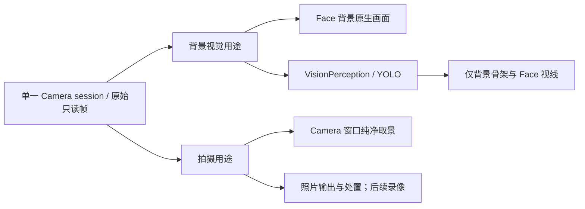

# Face、通用 Window 与 App 内灵动岛

## 2026-11-01 录像音频交接与成片方向修复

真机2026110110反馈：录像启动PlatformError.busy；竖向取景的照片缩略图横转。检查发现VoiceSessionCoordinator暂停使用stopCapture而未释放AppleAudioIO的session owner；原生照片使用gravity capture角度，而窗口渲染使用sensor-to-interface角度，两者在侧躺／斜持时不同。

- Actions/Speech/Listening：录像hold先关闭新聆听／语音播放准入，加入采集停止，再完整stop音频I/O并检查cleanupFailure；不取消整个回复或关闭用户聆听意图，避免当前语音录像请求等待自身。录像终态沿用代际恢复。复用可测试的实际交接函数，覆盖未释放owner、清理失败和取消；不强行清空PlatformKit的其他scope。
- UI/Camera与Actions/Camera：只读快照公开当前拍摄窗口显示的sensor旋转角（原生portrait参考＋实际窗口方向），在倒计时结束、快门前冻结；照片和录像使用该角度，后续转动不修改已有成片。缺少有效画面时明确未就绪。UI不事后旋转UIImage或视频文件，保留原生EXIF／track transform；Photos保存、缩略图和相册保持同一方向。
- PlatformKit/Vision：录像入口增加明确rotation参数；照片／录像验证有限且原生支持的角度后应用到输出connection。共享视频输出与YOLO重力坐标不改变。参考Apple RotationCoordinator与AVCaptureConnection官方文档区分preview、capture及显式orientation角度。
- 同步相关README，测试多窗口方向与重力不一致、前后镜头参考、音频交接顺序及清理失败；运行check.sh、四iOS构建、签名／资源校验，安装新真机版本，再区分设备实际验收。

本项代码与技术README已同步；针对性交接／方向测试、完整check.sh、四iOS构建、真机签名及资源验证通过，2026110111已安装并启动；真机收音／方向复验待确认。验证细节见[验证记录](../validation/Window-Camera.md)。

## 2026-11-01 拍照增强与录像实施计划

用户已授权倒计时（含取消）、闪光灯、变焦及带声音录像；录制期间暂停聆听，结束后恢复此前仍有效的聆听意图。保持同一Foundation Camera和独立背景视觉需求，不创建新目录或一级模块。

- **PlatformKit/Vision**：CameraCapturing／AppleCamera提供经设备能力验证的闪光灯与变焦，以及同一AVCaptureSession的有声Movie输出。原生输入、输出、方向、镜像和实际录制Facts由Foundation拥有。start等待真实didStart，stop等待didFinish和文件封装，委托与临时文件有明确所有者；可取消工作必须停止并加入。最多一个录制，最长600秒、单文件512MiB，达到预算停止并明确报告原因；禁止录制中换镜头／拍照。保留VideoDataOutput供窗口和YOLO读取，兼容性以canAddOutput及实际配置验证，不假装已录制。
- **Actions/Camera及Speech/Listening**：领域拥有设置、倒计时、录制／收尾／待处置状态、媒体归属和根清理。倒计时单槽且基于单调时钟，可明确取消；到期重新检查前台及就绪条件后仅拍一次。录制开始前加入聆听暂停，录制结束／失败恢复仍有效的旧聆听意图，用户关闭聆听或后台时不得自动重开。录制期间窗口最小化保留有声录制并显示业务状态；关闭需先停止再保存／忽略／取消，后台停止封装并保留可恢复文件、不继续后台拍摄。
- **PlatformKit/Audio与根装配**：录像加入既有原生音频owner互斥，录制占用camera scope，其他音频采集／诊断显式busy；Camera在原生终态释放后Actions才恢复聆听，避免仅暂停UI却并发抢麦。视频导出复用VisionContainer的单槽、根准入和提交后加入语义。Photography新增六项Action后单独调整提示词字节预算，Basic常驻目录保持不变。
- **Storage/Files、Database/Media、SQLite**：在既有媒体目录与相册中保存录像，提供有界文件导入和受控文件读取，避免把完整视频装入Data；保留元数据／字节发布和显式收录的区别、2GiB总预算与受保护相册不淘汰。相册识别视频、缩略图、播放、导出与删除；图片与模型附件预算保持原约束。
- **UI/Camera、Settings及Agents接入**：Components/LocalVideoPlayer.swift仅使用AVKit呈现已拥有的本地文件、离窗或后台暂停播放；在边界检查器中按文件允许AVKit，不允许UI调用采集或存储。VideoActions.swift按既有三级Action规范独立拥有Camera.Video声明。同一个Camera窗口提供照片／视频模式、倒计时显示与取消、闪光灯／变焦选择、录制计时／停止、视频回放及保存／忽略。UI仅呈现并发送类型化请求，经Photographer→Gateway→固定Action执行；不由View消失停机。沿用窗口壳、可见层镜头优先级、真实完成与代际围栏。
- **UI/WindowState及Components**：为最小化卡片增加领域提供的纯文字activity槽，用于录制／收尾状态；窗口框架只展示状态文字，不解释相机或计时。视频模式原生使用1080p预设，照片模式仍用照片预设，模式切换重新验证预览与照片输出几何，保持同一session及视频观察者。
- **Action与Skill**：新增配置、取消倒计时及录像开始／停止／保存／忽略的@Action，纯参数校验、CameraModule显式绑定、协议策略和Photography声明同步。原拍照入口保持兼容；模型使用实际回执和Facts，不把倒计时、录制接纳、文件完成、相册收录混为一个成功。已确认处置后的摄影任务仍先关闭窗口再结束。

本轮代码及拥有目录README／总体设计已同步；构建与自动化结果及真机未验项目见[验证记录](../validation/Window-Camera.md)。自动化覆盖参数／设备能力拒绝、倒计时取消与到期竞争、录制开始／停止／自动限时、并发拒绝、后台封装、聆听恢复围栏、媒体预算与故障清理、模式UI状态和Action／Skill链；执行check.sh、四iOS构建、真机包及资源验证。真机声音、共享预览连续性、录像回放和功耗单独验收，不以替身或编译证明。

## 当前后续清单（2026-11-01）

聆听开关Actions已单独提交；本轮通用窗口、照片闭环、背景视觉／跟随与拍摄独立开关、共享Foundation Camera及Facts、可见层镜头优先级均已实现。用户反馈基本可用；完整真机／真实模型和性能功耗验收仍独立跟踪。

1. **拍照增强**：倒计时／取消、原生闪光灯与变焦已实现，自动化与构建验证通过，真机效果待验收；曝光、对焦等参数留后续。
2. **录像**：同一个Camera窗口已接入照片／视频、带音开始／结束、最长时限、回放与保存／忽略；构建与自动化通过，2026110111已安装并启动；用户在110反馈音频占用与照片方向问题，111已修复，真机复验待确认。录制暂停聆听，终态按原意图恢复；后台停止，最小化继续录制。
3. **独立App内灵动岛**：可复用组件、收起／展开和流畅过渡，由Actions控制；与现有Task、蓝牙及回复频谱的关系和活动优先级另定。系统灵动岛／Live Activities不在本阶段范围。
4. **更多页面窗口化**：蓝牙扫描、历史记录、相册逐步迁入通用Window框架，复用窗口控制和生命周期，不另建多套窗口壳。

当前实施范围为第1、2项；第3、4项不在本轮实现范围。验证证据与未完成真机项目单独记录。

## 2026-11-01 通用标题栏布局调整

在既有UI目录实现：WindowHost.swift的WindowChrome以左右等宽控制槽保证标题相对整个窗口居中，左侧最小化、最大化／还原，右侧关闭；加载指示占用右侧固定空槽，不推动标题。最小化卡片同样居中标题、右侧关闭，保留标题拖动／点击恢复互斥，按钮44pt触摸区域独立于拖动。

控制移到两侧后，原只保证左侧240pt可见的横向约束会把关闭按钮拖出屏幕。WindowState.swift改为横向完整标题栏限制在安全区内，移除会越过右边界的横向弹性位移；纵向仍允许内容部分移出屏幕并保留52pt标题栏，最大化仍不拖动。补充移动／拖动／旋转后的两侧可达回归；同步UI和Components README及旧基线描述。执行check.sh、四iOS构建及资源验证；实际触摸与观感单独记录。

本轮已实现并通过窗口专项、完整check.sh、四iOS构建及包资源验证。2026110109已安装真机，标题观感、点按和拖动手感待用户验收；详见[验证记录](../validation/Window-Camera.md)。

## 2026-11-01 摄影收尾与视觉层次优化

本轮在现有目录内完成三个细节：

- `Resources/Skills/Photography/Instructions.md` 教学匹配的单张摄影 Task 在保存／忽略实际成功后，独立请求 `closeCamera`，等待窗口关闭回执后再 `finishTask`；失败不重复处置、不伪造关闭，明确重拍保持窗口与原 Task。未处置照片继续走现有保存／忽略／取消决策，不自动丢弃。只关闭 Capture，不关闭独立 Perception。递增 Skill revision，同步 Skills README 与请求提示回归。
- 同步 BasicSkill 的摄影完成示例和终态前清理规则，防止常驻提示提前 finishTask/cancelTask；正常完成、取消与替换均先执行 Photography 的窗口收尾。未处置照片的关闭决策取消时，保留窗口与 Task。BasicSkill 不增加常驻 Action 或 State。
- `UI/Camera/CameraConversationSurface.swift` 仅把 Face 背景视觉不透明度设为0.30，保留触摸透传；窗口预览、Face、右上角按钮及 YOLO 统计面板不受影响。同步 UI/Camera README。
- 快门声核对结果：AVCapturePhotoOutput 未设置 shutterSoundSuppressionEnabled（SDK默认false），AppleAudioIO.configureNativeAudioSession 已调用 setAllowHapticsAndSystemSoundsDuringRecording(true)。用户已明确选择跟随系统静音，保留原生快门音，不修改 Foundation 或增加重复音效；此前截图手机处于静音，实际听感仍需真机验收。不增加绕过静音的自定义音效。

验证提示词装配、真实关闭链及错误／重拍分支，执行check.sh、四iOS构建和包资源校验。真机听感、视觉透明度及真实模型收尾独立验收，不把编译或提示文本断言当成这些验收。

本轮实现：背景不透明度0.30、Photography revision30／BasicSkill revision36及两阶段关窗／终态示例已落地。提示词专项6项通过；测试要求保留的 Skill ID 原句已恢复，默认／摄影提示长度24978／31930字节，未放宽25000／32000预算。2026110108已原位安装到原iPhone17 Pro（安装流水5324，系统查询确认版本）。最终check.sh退出0（944项集成／225项实时测试及其余检查通过），四iOS构建、真机构建、签名与资源校验均通过。听感／视觉／真实模型验收边界见[验证记录](../validation/Window-Camera.md)。

## 2026-11-01 前置照片 photoFailed 修复计划

build 2026110105 已验证预览，用户进一步报告前置拍照通过手动和语音均失败。两入口复用 Foundation Camera 的 capturePhoto；本轮先在 PlatformKit/Vision/AppleCamera 保留原生处理／终结回执错误，诊断模式输出阶段、错误域／码、返回JPEG字节数与照片尺寸，不输出图像或用户媒体。区分原生采集失败、无编码数据、原生结束失败及4MiB结果预算拒绝，避免把它们全部抹为photoFailed。

诊断版2026110106真机确认：前置原生处理及结束均无错误，4032×3024 JPEG为5542949字节，随后被4194304字节上限拒绝；确认现场根因为成功照片超过字节预算，而非原生拍摄失败。NativeImageCompression 增加显式输入预算，默认仍为4MiB；Camera 唯一拍摄任务在原生回调终结后，对超4MiB且不超过32MiB／4096边长／16777216像素的JPEG使用既有有界Image I/O编码，输出继续严格限制4MiB。未超预算的原片保持字节不变；超预算编码保持构图与镜像、应用EXIF方向，有限质量／尺寸调整不重复快门。编码任务保留在photoTask内，取消和stopAndWait必须加入，原生10秒回调期限不延伸到已经完成的快门；编码阶段取消只取消并加入编码，不停止已经完成快门的共享采集，根stopAndWait仍显式停机。增加合成大JPEG、方向、小图不变、非法输入／预算和取消回归。随后根据真机回执定位是否还需修复原生格式或有界照片准备路径，继续保持共享采集、一次快门、回调加入、取消和真实完成；不以自动重拍、放宽下游媒体边界或假成功解决。若需编码适配，在既有 PlatformKit/Vision/NativeImageCompression 内完成并先补充具体预算计划；不新增目录或Action入口。同步该目录README及 Tests/IntegrationTests 的相关失败回归，执行完整check、四iOS构建和包资源校验。安装真机后验证前置及后置照片，而非只验证预览；语音和手动使用同一能力。

本项结果：已实现有界原生照片准备和原始错误保留；943项集成测试、225项实时测试及check.sh其余检查通过，四iOS构建／资源／签名校验通过。修复版2026110107已安装，用户明确确认前置正常拍摄；后置和本轮语音句式没有单独验收记录。证据见[验证记录](../validation/Window-Camera.md)。

## 2026-11-01 真机回归修复计划

用户报告 build 2026110103 点击开启相机闪退，并要求视觉／跟踪语音打开背景，拍照语音才打开拍摄窗口。先取真机异常证据，检查 PlatformKit/Vision/AppleCamera 的照片预设、输出尺寸、镜头切换和原生属性设置前提；修复需保留同一 Camera 流及真实 Foundation Facts，不用 Swift catch 假装捕获 Objective-C 异常。真机 .ips 与连接控制台已确认异常来自 AVCaptureVideoDataOutput.setVideoSettings，原因是手动输出宽高与 activeFormat 比例不符。改为显式开启系统 preview-sized buffers，仅请求 BGRA、不传自定义宽高；在配置完成后读取原生预览和 activeFormat 尺寸，校验正尺寸、同视野比例及既有4096边长／4194304预览像素预算，再选择同源比例的有界照片尺寸。配置不支持时通过 CameraError.configurationFailed 失败，不扩预算、不持续传输全分辨率视频。CameraCapturing.swift 中纯几何校验覆盖有效、比例不符、超预算和无兼容照片尺寸；首启和换镜头复用同一路径。支持动态比例的设备读取 iOS 26 dynamicDimensions 作为有效源尺寸，而不是把 activeFormat 的传感器包围尺寸当输出尺寸；不支持时才使用 formatDescription。既有 -direct-input-diagnostics 下只记录配置尺寸，便于真机核对，不记录图像。build 2026110104 真机未闪退，但显示配置失败；原生返回 source=4032×3024、preview=1206×1608。原生预览已经应用输出方向，因此几何校验允许同一源比例的90度转置，照片尺寸仍从原生支持列表按源比例选择；不通过交换像素或额外旋转数据修复。增加横向／竖向等价预览验收，继续拒绝不同取景比例。

UI/Camera/CameraConversationSurface 恢复原右上角胶囊：视觉开关（eye 图标）、仅视觉开启时出现的翻转、设置；移除新增的拍摄窗口快捷按钮。恢复左上角真实 YOLO 统计的折叠／展开入口，显示 FPS、采样间隔、画面运动、排队／推理／总耗时和跳帧；仅背景视觉显示，不混入拍摄窗口。恢复错误／权限／重试提示，沿用视觉 Action 链。

修订 BasicSkill 的入口指引和 ApplicationControl／Photography 的说明及描述：打开视觉、跟踪、跟随、人物／姿态跟踪归 application-control 的 Vision.open；拍照／拍摄照片归 photography 的 openCamera／takePhoto。BasicSkill 不新增常驻 Action。补充 Skill 加载后真实注册 Action 路径和隔离测试；不以关键词截流替代模型正常决策。

验证包括原生配置前提回归、UI 入口／真实统计投影、Skill 声明与 Gateway 路径、check.sh、四个 iOS 构建及资源校验；重新安装真机后，实际开启前后镜头、视觉与拍摄，独立记录功能验收，不能把安装成功当作已修复闪退。同步 PlatformKit/Vision、UI/Camera、Skills 及相关技术 README 和验证记录。

本轮修复结果：原生预览配置、横竖输出几何校验、分流提示与胶囊／YOLO统计已落地。check.sh、四个 iOS 构建、包内25项资源和签名校验通过；build 2026110105 已原位安装，真机日志确认两种预览方向真实出帧和GPU完成。完整语音／照片处置验收及性能功耗仍待反馈或实测，详见 [验证记录](../validation/Window-Camera.md)。

2026-11-01：通用多窗口和 Camera 拍照首期已构建并安装真机。用户实测反馈取景/成片比例不一致，并要求恢复 Face 背景镜像及 YOLO，与拍摄窗口分别启停。下方“真机反馈修订方案”为本轮实施范围，取代首期基线中的相机固定2/3高度、移除背景镜像、窗口独占采集和最小化停机约定。本轮已实现并通过自动化检查、四个 iOS 构建和资源校验；已按用户要求安装到 iPhone 17 Pro（build 2026110103），本轮交互验收仍待完成。验收结果单独记录。聆听启停独立提交为 `53d878d2`；录像、倒计时和独立 App 内灵动岛仍留后续。

## 首期交互基线

- Face 是常驻首页，不改变原生渲染树身份。WindowHost 覆盖 Face 和现有导航，未覆盖区域透传触摸；无全屏遮罩。
- 安全区内默认左右16pt、高度2/3、居中。圆角、细边框、阴影和半透明标题栏。标题居中，最小化、最大化/还原在左，关闭在右，触摸范围至少44pt。
- 标题拖动，内容和按钮不拖动；最大化不拖动，双击标题最大化/还原。普通窗口内容可向下部分出屏，横向保留完整标题栏及两侧控制。拖动跟手并约束边界，无惯性、吸附或缩放边。
- 点击窗口聚焦置顶并保留该次内容交互；最多4个实例，含最小化；超限明确拒绝。Camera 单实例，重复打开恢复并聚焦。
- 最小化160×48卡片，只有标题/关闭；单击标题恢复，拖动互斥。初始右下逐项向上错开；始终限制安全区。随机柔和色板在实例内固定，透明度0.75；高对比度/减少透明度使用实色。
- 普通位置、最大化前位置和卡片位置独立。恢复回到最小化前状态，最大化再次还原到普通位置。旋转重新约束；不跨进程恢复。

## 所有权、实现文件和链路

不新建目录、一级模块或第三方依赖。

| 所属位置 | 计划/实施责任 |
| --- | --- |
| `UI/WindowState.swift`、`UI/UIContainer.swift` | 唯一根状态、十个子能力、布局、实例/revision/generation、焦点、ui.windows、根接纳和有界类型化请求 |
| `UI/Components/WindowHost.swift` | SwiftUI 内容插槽、UIKit 容器和 UIViewPropertyAnimator、命中透传、标题控件、卡片、真实完成 |
| `Actions/Support/Contracts/WindowCapabilities.swift` | 中立窗口操作能力；不依赖 UI 或业务设备 |
| `Actions/UI/Navigation/WindowActions.swift`、`WindowModule.swift`、`WindowExecutionService.swift` | 纯参数校验、显式 Module 绑定、有限执行、逐实例替换取消/加入、领域生命周期端口 |
| `Actions/Camera/` | 组合唯一窗口与现有相机、权限/租约/照片处置/后台清理；保留失败窗口 |
| `UI/Camera/`、`UI/ApplicationRootView.swift` | 移除背景镜像，照片/预览/按钮/检查器统一窗口内；Face 保留相机入口 |
| `Agents/ApplicationControl/`、`Agents/Support/AgentUIRequests.swift` | 窗口按钮类型化请求经固定 Gateway 调用，不执行相机业务 |
| `Agents/Photographer/` | 原相机链增加本地拍摄请求 |
| `App/Composition/`、`Agents/AgentContainer.swift`、`AgentRuntime.swift` | 同一根注入和前后台；删除导航路径控制相机的旧入口 |
| `Agents/Assistant/AssistantStateBindings.swift`、`Resources/Skills/` | ui.windows 选择，Photography/ApplicationControl 一致 Window 别名；BasicSkill 不扩大 |
| `Tests/UITests/WindowStateTests.swift`、`Tests/AppWorkflowTests/WindowExecutionTests.swift` | 布局/层级/容量/真实回执契约、生命周期失败与取消的替身验证；不增加产品演示窗口 |

链路：窗口按钮 → UIRequests → ApplicationControl → Gateway → 固定 UI.Window Action → WindowExecutionService → 领域暂停/恢复/关闭 → UI 呈现完成。拍照按钮继续走 Photographer → Camera.Capture。拖动和聚焦直接修改同一 UI 状态，不逐帧发 Action。

普通请求源上限64，控制源1；窗口订阅最多4个并发普通工作，其余 UI 请求源默认串行。逐实例最多一个 UI 提交任务和一个 Actions 操作；替换取消旧请求，关闭优先并加入清理。跨实例互不取消。业务长期任务继续由领域 owner 持有。

## 呈现与异步契约

尺寸模式 normal/minimized/maximized 与 opening/settled/changing/closing 分开。窗口身份、revision 和根 generation 校验所有完成；替换请求明确失败/取消，不接受迟到回执。

打开约280ms淡入/轻缩放，关闭200ms，最小化/恢复350ms，最大化/还原约300ms；新目标接续当前视觉位置。SwiftUI承载内容，UIKit UIViewPropertyAnimator提供有限完成，不能用固定延迟伪造。Reduce Motion 用短淡入淡出；后台/根停止解除等待并停止隐藏渲染，无新增显示线程或逐帧业务任务。

WindowChrome 提供统一外观、错误和声明式决策提示；不解释相机、存储或 Task。Camera 通过领域生命周期接口组合拍照业务。展示完成不代表拍照成功；容量、无效实例、业务忙、权限和清理失败明确传播。

## Action 与 State

公开 UI.Window.focus/minimize/maximize/restore/move/close，参数稳定 windowID；move 为安全区内0...1归一化位置，使用相同边界约束。restore 恢复最小化前模式或把最大化还原。类型化领域呈现创建窗口，模型唯一相机打开入口仍是 Camera.Capture.open。

遵循 @Action、纯 preflight、Module、CapabilityModules、BehaviorProtocolBindings 和 Skill 声明。窗口采用 direct/returning 双协议，沿用 Display Channel；领域生命周期不由 Channel 隐式保证。ui.windows 只报告身份、模式、过渡和焦点，不复制设备或 Task 权威状态。

## Camera 首场景

- 只有照片模式，复用预览、镜头、拍照、保存和忽略；无不可用视频按钮。照片检查器在窗口内。
- open 返回原相机结果并补充 windowID；窗口先挂载，采集失败保留错误和重试入口，明确报告失败。
- 最小化先停止采集并释放租约，保留照片/窗口；恢复先呈现再重新准入，失败仍可看照片。拍摄最小化窗口先恢复并等待就绪。
- 被其他窗口完全遮挡时暂停预览渲染，展开且前台仍保持采集，避免焦点切换反复启动。
- 未处置照片关闭提供保存/忽略/取消；取消保留窗口。成功处置后停止并加入相机清理，再退出窗口。View 消失不是设备停机。
- 后台停机，前台只保留窗口和重新开启入口，不自动采集。

## 验证与剩余范围

执行 check.sh、四个 iOS 构建及包内资源验证。自动化覆盖尺寸/边界、层级、位置恢复、颜色稳定、容量拒绝、动画替换/迟到回执、后台解除等待、关闭决策、领域失败与 Action/Skill。原生动画、触摸透传、真实相机租约释放/恢复、照片处置、旋转和无障碍在真机独立验收。性能/功耗只报告实测，不从实现方式推断。

完整真机/真实模型验收尚未完成；实施证据见 [Window / Camera 验证](../validation/Window-Camera.md)，不将编译或替身测试视为设备验收。

## 后续 App 内灵动岛和录像

用户已选择 App 内灵动岛。后续将独立根组件与现有蓝牙/Task/回复频谱整合，另行确定 compact/expanded、活动优先级、计时、进度和控制 Actions。当前不预建 Island 依赖或录像实现。系统 Live Activities 是单独的 ActivityKit/WidgetKit 扩展，新增目录/target 需单独讨论。

倒计时和录像的持续任务归 Actions/Camera，窗口/岛仅展示真实状态；录音与聆听的资源冲突、文件封装、定时停止、后台策略必须另定。

## 设计参考

参考原理，自行实现，不引入第三方窗口库或复制源码：

- [Microsoft 标题栏与拖动区](https://learn.microsoft.com/en-us/windows/apps/develop/ui/controls/title-bar)
- FloatingPanel [展示状态](https://github.com/scenee/FloatingPanel/blob/master/Sources/State.swift)、[弹簧行为](https://github.com/scenee/FloatingPanel/blob/master/Sources/Behavior.swift)、[透明区域命中](https://github.com/scenee/FloatingPanel/blob/master/Sources/PassthroughView.swift)

关闭的领域忙碌边界：窗口展示替换仍取消并加入；照片生成或保存/忽略尚在执行时，相机关闭明确返回 busy 并保留窗口，不通过取消照片展示让尚未处置的作品消失。根后台/停止仍按原有相机清理契约取消并加入。未完成的采集启停工作先加入，再执行关闭检查。

模拟器交互修订：ApplicationRootView 的 Face 相机入口不再复用对话模型准备门；只在应用会话尚未建立或根启动失败时禁用，并继续保留 Camera 自身 busy 与类型化请求/Action 准入。未安装对话模型不应阻止用户打开相机窗口；姿态模型失败仍由原领域单独呈现。同步 UI/Camera README 的入口契约。

签名包验证修订：模拟器可执行验收使用 Xcode ad-hoc 签名包；scripts/verify-app-agent-resources.py 区分资源根的 Apple `_CodeSignature` 标准元数据与业务资源，仍逐字节校验所有声明/提示词并拒绝未知文件。同步 scripts/README.md。无源码签名设置或凭据变更。

权限弹窗实测修订：系统授权弹窗导致场景暂时失活时，现有请求按代际撤销，保留窗口并允许重新开启。CameraInteractionWorkflow 将 UIRequestError 和取消映射为明确的业务提示，不向用户显示 Swift 类型/数字错误码；保持已保存照片的成功事实及原始请求失败语义，新增工作流回归测试并同步 Camera README。

## 真机反馈修订方案：取景比例与双路用途（实现及验证）

### 取景比例决定 Camera 窗口尺寸

当前 AppleCamera 使用 hd1280x720，CameraFrameView 使用 aspect-fill，而成片查看使用 scaledToFit；窗口内容区还被标题/底部控制/错误文字占用。因此不能仅把窗口外框改成3:4就宣称修复取景范围。

- 照片模式目标为横向4:3、竖向3:4；PlatformKit 提供实际照片尺寸、视频有效取景区域和方向元数据。启动前可用目标比例布局，完成格式选择后以实际元数据校准；不声称读取或继承系统 Camera App 的私人设置。
- 将照片模式采集配置从固定720p改为支持照片输出与同视野预览的格式选择。优先验证 photo preset/支持的照片尺寸及预览尺寸配置，限制预览像素、帧率与现有内存预算；不能直接切成全分辨率 BGRA 持续采集。保留照片字节上限的明确失败，不通过拉伸、静默裁切或忽略预算制造成功。
- **图像区**保持照片比例，外框高度为图像区高度+标题栏+底部控制区。正常打开优先左右16pt；若高度超出安全区，等比缩小图像与窗口宽度并居中。通用窗口默认2/3高度仍保留，Camera 通过类型化尺寸策略覆盖，WindowState 不解释相机型号。
- 最大化仍填安全区，但图像保持比例完整显示，剩余区域留底色。错误/加载信息覆盖在预留区域内，不临时挤压取景比例；照片查看沿用同一图像区域，缩略图/检查器保留已有交互。
- 统一有效取景范围、镜像及旋转约定；单纯比例一致不等于视野一致。先检查四边实物标记，再核对成片像素与方向。iPhone 界面仍按现有竖屏策略；横持拍摄按实际照片方向展示，不拉伸到竖框，必要时等比留边。iPad 旋转更新尺寸策略并重新约束窗口位置。

### 一份硬件采集，两条独立用途链

用户进一步明确：视觉与人物/姿态跟随是同一个产品功能，不是两个可独立启停的模式。另一功能为拍摄。正常前台且平台允许时，`Camera 采集需求 = 视觉/跟随开启 OR 拍摄开启`；从单路变为双路只是增加消费者，不能重启、替换或独占已经工作的采集。双路并行输出，先开视觉再开拍摄与反向顺序结果相同。

- 保持唯一 AppleCamera/AVCaptureSession 和硬件租约 owner；“两路”指独立业务消费，不创建两套相机会话，也不让两个消费者竞争同一 AsyncStream iterator。复用现有 NativeInputBroadcast 的独立只读订阅能力。
- CameraCoordinator 独立记录 backgroundVision 与 photoWindow 的需求/实际状态，硬件目标由所有有效需求合并。打开拍摄窗口不自动启动 YOLO；打开背景视觉不创建拍摄窗口。视觉/跟随是同一个功能开关，不要求用户再单独说“开始跟随”；实际跟随仍须有有效目标，设备输出沿用原有授权、连接和资源准入。背景模型加载或推理失败保留背景镜像并明确报告跟随不可用，也不阻断拍照。
- 在背景视觉已开启时打开、操作或关闭拍摄窗口，必须继续向背景提供视频并运行跟随；拍摄分支不得消费掉背景帧、暂停背景推理或更换背景订阅。两个消费者分别保留最新帧，慢消费者不能阻塞另一路。普通拍照使用既有 session 的照片输出，不为拍一张照片 stop/start 相机；平台瞬时出帧波动单独实测，不能以业务关闭背景实现拍照。
- 将 runPreview 从 startVision 的生命周期中拆出；YOLO 继续由 VisionPerception 拥有推理、采样和最新候选，Actions 负责设备与接纳，UI 负责各自的画面。清除一个用途的呈现不能清空另一用途的帧或错误状态。
- UI.camera 内区分共享帧事实与 background/photo 两个呈现面，分别持有显示几何、遮挡、故障和回执代际。背景允许 aspect-fill，视频/骨架/视线使用同一投影；窗口不接收骨架或 YOLO 统计，按照片取景投影显示。单个渲染面故障不能关闭另一个渲染面。
- 恢复 Face 原生背景层，保留 Face 树身份、眼睛及交互；WindowHost 仍覆盖 Face 和已有页面。Face 不可见时停止背景绘制，不由页面消失隐式撤销明确开启的识别任务；窗口被遮挡只暂停其绘制。
- 帧保留不可变像素引用，禁止每帧 JPEG/全图复制。UI 只适配一次共享帧，再提交到两个呈现面；推理仍独立订阅。每路最新帧槽1，过期帧替换；沿用有界广播上限并对超限明确拒绝。新增双面绘制需要实测 GPU/内存，不以“共享采集”推断绘制无额外成本。

### 生命周期与共享镜头

| 操作 | 拍摄窗口用途 | 背景视觉用途 | 硬件 |
| --- | --- | --- | --- |
| 仅打开拍摄窗口 | 开启纯净预览 | 保持关闭 | 启动一次 |
| 仅打开背景视觉/人物跟随 | 不打开窗口 | 镜像+YOLO+默认跟随意图 | 启动一次 |
| 两者同时开启 | 保持 | 保持 | 共用采集，不重启第二次 |
| 最小化拍摄窗口 | 只收起窗口并停止隐藏绘制，保留拍摄用途开启 | 保持 | 继续采集；最小化不等同于关闭 |
| 关闭拍摄窗口 | 照片按原关闭决策，完成后撤销本用途 | 保持 | 背景仍需要时保持采集，否则停机并释放租约 |
| 关闭背景视觉 | 保持窗口用途 | 加入推理退出并清除背景/骨架/视线 | 窗口仍需要时保持，否则停机并释放租约 |
| 应用后台/根停止 | 停止用途、加入照片工作清理 | 停止用途、加入推理清理 | 停止采集并释放；前台不因残留窗口自动重启 |

第一路开启完成须等待原生采集就绪；背景视觉分别报告镜像就绪与模型就绪，模型失败不得当作识别成功。最后一路关闭须等待真正停机和租约释放；存在其他用途时，回执说明本用途已关闭、硬件仍供其他用途使用。释放失败保留清理句柄与错误，禁止伪造 stopped。

以上按“任一路仍开启就继续使用 Camera”的最新约定，替代首期的“最小化即停机/释放拍摄用途”。系统后台、权限撤销和设备中断仍遵循平台清理要求，不承诺后台持续采集。

共享一枚实际镜头，前后镜头切换对两路同时生效。切换前加入在途照片工作或明确 busy，切换后更新捕获代际，清除旧骨架/视线并重新订阅；YOLO 重新建立目标，旧目标不能继续控制机械臂。切换失败回滚并保留明确失败。首期不支持背景前摄+窗口后摄同时工作，不引入 MultiCam。

用户最新约定按最上层实际显示的相机画面分配镜头切换权，替代此前“两路对等切换”和“最小化仍由拍摄占权”的建议。拍摄画面展开可见时优先，最小化后交回已开启且可见的背景视觉；恢复展开后再交给拍摄。两路仍共用同一 PlatformKit Camera Capability 和实际镜头；上层只做业务准入、资源协调及请求转发，不操作 AVCaptureDeviceInput。目标 facing 与实际 facing 分开；仅在原生切换成功后更新实际状态并同步两路，失败不得把请求目标当作已切换事实。

| 拍摄窗口状态 | 背景镜头切换 | 拍摄窗口镜头切换 |
| --- | --- | --- |
| 不存在 | 视觉开启且设备就绪时允许 | 无入口 |
| 正常/最大化且拍摄画面可见 | 禁用，说明“拍摄窗口正在控制镜头” | 遵循设备及拍摄忙碌约束 |
| 已最小化 | 视觉开启且背景可见、设备就绪时允许 | 无切换权；恢复展开后再操作 |
| 等待照片关闭决策且画面仍展开 | 继续禁用；取消关闭保持当前显示归属 | 遵循关闭/拍摄忙碌约束 |
| 打开/恢复/最小化/关闭过渡中 | 交接期间暂不接纳新的切换 | 交接期间暂不接纳新的切换 |
| 实际关闭完成 | 重新根据背景与设备状态开放 | 无入口 |

切换权只限制谁能改变镜头，不暂停背景视频、YOLO 或跟随，也不改变两路采集需求。窗口最小化不会关闭拍摄用途或 Camera；背景未开启时，不因权利交接自动开启背景。镜头经任一获权分支切换成功后，另一分支同步实际状态；最小化、恢复和关闭均不自动切回旧镜头。窗口打开失败且未建立实例时不占权；错误窗口按展开可见/最小化的同一规则管理。其他普通窗口不会获得镜头切换权；若两个相机呈现面均不可见，则无可交互的切换持有者，采集和跟随生命周期仍独立。

该优先策略由 Actions 的共享相机业务协调者拥有，UI 读取类型化准入值控制按钮，不能把业务优先级放入 Foundation。背景来源的 Action 也必须执行同一准入检查，明确返回“拍摄窗口正在控制镜头”，不排队等待关闭后自动执行；来源由已有类型化请求/可信调用上下文区分，不由模型任意填写。拍摄与背景的启停仍独立，Camera 实际状态 Facts 仍由 Foundation 发布。

窗口显示变化与镜头切换接纳使用同一有界协调入口：已接纳的原生切换先加入完成，再依据实际挂载/最小化/退出及层级回执完成控制权交接；交接期间拒绝新的切换。过期或被取消的显示回执不得转移权利，并发请求明确 busy，不抢占在途原生操作，不维护两套实际镜头。

2026-11-01 源码核查（并非新实现）：

- CameraCapturing 已包含 start、subscribeFrames、switchCamera、capturePhoto、stop/stopAndWait；AppleCamera actor 实际拥有 AVCaptureSession、输入和照片/视频输出，VisionContainer 复用同一实例。基础视频流、照片采集、前后镜头操作的原生执行归属已符合要求。录像录制尚未实现，视频流能力不等同于录像能力。
- 当前切换入口仍经 Photographer → Camera.Capture.flip → CameraCoordinator → CameraCapturing.switchCamera；背景视觉独立开关及镜头切换优先策略尚未实现，所以不能声称两路已经按上述规则控制并同步。
- CameraCoordinator.flip 当前先写 UI facing，再执行原生切换；且根据该 UI 值生成 selectedFacing。它表示请求目标，不能作为 Foundation 实际镜头 Fact。需要按上文补齐 Foundation 快照和切换回执，迁移此状态归属并覆盖失败回滚测试。
- VisionContainer 当前 State 只报告权限和 cameraCreated 等信息，尚无独立 Camera 实际镜头/运行状态节点；相应 Facts 改造仍是待实现项。拍照会调用 Foundation capturePhoto，照片保存/忽略和窗口决策继续由 Actions 业务层拥有。

### Action / State 与界面入口

- 保留 Camera.Capture.open/close/flip/retry/takePhoto/savePhoto/ignorePhoto，语义限定拍摄用途；UI.Window 生命周期调用只增减对应窗口需求。enabled 明确指该用途，硬件 running 独立报告。
- 建议新增 Camera.Perception.open/close/retry 作为背景视觉入口，避免将具体 YOLO 模型名固化到 Action 路径。按现有 @Action、纯 preflight、显式 Module/Capability 绑定、协议策略、Skill 声明及测试流程开发，不增加绕过 Gateway 的 UI 设备控制。
- Face 相机按钮继续打开拍摄窗口；新增独立“视觉/跟随”开关控制背景及默认跟随。既有视觉/跟踪业务显式申请背景视觉用途，不再靠打开拍摄窗口顺带启动 YOLO。两个入口均可独立启动 Camera，未启用的另一用途保持关闭。
- 提示词将“打开视觉、开启跟随、人物跟随、姿态跟随”等意图归入背景视觉入口；该入口接纳默认跟随意图。将“打开拍摄、打开拍照、拍摄照片”等归入 Camera.Capture；“拍摄视频”归入后续录像入口，录像尚未实现时明确说明不可用，不能借用视觉/跟随入口假装录制。仅请求拍照/录像不能隐式开启背景视觉或跟随；用户明确要求“跟随拍摄”等组合行为时才组合两路。“关闭视觉/停止跟随”撤销背景用途，不关闭拍摄窗口；“关闭拍摄”不撤销背景用途。
- 在现有 Photography/ApplicationControl 按需声明一致别名，不扩大 BasicSkill。通过 Skill 提示词和角色执行测试覆盖两类单独意图及显式组合意图，不能仅靠提示词保证独立性；领域状态和资源生命周期必须真正拆开。Agent 身份绑定和受保护 Pose/Gaze 输出权限保持原有边界。
- actions.camera 只报告两用途意图/接纳、业务操作与识别就绪/失败；Camera 原生开启/关闭、running 和实际镜头的权威 Facts 归 Foundation Camera 自身。ui.camera 只报告两个呈现面事实，ui.windows 继续只报告窗口身份/模式/焦点。每用途独立 revision，加共享捕获 generation，拒绝迟到帧、推理、渲染及关闭回执。

### Camera Foundation Facts 的权威归属

用户确认：拍摄与视觉/跟随在打开和关闭两个方向都独立；各自需要 Camera Foundation 提供视频，两路同时开启仍是一份原生采集的独立消费。需求的 OR 结果只能说明“希望 Camera 开启”，不能直接充当 Camera 已开启的 Fact。

- Foundation Camera 指现有 PlatformKit/Vision 下的 Camera 原生能力，不新建一级模块。AppleCamera 在自身隔离域内拥有硬件状态机和事实，结合实际 start/stop 完成、原生 interruption/runtime error 更新，提供窄状态读取端口。
- 通过 PlatformContainer 的现有 State 机制公开独立 `platform.vision.camera` 子节点；父节点只索引，不递归采样。该节点读取已持有的状态，不因查询构造相机、申请权限或启动设备。
- 成功启动、真实运行后才报告开启；最后一路退出并完成实际停机后报告关闭。启动/停止过程中、权限失败、系统中断和清理失败应保留对应阶段/错误和实际 running，不能用请求目标或消费者数量伪造成功。硬件仍运行而清理失败时，不能报告已关闭。
- 删除或迁移 Actions 当前 observedRunning 的重复事实拥有关系；业务准入使用 Foundation 的窄能力接口，模型判断实际 Camera 状态读取 Foundation 节点。Actions 可以持有本次操作所需的回执，不发布另一份自称权威的硬件状态。
- 更新 State reader 显式绑定、Assistant 事实选择和需要此事实的 Skill useStates；Camera.Capture.open/close 的业务回执明确说明拍摄用途，不能因关闭拍摄就宣称共享 Camera 已关闭。视觉/跟随回执遵循同样规则。
- 测试须覆盖：只开拍摄时背景仍关闭且 Foundation Camera 为运行；只开视觉时无拍摄窗口且 Camera 为运行；两路并行只启动一次；关闭任一路 Camera 仍运行；最后一路关闭后才报告关闭；启动失败与停机失败不产生虚假 Facts。

### 文件归属、实施与验证

不新建目录。PlatformKit/Vision 的 AppleCamera、CameraCapturing、CameraFrame 提供照片/视频几何、受限采集配置及原生 Camera 权威状态机/Facts，VisionContainer/PlatformContainer 显式索引和读取该节点，保持无业务依赖；Actions/Camera 负责双用途需求合并、租约、Action 和拍照闭环；Agents/VisionPerception、Photographer、ApplicationControl 负责各自类型化调用与推理所有权；UI/Camera 负责双面呈现，UI/WindowState 及 Components/WindowHost 负责通用尺寸策略；App/Composition 仅绑定同一根能力。实现后同步上述所有 owning README、MobileHarness/README.md 的跨模块流程以及 Skill 说明；当前技术 README 暂保留真实已实现设计。

实施顺序：①用真机输出元数据确认并修复照片/预览取景与 Camera 尺寸策略；②拆分采集需求与推理/绘制生命周期，恢复背景并隔离骨架；③接入感知 Actions、独立入口及 State/Skill；④执行自动化、四个 iOS 构建、资源校验和真机交叉验收。

自动化覆盖两用途四种开关组合、幂等开关、并发开关替换、最后一路释放/失败、共享镜头切换、各路单独失败、后台取消、迟到回执、窗口最大化/还原/旋转约束和 Action/Skill 链。真机以四边标记验证取景/成片一致，检查背景有骨架而窗口无骨架；YOLO 开启时最小化/关闭窗口仍继续，关闭 YOLO 后窗口仍可拍摄；最后一路关闭相机指示灯与租约均停止。重测保存/忽略/取消、权限、镜头切换、旋转及无障碍；分别测背景单路、窗口单路、双路的帧率/延迟/内存/能耗。录像只保留独立用途和模式几何接口，不提前实现录制。

镜头优先级回归覆盖拍摄展开后背景按钮禁用、背景 Action 同样拒绝、最小化后背景获权、恢复展开后拍摄重新获权、最小化不自动开启背景或停机、取消关闭保留当前显示归属、过渡失败不误交接、真实退出后恢复背景控制、任一路切换后两路镜头一致，以及背景切换在途与窗口显示变化并发时的确定性交接。

参考：Apple [相机比例选项](https://support.apple.com/en-ie/guide/iphone/iph3dc593597/ios)、[照片采集 preset](https://developer.apple.com/documentation/avfoundation/avcapturesession/preset/photo)、[设备支持的照片尺寸](https://developer.apple.com/documentation/avfoundation/avcapturedevice/format/supportedmaxphotodimensions)。具体采集组合以设备能力和实测为准。

### 实施细化（2026-11-01）

- 在现有 CameraState/WindowState 内投影可见相机表面和镜头持有者。Face 的真实页面可见性、窗口非最小化、呈现完成和遮挡共同决定准入；UI 按钮和 Actions 读取同一投影。窗口生命周期交接先屏蔽新的 flip，再加入在途原生操作，展示回执完成后解除屏蔽。无来源参数绕过；Capture.flip 和 Perception.flip 固定绑定各自分支。
- UICameraContainer 保留一份不可变帧引用，两种渲染面各自决定是否绘制，窗口不传入姿态。CameraCoordinator 分离采集/预览与姿态任务，只在视觉需求变化时替换姿态任务；任一需求仍在时不重启硬件。现有 UI 类型化 CameraInput/PhotographerCameraIntent 增加固定 perception 操作，复用请求通道及显式 Module。
- Camera Foundation 常驻原生快照与事件同步更新；VisionContainer 注册精确子节点，无相机实例时返回未创建/停止事实，读取不得实例化或启动相机。
- WindowGeometry 增加内容宽高比尺寸策略，默认策略保持不变。照片图像区单独按比例 fit，标题及控制区计入外框。原生使用照片预设并限定视频输出尺寸，照片分辨率仍执行现有像素及字节上限。

Action 命名按现有统一 CameraActions 命名空间约束落地：新增 PerceptionActions.swift，规范路径为 Camera.Perception.openVision / closeVision / flipVision / retryVision，模型别名保持 Vision.open / close / flip / retry。不放宽现有 Action 元数据归属和重复绑定检查；Capture 路径保持兼容。

呈现回执补充：WindowPresentation 记录已确认 revision，失败回执不能把目标 mode 当作已呈现状态并转移镜头权限。重新挂载或重试后必须等成功回执。标题仍可见但图像区已移出安全区域时，拍摄表面不算可见。

照片预设的照片分辨率高于原720p流程，采用 SDK 明确支持的 JPEG quality 0.85 原生压缩设置，并继续严格执行4MiB上限；超限明确失败，不隐式改变成片比例或扩大存储预算。

取景比例作为 UI 离散几何值缓存，仅比例变化才通知根窗口布局，避免根视图因每帧像素更新重建窗口内容。

### 本轮交付检查

共享采集需求、独立背景视觉与拍摄呈现、Foundation Camera State、镜头可见层级准入和相机窗口按图像比例布局已写入实现；自动化和构建结果见 validation/Window-Camera.md。录像、独立灵动岛、真机四边取景一致性和功耗测量继续独立验收，不能以编译替代。
