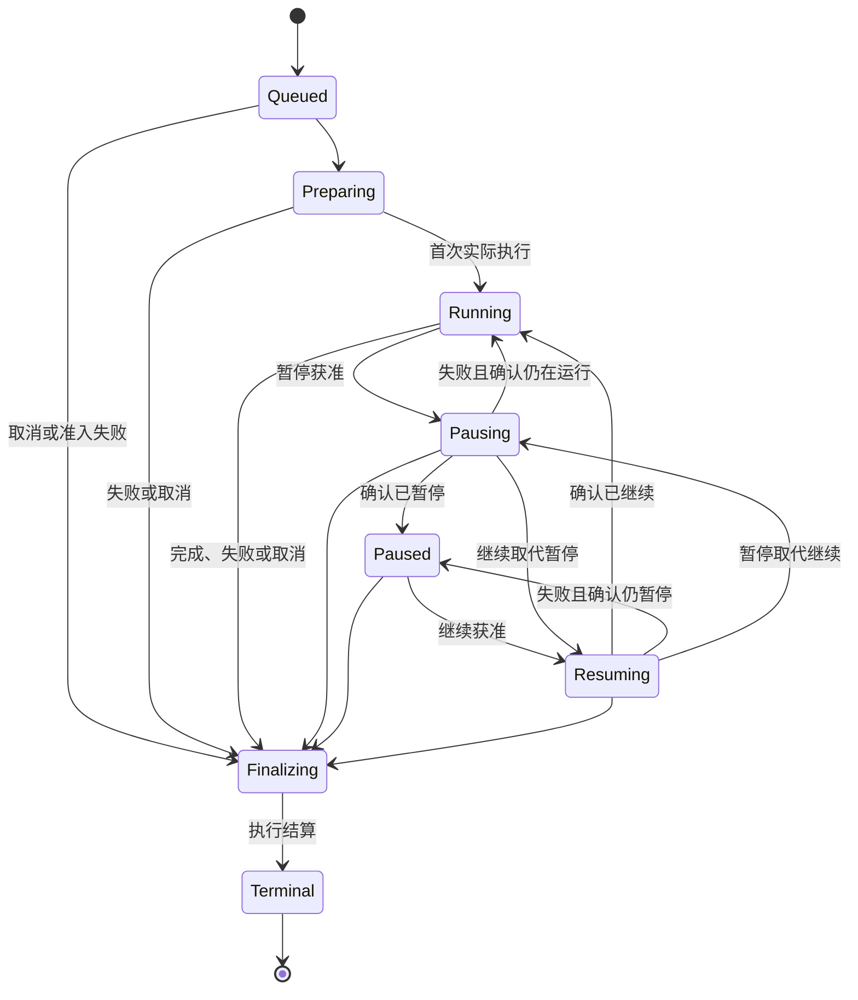

# Action 执行反馈、生命周期控制与续说等待

确认方案见 [统一 Action 回报与打断等待](https://chatgpt.com/space/page_d7804d5c963881919c9567e8e4c2cb3e)。

## 执行边界

- Actions 的执行调度和结果账本提供真实的 Action 开始、结束和清理事实。Gateway 使用 Assistant 实例和会话的可信执行身份，投递同一反馈协议的独立事件。单个 Action 按调用 ID 配对，开始只表示实际执行，终态保留成功、失败、取消和已知副作用。排队取消可以直接收到终态。
- Assistant 发出明确的模型轮次开始和收口，Gateway 分别回送轮次开始和轮次终态。正常结束封口并排空该轮，打断、取消和异常关闭准入并结算同一轮次契约。轮次结束与单项完成分开，空轮也有独立起止。
- 会话打断按一次请求 ID 跟踪开始和结束。接纳后关闭当前 Assistant 实例在该会话内的在途和排队执行，可能涉及多个已打开的模型轮次。等待直接执行、调度树、未启动的准备凭证及结果投递结算，再回报相关轮次和打断范围的完成。调度器按执行身份返回全部原生收尾是否确认，包括没有模型轮次的在途调用。其他 Agent 继续使用既有逐项结果投影。
- Assistant 通过反馈终态确认清理。会话关闭、角色结束和打断有各自的生命周期。清理失败或完成反馈缺失时，在首页 Toast 提示异常、保留输入和暂停自动回复。已实际清理的调用错误仍可以真实失败结算。重复或迟到事件只适用于原会话、原轮次或原打断请求。

## 续说窗口

- 全双工语音会话接纳打断时在 Assistant 记录单调时刻。SpeechPerception 发布实际处理的 512 样本 VAD 窗口进度。Assistant 按进度确认同代采集的 64 个窗均起于接纳时刻之后。起声和进度沿 VAD 频道有序传递，终稿在独立 ASR 频道结算。详见 [语音感知单向通信](One-Way-Speech-Perception.md)。
- 64 个窗口对应 16 kHz 下 2.048 秒音频。接纳时已经起声或在第 64 窗及以前起声的语句继续等 ASR。随后才开始的语句进入普通队列。关键词命中后在同一语句内连说，沿用语句 ID 并等待整句终稿。语句结束后再次说话才按常规 VAD 规则确认新的起声。
- 采集切换或断开使旧代观察失效，恢复后从该代第一个有效窗口重新累计，旧代消息不可完成新代观察。保留已确认的执行清理。采集或回报停滞可以报告异常，不能当作窗口完成。
- 新回复须同时满足已确认的执行清理、64 个实际窗口、起声候选清除或确认且其 ASR 已结算。旧回复生成停止及语音输出收尾属于执行清理。移除 Assistant 内原有的停播后定时和合成的模型轮次成功回执。

## 实施与验收

- Actions 执行契约、调度及结果账本负责单项事实和等待清理。Gateway 和 Agents 的输出、输入适配器负责统一反馈、轮次/会话围栏和兼容投影。Assistant Workflow 保留语义调度及入队规则，SpeechPerception 管理 VAD 窗口。
- 覆盖正常、异常、打断、取消、空轮、多 Action 和跨轮次打断。核对独立起止、身份关联、真实终态、清理失败、重复和迟到回报。语音用例覆盖窗口、清理、在途 ASR 的三种先后顺序，以及采集更换、快速连说和空转写。

## Action 实例生命周期与控制

Action 定义描述一种能力。每次调用由 Actions 执行层创建一个执行实例并分配 `executionID`。实例拥有状态、控制器、资源和终态结果。再次调用创建新实例，暂停与继续沿用原实例。

### 通道与消息

| Gateway 通道 | 方向 | 契约 |
| --- | --- | --- |
| Send · `ActionCall` | Assistant → Gateway → Actions | 发送已解析的 `ActionCall`、执行信封和已有调度指令。Gateway 定向投递到执行入口，再由 Actions 根据注册的执行 Channel、资源和 `wait` 规则调度。 |
| Send · `ActionControl` | Assistant → Gateway → Actions | 请求携带 `executionID`、`controlID`、该执行内递增的 `controlSequence` 及类型化的生命周期 `command`。当前定义 `pause`、`resume` 和单实例 `cancel`。Gateway 定向投递到独立控制入口，使占用执行 Channel 的实例仍能接收控制。 |
| Send · 执行反馈 | Actions 执行层／轮次协调器 → Gateway → 所属 Agent | 沿用现有定向反馈。每次 Action、每个模型轮次及每次打断范围分别发送各自的开始和终态消息。中间实例状态及控制回执也独立发送。 |

两条前向信道通过 Gateway 的 `SignalTransport.send` 定向投递，使用不同的消息契约和准入额度。Gateway 持有受信任的 Actions 接收端，通过 `GatewayExecution` 和中立执行接口转交。Send 的接收确认表示消息已准入。现有 Pub/Sub 用于允许多个消费者订阅的观察事件，例如语音活动；Action 调用、控制、终态和需要确认的回执统一走 Send。

单 Action 的开始消息携带 `executionID`、原 `callID`、可选 `roundID` 和实例的有效控制能力。Shell 的 `ExecutionStart` 将 `executionID` 保留到 Assistant 的开始反馈。有控制能力的独立调用可以在没有模型轮次时收到开始反馈。中间状态使用 `ActionExecutionStateChange`，一条控制请求的最终回执使用 `ActionControlReceipt`，控制异常随该回执返回。Action 终态在同一条 `ExecutionResult` 内携带状态、结果值、副作用、结构化异常和清理证据。轮次开始和结束仍由轮次协调器按 `roundID` 单独发送，结束消息携带原因和清理结算；空轮也有自己的起止。已有会话打断范围的独立反馈保留。重投沿用消息身份，接收端按执行、控制请求或轮次关联。

Assistant 的运行时策略发出控制。Gateway 校验可信端点、实例代和会话。Actions 根据 `executionID` 定位实例，复核执行归属、指令顺序和可用能力。控制入口只接受显式的实例身份。未授权与未知实例统一返回不可访问，避免泄漏其他实例的存在。控制协议通过受信任端口接入，模型 Action Catalog 继续承载业务调用。

### 生命周期



- 执行层管理排队、准备、正式开始、收尾和结算。首次进入 `running` 发布 `ExecutionStart`。排队取消或准备失败可以直接收到终态。继续回到 `running` 时只发布状态变化。
- 暂停与继续是可选的实例能力。`pausing`、`resuming` 表示过渡。`paused` 由 Action 在确认副作用已暂停、继续所需状态已保留后回报。控制失败且能确认稳定状态时，回到已确认状态并发失败回执。无法确认实例还能安全运行时，进入失败结算并记录副作用和清理证据。
- 收尾时关闭控制准入，撤销过渡、等待执行退出及原生清理，随后发布一次 `succeeded`、`partialFailure`、`failed` 或 `cancelled`。异常与超时作为终态原因及结果证据。清理无法确认时沿用现有失败和打断围栏。
- 暂停保留实例的 Channel 位置、必要资源和执行预算。首版超时仍按经过时间计算，覆盖暂停时间。`wait` 继续等待终态，独立 Channel 按原规则运行。取消、宿主关闭和资源撤销优先于暂停与继续。
- Assistant 用成功终态维护已完成 Action 集合。控制回执和中间状态用于执行观察与日志。语义打断继续等待执行清理，然后按既有规则截断与落盘。

### Swift 编写模板与控制接口

Swift 支持类继承和覆盖。编译器强制实现接口要求的写法是 `protocol`，类、结构体等可以分别选择遵循的协议。Swift 没有 Java／C# 的 `abstract class` 或 `abstract` 方法语法。这里采用组合：执行层的统一状态机承担抽象基类负责的固定流程，Action 通过协议提供业务钩子。[Swift 类继承](https://raw.githubusercontent.com/swiftlang/swift-book/main/TSPL.docc/LanguageGuide/Inheritance.md) · [Swift 协议](https://raw.githubusercontent.com/swiftlang/swift-book/main/TSPL.docc/LanguageGuide/Protocols.md)

所有注册的 Action 通过同一个执行层创建实例，由现有 Shell 的隔离域负责准备、状态迁移、取消、加入清理和反馈。业务实现只提供执行钩子及声明支持的可选能力。返回值经现有 `ActionCompletion` 校验，抛出错误或取消进入统一结算。关闭和清理由执行层显式等待，原生服务可保留自己的隔离方式。Actor 隔离保护状态访问，跨 `await` 的回调仍须核验执行及过渡身份。[Swift 并发与隔离](https://raw.githubusercontent.com/swiftlang/swift-book/main/TSPL.docc/LanguageGuide/Concurrency.md)

```swift
// 接口示意。实际绑定复用 ActionBinding 和 ActionCompletionHandler。
protocol ActionExecutable: Sendable {
    func execute(_ invocation: any FunctionInput) async throws -> ActionCompletion
}

protocol ActionPauseControl: Sendable {
    func pause() async throws
    func resume() async throws
}
```

已有 `@Action` 静态函数和闭包由注册层用现有 `ActionCompletionHandler` 适配到基础契约，保留原有声明和调用方式。新 Action 沿用同一注册模板。需要暂停和继续的 Action 在注册时声明成对能力，为每次执行提供 `ActionPauseControl`，在发布开始消息前完成绑定。默认能力为空。Registry 核对声明、控制入口和控制器是否匹配。

`pause()` 和 `resume()` 成功返回时分别意味着原生暂停和继续已经确认。执行层据此提交 `paused` 或 `running`，并统一生成控制回执。`cancel` 由调度器停止单个执行实例，控制回执确认取消已受理，实际停止和原生清理由该实例的终态回报。其他同轮执行仍按各自调度和现有轮次规则运行。最终控制回执关联请求 ID 和状态版本，区分已生效、已处于目标状态、被替代、不支持、当前状态不可执行、已结束、不可访问、容量不足与执行失败。只有仍可查询且属于调用方的已结算实例返回已结束。

执行目录提供 Action 定义声明的控制能力；开始消息提供本次执行已绑定的能力。调用方根据开始消息和中间状态选择操作，Actions 对目标实例重新检查授权、可用能力和当前状态。定义新的生命周期命令时，需同时规范状态准入、实现接口、并发优先级和回执的生效含义。领域参数由该领域的 Action 声明并校验。

### 控制并发与回执

执行层串行提交每个实例的状态变化。每个实例最多一个原生过渡和一个待执行意图，较新的相反指令覆盖待执行意图，并取消、等候旧过渡退出后再执行新意图。被覆盖的请求收到被替代回执。过渡回调携带身份，迟到回调无法覆盖新状态或终态。重复 `controlID` 复用原回执，回执淘汰后旧 `controlSequence` 仍不能重执行。

控制入口具有独立的有限容量，超载显式拒绝。接纳命令时预留回执容量，反馈重投只重复投递事实。状态变化带实例内递增版本。背压时允许合并中间状态并提供最新版本，终态和已接纳命令的回执保留到既有反馈结算。Assistant 以实例和状态版本识别重复或迟到状态。

### 命名与文件归属

沿用现有类型和领域词汇。一次调用用 `callID`，一次实际执行用 `executionID`，一条生命周期控制请求用 `controlID`，一次模型轮次用 `roundID`。控制请求顺序用 `controlSequence`，执行状态的版本用 `stateVersion`。变量名标出对象和角色，例如 Assistant 使用 `activePlaybackExecutionID`，执行层使用 `pendingControl`。方法与协议名称说明执行、控制或反馈职责。

复用现有职责明确的文件。[AgentOutput.swift](../../../MobileHarness/Agents/Support/Core/Output/AgentOutput.swift) 保留 `ActionCall` 和 Agent 反馈消息，[ActionExecutionTransport.swift](../../../MobileHarness/Agents/Support/ActionExecutionTransport.swift) 把执行和控制契约接到 Gateway 的通用传输端点，[ExecutionResult.swift](../../../MobileHarness/Actions/Support/Contracts/ExecutionResult.swift) 保留执行开始和终态类型，[PlaybackActions.swift](../../../MobileHarness/Actions/Speech/Playback/PlaybackActions.swift) 继续拥有播报业务入口。新增的中立控制请求、回执和能力协议归入 Actions Support Contracts 的 `ActionControl.swift`，状态变化类型随执行反馈契约归属。

### Speech 首个接入

- 每次 `Speech.Playback.speak` 登记实例控制器。Assistant 按 `ExecutionStart` 关联当前回复及播报实例，沿用全双工、起声确认和逐窗 VAD 规则。片段切换时可保留同一回复的期望档位，由下一次有效 `speak` 使用自己的 `executionID` 接收调节。
- `pause` 由 Speech 执行淡出，在播放器确认暂停后回执，保留音频进度和缓冲。`resume` 从原位置确认起播，继续平滑淡入。防抖和约 120 ms 的增益过渡沿用首版配置。
- `Speech.Playback.setVolume` 是独立 Tool，传归一化音量和可选的目标执行 ID。Assistant 从抑制档位算出目标音量，需要续播时等待音量调用成功，再发送独立 `resume`。Tool 完成表示目标增益已设置，原生播放器负责过渡。
- 语义打断沿用轮次取消。暂停中的播报仍要退出、清空和释放原生资源，后续继续指令随实例失效。产品范围及真机标准见[播报两级声学抑制](../product/Assistant-Speech-Energy-Suppression.md)。

### 实施范围与验收

| 现有归属 | 计划变更 |
| --- | --- |
| Actions Support Contracts、Shell、Scheduling、Results | 扩展中立控制和反馈类型，管理实例能力登记、控制仲裁、生命周期和回执账本。 |
| Gateway Input、Agents Support、Assistant Output／Workflow | 绑定调用和控制的定向端点，保留反向定向反馈，并补齐执行实例投影。Assistant 跟踪当前播报实例与期望档位。 |
| Actions Speech、PlatformKit Audio | Speech 实现实例控制器，PlatformKit 提供原生暂停、继续和失败确认。 |

先落共享运行时与原有处理器的注册适配，再接入 Speech。其余 Action 随对应能力的开发逐个扩展。实施后同步相关技术 README 和总体设计。工程回归覆盖原有有限 Action、无控制接口、两条 Send 信道隔离、按实例及轮次分别反馈、跨会话拒绝、重复与迟到、压力下回执、暂停时 `wait`、自然结束／超时／取消竞态、清理和终态唯一。Speech 回归覆盖原地续播、跨片段更换实例、非语音窗、暂停期间语义打断及截断落盘。设备验收独立记录实际淡出、暂停、续播和听感。

### Gateway 信道所有权

Gateway 拥有发送准入、容量和关闭。Send 是有界并发的定向请求，同一信道可同时处理多项请求。Gateway 确认目标端的接收结果，调用方等待回执或类型化回复，到期取消并回收处理任务。Send 默认 30 秒，已有类型化请求及长执行端点可声明自己的期限，较早的信封截止时间优先。Pub/Sub 确认本地分发准入，每个订阅者按同一频道的发布准入顺序接收，独立频道和订阅者可并行。语音适配器按业务顺序提交已声明的发布频道。

遇到端点撤销或调用方取消时，Gateway 保留接收端报告的实际失败，定时器取消本身不会覆盖该结果。真正到期的请求以超时结算。

Assistant 的发布通信与定向请求独立提交。ActionControl 走并发定向请求，由 Action 实例根据序号仲裁。轮次登记先于本轮调用，`wait` 和 Action 分支封口等待前序 ActionCall 接纳，Tool 分支独立封口，两条分支结算后结束整轮。Actions 的执行 Channel、资源等待和结果重投仍属于运行时执行。Assistant 和专项 Agent 的原生 Tool 兼容同函数并发，通过 Gateway 执行独立请求并回收结果。回归覆盖定向同通道并发、发出后超时、Pub/Sub 同频道顺序、跨频道并行和 Action 业务边界。

### 调用身份与轮次结算简化

Agents 用类型化调度作用域表达模型轮次、任务或输入。无轮次的 Tool 通过原调用独立结算。Actions 的 Action 封口与取消入口明确传调度作用域，调度队列按作用域归属。保留独立的 `inputID`、`roundID`、`callID`、`executionID` 与控制身份。模型历史在边界将 `roundID` 映射为请求 ID，等待提示使用自己的 `replyWaitingID`。

Agents 对无执行实例的拒绝返回可缺省执行身份的调用终态；执行端产生的结果继续携带原执行 ID。定向发送超时按未确认投递处理，模型轮次仍用原调用的终态结算；封口后缺少该调用反馈则报错。Assistant 复用每条 Action 终态的校验和结果投影。已经完成传递的轮次按 `roundID` 进入独立结算队列，结算优先于同一调度流程的下一批语义输入，不将原输入重新入队。保留打断、取消、原轮次记录和 `callID + ".result"` 的独立 ReACT 输入。更新 Gateway、Agents、Actions 和总体设计的接口说明。回归检查无实例拒绝、同 ID 不同作用域、Action 控制和轮次/融合输入边界。

### Action 与 Tool 的轮次边界及回包

两个调用协议各接受一类显式轮次边界消息，携带 `roundID`、`scope` 和可信调用者。Assistant 在两条入口的 Start 确认后提交本轮调用。Action 按生成顺序提交并在本分支完成准入后发 End，Tool 并行执行并在结果已投递后发 End。Actions 按调用方与分支封口，End 确认仅表示已接纳封口，后续结算独立完成。Assistant 等两分支结算后发送唯一的整轮终态。打断沿用既有执行清理并关闭相同轮次。Gateway 转发类型化调用，不判断轮次或 Wait。

Action、Tool 和控制命令分别使用 `action.result.v1`、`tool.result.v1`、`action.control.result.v1`，实例状态及轮次和打断生命周期使用 `action.execution.event.v1`。现有 Action 终态与 ReACT 语义保持。更新 Actions、Gateway、Agents 及总览设计，验证 Wait、双分支封口、拒绝迟到调用、打断和结果归属。

全双工模式在 Storage 写门内按当前对话及原输入 ID 准备已经接纳的输入。打断结算和 Decision 可以并发写历史，其他记录的写入不使已接纳输入失效；对话切换、输入缺失及已发出的请求仍保留原有保护。

工程验证见 [Action 与 Tool 调用协议验证](../../validation/Full-Duplex-Playback-Admission.md#action-与-tool-调用协议)。

提交前的全量回归需校对语音片段与 Wait 的交错顺序、角色回包声明、Tool 结果的因果信息和排队 Action 取消后的终态。排队取消用例观察执行快照，等到待验证的状态出现再读取诊断；并发下的定向超时单独复测。

同时订阅 Action 结果和生命周期事件的 Agent 保留两种独立输入。通用通信声明分别推导输入类型，Assistant 的执行会话显式选择统一反馈载荷。用 `AgentArchitectureTests` 验证委派角色收到自己的 Action 结果并完成下一轮。蓝牙替身装配注册最新的内部播报能力，继续验证原有连接和动作效果。

### 将执行适配从 Gateway 移出

本节记录通信边界迁移时的设计。执行终态的当前方案见 [Assistant 与 Writer 的对称执行通信](#assistant-与-writer-的对称执行通信)。

GatewayContainer 只装配通用传输和隔离观察作用域。Gateway target 移除 FunctionContracts 依赖；SignalTransport 校验通用端点和信封。App 的 ModuleRegistration 装配 Actions 执行接收端与 Agents 执行发送端。Actions 共享契约定义调用载荷、回复和执行归属，接收端负责分派 Action、Tool、轮次和控制，验证端点映射后的执行身份。Agents 负责选择协议、授权与结果投影。原有资源、取消、清理及快照走显式注入的执行管理端口。诊断用观察作用域直接使用隔离的传输及拒绝执行的角色适配。

Action 与 Tool 信道各携带调用和轮次变体。共享 Tool 定向调用使用 `tool.call.v1`，与 Action 和 Control 都使用通用类型化请求回复。Writer 与 Assistant 的模型 Tool 从同一次调用取得结果。Assistant 保留分支独立封口与原有 ReACT。Tool 回复是同进程返回值，保留现有长结果行为。通用传输允许注册不为内存引用回复预留序列化字节的协议，请求仍受字节、并发与截止时间预算约束。

实施后同步 Gateway、Actions Shell 与契约、Agents Support、Writer、App Composition 与总体设计。验证传输独立启停、跨端点归属、容量和超时、双信道封口、ActionControl 以及 Writer 的工作区执行、流式写入和历史配对。

### Assistant 原生 Tool 直接结算

本节记录移除模型 Tool 二次回投时的设计。通用执行回包方案见 [Assistant 与 Writer 的对称执行通信](#assistant-与-writer-的对称执行通信)。

Assistant 的模型 Tool 和 Writer 共用调用方直返入口。Assistant 执行会话等待 `tool.call.v1` 的返回值，在 Agents 模块内部交给轮次结果处理，直接路径的成功和执行拒绝均取消第二次信号投递。同一次 Tool 请求保留调用 ID、结果值、失败、取消、已捕获调用快照和原有历史写入。Tool 分支在本地结果处理完成后封口，其他分支的顺序与打断结算沿用现有机制。专项 Agent 显式使用的 Tool 反馈协议与 Assistant 普通 Action 终态仍使用原有定向投递。

更新 Assistant 会话、历史反馈处理、Agents 调用适配和技术 README。回归验证并发 Tool、封口等待、拒绝和失败、打断预收尾、模型观察配对与旧反馈兼容入口。

### Assistant 与 Writer 的对称执行通信

Assistant 与 Writer 共用 Agents 的请求适配和 Actions 执行接收端。请求沿角色 → Agents → Gateway → Actions 传递，执行结果沿 Actions → Gateway → Agents → 原角色返回。保留 `action.call.v1`、`tool.call.v1` 两条调用信道及独立的轮次边界，统一调用确认形状和结果发送接口。Actions 内部将普通 Action 放入现有调度队列，Tool 继续直接执行。两者的执行终态都经同一反向定向 Send 回到 Agents。原 Tool 请求保留取消与超时机制，并在结果被接收后返回确认。

Actions 共享契约定义 `CallResultSignal`，承载调度账本的 `ExecutionResult` 或直接执行的 Tool 值／异常。Agents 的 `ActionExecutionTransport` 把两类结果接到同一 Gateway 接收端，校验 Actions 发送者和执行身份。`InputGateway` 校验角色会话与声明，将普通 Action 结果投影为 `ActionResult` 或 `.actionFinished` 后交给原角色。Tool 结果由 Agents 按执行归属、原输入、可选轮次和执行 ID 匹配等待者，同一原生调用 ID 可在不同输入或轮次使用。Assistant 提交给发起调用的轮次，Writer 按原生 `toolCallID` 交还模型。保留执行身份、接收确认、停止与临时压力处理。重投只传输结果。皆沿用进程内 `Sendable` 类型，Gateway 仅处理通用传输。Agents 本地形成的准入拒绝、设备事后故障和专项工具观察仍按各自的反馈契约处理。

更新 Actions 契约与 Shell、Agents Support、Assistant 和 Writer、Gateway、App Composition 与总体设计对应的接口说明。回归验证真实 Actions 经 Gateway 交付原始终态、跨端点或会话拒绝、背压重投、轮次结算、Assistant 与 Writer 的原生 Tool 回复以及播报控制。

### 无轮次 Tool 直返与执行反馈单向传输

- `ActionCall` 和 `ToolCall` 继续经各自的定向调用信道进入 Actions。Actions 的调用终态沿既有 `execution.call.result.v1` 回传至 Agents。执行开始和控制状态沿独立执行事件契约使用同一结果接收端，控制指令保留定向 Send 及其回执。Agents 在本模块内把原始回包交给发起调用或订阅反馈的角色；现有专项角色的 Tool 工作流保留本地结果处理与诊断。Gateway 只处理通用端点、传输、确认、取消和超时。
- `AssistantGenerationTransport` 的所有 Tool 共用有界并发准入，单项完成即由 `GatewayOutputConsumer.callTool` 返回。可选 `roundID` 只决定该项是否纳入轮次封口。无轮次调用在输出会话关闭时统一回收，正常运行时不占用输出读取循环，也不阻塞其他轮次封口。
- `Speech.Playback.setVolume` 和 `Speech.Listening.update` 使用独立 Tool。Assistant 只凭匹配当前播放的成功音量结果发出续播控制；Actions 使用从接收端认证得到的执行所有者和原有序号检查。Speech Perception 仍持有收听策略，通过会话与 revision 校验处理并发的录音状态更新。保留成组字幕和播报的 Action 调度与动作轮次语义。移除独立音量 Action 专用调度范围。
- 同步总体设计和 Agents、Actions 各所有者的 README。回归验证单项 Tool 即时回包、慢调用期间其他输出与轮次独立完成、原调用方归属、快慢音量更新、暂停恢复依赖和收听策略版本。

### 执行日志显示 Agent 内部 Control

- Assistant 的 `state.set`、`state.clear`、`state.get`、`skill.load`、`skill.unload` 和 `send` 在角色内部执行。`AssistantControlExecution` 从共用执行入口记录已授权调用的真实终态、耗时、参数及返回值或异常，复用模型已有的调用 ID。通过 App 注入的 `RuntimeLogWriting` 投影到 UI，执行与 Gateway 通信契约沿用原设计。
- `RuntimeLogState` 独立保留最近 100 条 Control 终态，与 Actions 调度快照合并显示。Action 页默认显示 `Control` 标签，支持来源、通道和状态筛选。首页的 Channel 摘要继续使用调度快照。`RuntimeLogView` 的通道标签保留颜色，删去装饰圆点，宽度按文字及少量内边距计算。
- 同步 Assistant Controls、RuntimeLog 和总体设计。回归覆盖成功、失败、取消、参数及结果投影，验证 Actions 快照刷新后 Control 仍可查询，通道和状态筛选正确。

### 灵动岛发布与来源请求隔离

语音采集状态可在 Actions 请求回调内提交灵动岛更新。Agents Support 的 `AgentIslandPublication` 启动独立发送任务时隔离调用方的任务局部值，避免继承 Gateway 当前请求链。保留发布任务的单工作者、最新待发项、失败重试节奏、取消和停止回收。Gateway 保留对真正嵌套循环的拦截。更新 Agents Support 的发布生命周期说明，使用真实 Gateway 验证更新可独立发往同一端点，并回归真正的循环请求仍被拒绝。
