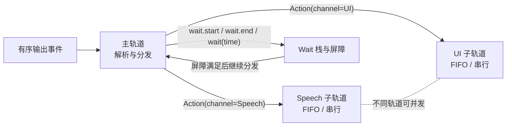
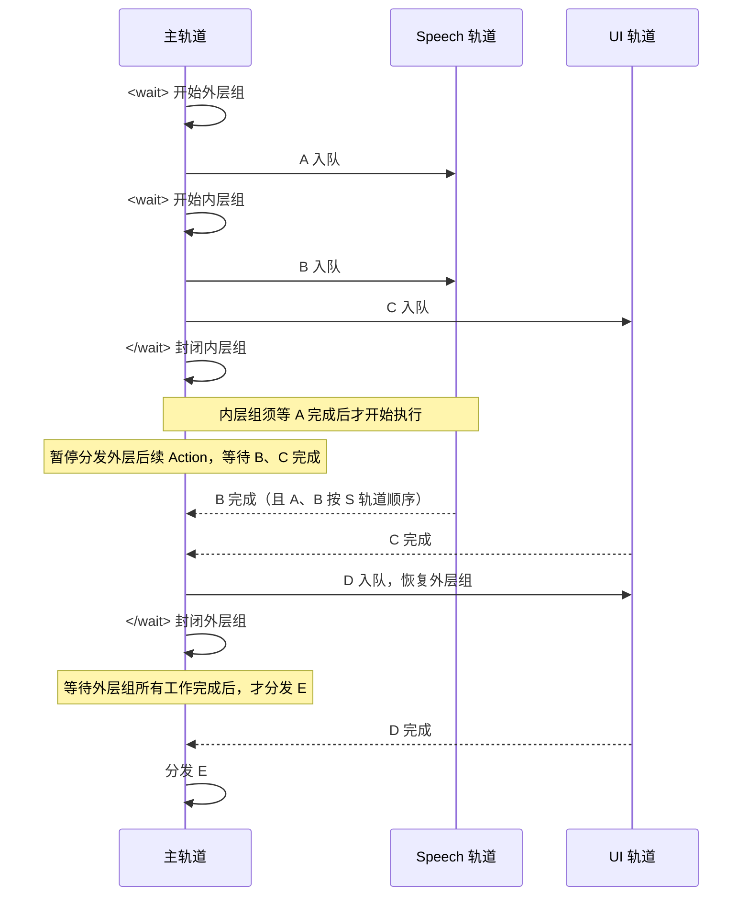

# Action 多轨道调度与 Wait 需求

## 目标

明确 Action 输出在主轨道与 Channel 子轨道之间的分发、执行和同步语义，并扩展全局 `wait` 的表示能力：

- 成对作用域：`<wait>...</wait>`，作用域内的 Actions 分发到各自 Channel，闭标签构成完成屏障。
- 自闭操作：`<wait time="秒"/>`，用于不带作用域的等待；不带有效 `time` 的 `<wait/>`、多余属性均无效，按 `invalidParameters` 调用拒绝，不终止整个生成。
- 自闭 `wait` 可携带 `time` 参数，单位为秒，允许小数。通常按整秒表达；只有确有必要等待不足一秒时才使用小数。它表示主轨道暂停分发的时长，计时期间子轨道继续运行；不隐含等待先前分发的 Actions 完成，也不用于成对作用域。取值为十进制秒，大于 0 且不超过 60 秒，按毫秒精度；单次生成累计不超过 120 秒，Shell 对每个任务同样累计 120 秒；超界、非法或超出累计的值明确失败。

`wait` 是 Assistant 的系统调度 Action，始终作用于主轨道，不占用业务 Channel，也不作为普通子轨道 Action 执行。它通过 Assistant 必然加载的 `basic-interaction` Skill 注册和教学；不需要再增加独立 Skill 或按业务角色重复声明。实现可以在协议层将其编码为调度事件，并由 Actions Shell 执行其调度语义。

职责边界：Actions 拥有 Action 声明/注册、准备与执行机制，以及 Channel/wait 调度；它不拥有、编写或向模型提供角色提示词、Skill 教学或 Action 用法教程。wait 的使用规则和例子由 Basic Interaction Skill Instructions 拥有。Action 声明所需的中立名称、参数 schema、约束和完成契约仍是 Action 元数据，不视为提示词教学。

## 术语与算法

- **主轨道**：按模型输出顺序接收、解析并分发调度事件和 Action 的输入序列。它维护 wait 嵌套栈，不执行普通 Action 的业务效果。
- **Channel 子轨道**：由 Action 的 Channel 标识。主轨道将 Action 按顺序放入对应轨道；每条轨道 FIFO 且同一时刻至多执行一个 Action。
- **并行**：不同 Channel 的队首 Action 可同时运行；是否能真正并发仍受 Action 资源声明和资源仲裁约束。
- **Wait 作用域**：主轨道上的嵌套分组。作用域开始位置受父组此前工作约束；后续 Actions 归入该组。闭合时封闭该组，并阻塞主轨道后续分发，直到组内所有 Channel 工作及嵌套组均完成。
- **完成**：Action 的执行及其必要清理已结束，不只是已入队、已开始或已请求取消。

### 主轨道分发模型



普通 Action 的分发顺序由主轨道确定；完成顺序则由各 Channel 的 FIFO、执行时长、资源冲突和嵌套屏障共同决定。模型输出顺序本身不构成跨 Channel 的完成同步。

### 成对作用域

`<wait>` 创建一个子组并压入 wait 栈。子组按父组序列位置生效：父组中排在它之前的工作必须先完成，子组中的 Action 才开始执行。作用域内每个 Action 被分发到其 Channel 子轨道；同轨道保持先后顺序，异轨道允许并发。遇到 `</wait>` 时，主轨道封闭当前组并等待其全部后代工作完成，然后弹出该组并恢复父轨道分发。

嵌套时，子组闭合只释放父组在子组之后的部分；它不会释放外层屏障。外层 `</wait>` 仍需等待外层组中所有直接 Action 和已完成的子组。



### 示例

**跨轨道并行、同轨道串行，闭合处汇合**

```text
<wait>
  Speech.A
  UI.B
  Speech.C
</wait>
UI.D
```

分发时 `A`、`B` 可分别开始；`C` 在 `Speech` 轨道中排在 `A` 后。遇到闭标签后，主轨道等待 `A`、`B`、`C` 全部完成，再分发 `D`。

**嵌套屏障**

```text
<wait>
  Speech.A
  <wait>
    Speech.B
    UI.C
  </wait>
  UI.D
</wait>
Speech.E
```

`B` 与 `C` 可并发；内层闭标签阻塞 `D`，直到 `B`、`C` 完成。之后执行 `D`；外层闭标签再阻塞 `E`，直到外层所有工作完成。

**自闭等待**

```text
Speech.A
<wait time="1.5"/>
UI.B
```

主轨道在 `wait` 处暂停分发指定时长，然后继续分发 `UI.B`。计时期间 `Speech.A` 可继续执行；定时 wait 不等待它完成，也不替代成对作用域的完成屏障。

`time` 以秒为单位。通常使用整秒，例如 `time="2"`；只有需要亚秒级停顿时才使用小数，例如 `time="0.5"`。不应通过短定时等待来代替依赖完成的成对作用域。

## 已确认的算法语义

- 普通 Action 按输入顺序由主轨道分发到 Channel；主轨道不等待每个普通 Action 完成。
- 同一 Channel 的 Actions 严格串行，不同 Channel 可并行；实际资源冲突仍由资源仲裁处理。
- 成对 wait 形成嵌套组。子组遵守父组顺序：父组在子组之前的工作先完成，子组才开始执行；子组闭合只放行父组后续工作，外层闭合仍等待整个外层组完成。
- 自闭 `<wait time="..."/>` 只暂停主轨道指定时长，不等待子轨道已分发的工作；`time` 只用于自闭形式。
- `time` 单位为秒，允许小数；一般用整秒，仅在确有必要时使用小于一秒的小数。
- wait 在 Assistant 的必加载 `basic-interaction` Skill 中注册；用法教学只归该 Skill，不由 Actions 模块提供。

## 实施前现状与需求差异

本节的“当前实现”列记录实施前的基线，实现后的设计见各目录 README。

| 领域 | 当前实现 | 本需求需明确/扩展 |
| --- | --- | --- |
| 轨道调度 | [ChannelScheduler](../../../MobileHarness/Actions/Support/Shell/Scheduling/ChannelScheduler.swift) 已有 task-local wait/group/phase 树和每个 Channel 的 FIFO；活跃轨道工作可并发。 | 将该行为正式定义为“主轨道有序分发 + Channel 子轨道”，明确每个屏障对应的闭合与汇合条件，并检查现有阶段转换是否严格符合该定义。 |
| Wait 表示 | [FunctionTokenParser](../../../MobileHarness/Agents/Support/Core/Generation/FunctionTokenParser.swift) 只接受无属性的 `<wait>` 与 `</wait>`，并生成 `.beginWait` / `.endWait`；拒绝 `<wait/>` 和 wait 属性。 | 添加并验证自闭形式及 `time` 参数；流式解析、边界拆分、错误和上限保持一致。 |
| Action 注册与提示词归属 | Assistant 的 [Agent.json](../../../MobileHarness/Resources/Agents/Assistant/Agent.json) 已将 `basic-interaction` 设为基础 Skill；其 [Skill.json](../../../MobileHarness/Resources/Skills/BasicInteraction/Skill.json) 当前尚未注册 wait。wait 目前是 parser/scheduler 的结构化调度事件，`wait` 为保留名。英文/中文共享 [ActionCatalog 模板](../../../MobileHarness/Resources/Agents/Shared/ActionCatalog.json) 目前仍包含长篇 wait 用法教学。在 Actions 目录中未发现独立命名为 Prompt/Instruction 的提示词资源文件。 | 在 Basic Interaction 的 Skill 配置中注册 wait，并在该 Skill 的中英文 Instructions 中统一教学；从共享 ActionCatalog 移除 wait 教程，避免两份提示词来源。审计 Actions 目录中的提示词编写/注入代码；若发现 Actions 自有模型提示词或教程则移除并迁移至其真实所有者。保留 Action 运行所需的中立元数据和调度契约，不误删业务参数或系统权限提示。 |
| 调度契约 | [ExecutionSchedulingDirective](../../../MobileHarness/Actions/Support/Contracts/ScheduledAction.swift) 目前只有 begin/end；Agent、Gateway 与 Actions Shell 转发该边界。 | 为带参数的自闭等待定义类型化、可验证的调度契约，并保持来源、会话和 input 作用域隔离。 |
| 资源与生命周期 | Actions Shell 与 ResourceCoordinator 分别拥有 Channel 排序和资源互斥；当前 wait 没有额外超时，取消会加入实际执行清理。 | 定时等待必须不占业务资源锁；取消、finish、非法/未闭合标签和关闭时要有确定结果，不得提前释放仍在执行或清理中的轨道工作。 |
| Skill 教学 | [Basic Interaction 英文说明](../../../MobileHarness/Resources/Skills/BasicInteraction/Instructions.md) 与[中文说明](../../../MobileHarness/Resources/Skills/BasicInteraction/Instructions.zh-Hans.md)已有表情排序示例，但没有覆盖 wait 的完整用途；两边当前内容不完全一致。 | 扩展中英文 Skill 教学，覆盖互不重复的场景：不同 Channel 并行后汇合、跨 Channel 严格串行、外层顺序中的嵌套并行批次、纯时间停顿及“何时不该用 time”。案例须与本文算法一致。 |

相关现状见 [Actions 模块设计](../../../MobileHarness/Actions/README.md)、[Execution Shell 设计](../../../MobileHarness/Actions/Support/Shell/README.md)、[Function Token 协议](../../../MobileHarness/Agents/Support/Core/Generation/FunctionToken.swift) 与 [调度器测试](../../../Tests/Actions/Execution/ChannelSchedulerTests.swift)。

## Basic Interaction 教学内容计划

在 [Skill.json](../../../MobileHarness/Resources/Skills/BasicInteraction/Skill.json) 中新增 wait 的系统 Action 注册。该注册需要表达其属于 Assistant 必加载基础 Skill，同时没有普通业务 Channel；如现有 schema 无法表达，应扩展 Skill/Action 注册契约，而不是把 wait 伪装成某个业务 Channel 的普通 Action。

分别更新英文 [Instructions.md](../../../MobileHarness/Resources/Skills/BasicInteraction/Instructions.md) 和中文 [Instructions.zh-Hans.md](../../../MobileHarness/Resources/Skills/BasicInteraction/Instructions.zh-Hans.md)。围绕不同决策场景给出简洁、不重复的例子：

1. **不同 Channel 并行后汇合**：例如表情 Action 与一句自然语音可同时开始；放在同一成对 wait 中，后续步骤等二者都完成。
   ```xml
   <wait><express emotion="smile"/>你好。</wait>
   ```
2. **跨 Channel 严格串行**：先等表情演出完成，再开始语音，而不是只依赖输出书写顺序。
   ```xml
   <wait><express emotion="thinking"/></wait><wait>现在开始说明。</wait>
   ```
3. **嵌套批次**：外层先完成准备步骤；内层让跨 Channel 的一组表达并行并在组尾汇合；随后才执行外层的收尾步骤。
   ```xml
   <wait>
     <express emotion="thinking"/>
     <wait><express emotion="happy"/>先说结论。</wait>
     <express emotion="clear"/>
   </wait>
   ```
4. **纯时间停顿**：仅当用户要求经过一段时长再继续时使用带 `time` 的自闭 wait；通常写整秒，只有亚秒级需要时才写小数。
   ```xml
   让我停两秒。<wait time="2"/>我继续。
   ```

说明需明确区分“等 Action 完成”与“暂停主轨道计时”：前者用成对作用域，后者用自闭 `time`。不要用 `time` 猜测设备/Action 完成时刻，也不要重复已有的多个同构表情枚举来凑示例。共享 ActionCatalog 保留通用目录结构和必要系统标识，不再承载上述用法教程；Basic Interaction Instructions 是唯一的 wait 教学来源。

## 实施计划

1. **定稿参数与注册表示**：实现 `time` 秒数解析（支持小数），确定有效范围、精度和超界行为；允许 wait 作为无业务 Channel 的系统 Action 注册到 `basic-interaction`，并确认该配置稳定随 Assistant 的必加载基础 Skill 装载。
2. **扩展解析与中立契约**：在 Agents 解析 `<wait/>` 和参数，保留完整事件顺序；在 FunctionContracts 明确表达定时等待或对应的参数化调度事件。拒绝未知/重复参数、非法值、未匹配闭标签和不完整作用域。
3. **完善 Actions Shell 算法**：主轨道按输入事件顺序分发，Channel 内保持 FIFO、跨 Channel 并行；作用域开始/结束通过嵌套组形成完成屏障；定时等待在主轨道执行且不获取业务资源。
4. **迁移提示词所有权**：更新 Basic Interaction 的 `Skill.json` 注册及 Instructions.md / Instructions.zh-Hans.md 教学，按本需求的场景分别给出例子，避免同义重复。删除共享 ActionCatalog 中的 wait 教程，审计 Actions 目录内任何 Action/Skill 提示词暴露、编写或注入实现；若有 Actions 自有模型提示词/教程则移除，并迁至 Basic Interaction 或其他真实所有者。Actions 只保留 Action 管理和调度职责。
5. **守住生命周期与容量**：沿用有界输入、Channel、Action 和 wait 深度策略；为定时等待定义明确的时长边界与失败结果。finish 对未闭合作用域显式失败；取消须加入实际运行与清理；队列溢出不得静默丢弃或伪装成功。
6. **更新技术契约与验证**：实现后更新 Agents、Resources/Skills 与 Actions/Shell README；补充解析器和调度器回归，覆盖自闭/成对语法、秒/小数参数校验、并行/串行、嵌套、屏障、取消及无效输入。

以上为需求契约；实施结果与验证见下方“实施状态”。

## 验收条件

- wait 在 Assistant 必然加载的 Basic Interaction Skill 中注册并可用，不进入业务 Channel；系统调度语义由 Actions Shell 执行，不要求普通业务 Action handler 执行。
- 普通 Action 按输入顺序由主轨道分发；主轨道不等待普通 Action 完成。同 Channel 严格串行，异 Channel 可并发。
- 成对作用域的闭标签阻塞后续主轨道分发，直到作用域内所有直接及嵌套 Actions 完成；嵌套闭合只释放当前内层屏障。
- 作用域开始服从父组顺序；自闭定时 wait 只暂停主轨道，不等待子轨道完成。
- `time` 以秒为单位并支持小数，通常使用整秒；只有必要的亚秒级等待才使用小数。非法、超界参数明确失败。
- wait 的具体用法只在 Basic Interaction Skill 的中英文 Instructions 中教学；共享 ActionCatalog 不再复制长篇 wait 教程。Actions 模块不拥有或注入提示词，目录中若有此类自有资源/逻辑应在本需求内移除。
- malformed/unclosed scope、finish、取消、资源清理和容量超限均有确定且可观测结果，不提前放行后续轨道工作。
- 工程回归覆盖上述外部可观察行为；真实模型是否正确生成标签与真机表现属于独立验收，不以 parser/scheduler 单测代替。

## 已定稿的协议决定

- `<wait/>`（无 `time`）无效；`time` 十进制秒、大于 0 至 60 秒、毫秒精度，单次生成与每任务累计各 120 秒。
- Skill 注册表达：`useActions` 条目 `callType: "scheduling"`、path `Scheduling.Wait.wait`、alias `wait`、无 channel；仅 Basic Interaction 使用。注册使 `CapabilityRegistry.supportsWait` 为真；未注册的 Agent 发出 wait 标签得到 `unknownCapability` 调用拒绝。
- 共享 ActionCatalog 不再含 wait 条目；Actions 目录未发现自有提示词或教学资源，无需删除，已在 Actions README 记录其不拥有提示词的边界。
- 语音退出规则放宽：`stopListening` 可附带一句简短告别，不强制“只输出 stopListening”；Basic Interaction 的 Listening 段在示例中给出最佳生成（简短告别加 `<stopListening/>`，不重启聆听），中英文同步，不增加其他约束。真实模型评估对应放宽 `voice-exit` 评分。

## 实施状态

已实施：`pause(milliseconds:)` 调度指令（Agents → Gateway → Shell）、生成器解析/校验/注册门控、ChannelScheduler 主轨道定时暂停（取消即结束、累计上限）、Basic Interaction 的 Skill.json 注册与中英文教学（revision 2）、ActionCatalog 删除 wait 教程、OutputProtocol 语法说明、校验脚本及相关 README。回归：解析器/生成器（秒与小数、非法形式、累计、未注册）、调度器（暂停不等待已启动 Action、取消、预算）、Skill 教学示例可解析、目录不再暴露 wait。

验证记录与限制见 [Action wait 验证](../../validation/Action-Multi-Channel-Wait.md)。真实模型是否按教学生成标签、真机体验属于独立验收，尚未执行，因此本需求保留在 requirements。
