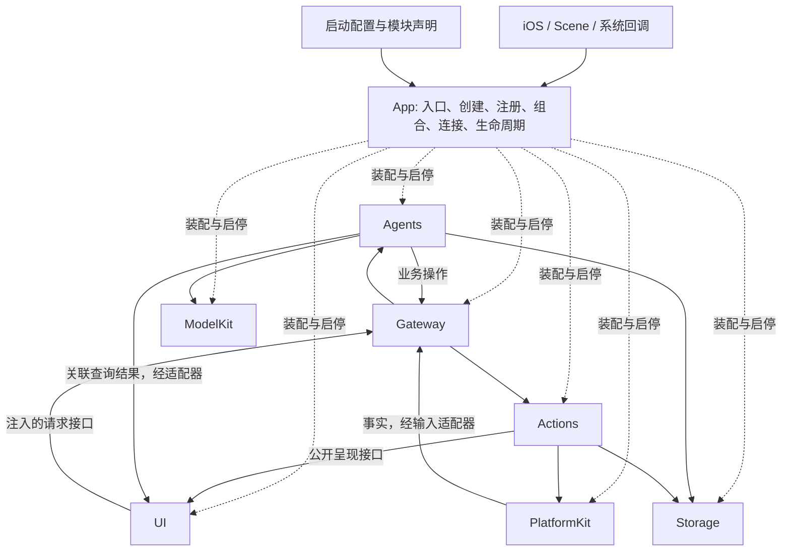
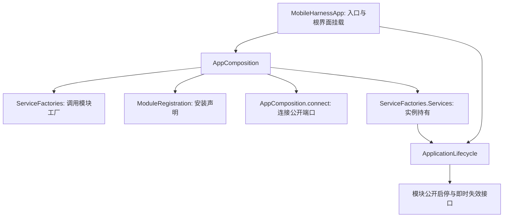

# App 模块职责收敛与框架重构计划

状态：✅ 代码与结构迁移完成；❌ 全量回归、Simulator 构建及真实模型/原生 UI/物理设备验收尚未全部通过。用户已批准在 `codex/app-architecture-boundaries` 实施本方案；本文件替换之前把适配器集中到 App 的方案。不增加一级模块或目录，复用现有目录和互斥编译源清单。

## 目标与边界

App 只负责入口、创建、注册、组合、连接及应用级生命周期。业务规则、数据转换、错误文案、页面路由和领域状态机全部迁回拥有者；注入闭包只连接公开接口，不隐藏业务转换。

UI、ModelKit、PlatformKit、Storage 保持独立基础模块。Agents 核心不依赖 UI、Actions、Gateway 实现。AgentBindings 拥有角色运行接入、输入请求/关联结果与事实观察；ActionBindings 拥有函数绑定、原生执行组合和 UI 展示适配，不依赖 Agents/Gateway 实现。AppLifecycle 只依赖系统框架，管理有限静态服务图。

## 迁移与接口

- ✅ App/Adapters、Workflows 和 Composition/Behaviors 删除。角色接入及 UI 请求迁到 Agents 现有领域/Support；执行与展示适配迁到 Actions 现有领域/Support；纯展示状态、根界面和页面树迁到 UI；通用原生屏障迁到 PlatformKit；独立输出消费迁到 Gateway；当前模型绑定代理迁到 ModelKit。
- ✅ 拆开 VoiceSessionCoordinator 的策略接入、原生反馈/播放及 UI 呈现；拆开 CameraCoordinator 的原生拍摄/保存与感知接入；拆开 BluetoothWorkflow 的恢复策略、执行和展示投影。
- ✅ 新增 AgentBindings、ActionBindings、AppLifecycle 编译目标，移除 AppWorkflows 和被替代目标。源文件只编译一次，基础模块禁止反向依赖集成目标。
- ✅ UI 提供自身的请求、呈现和不透明作用域接口。业务请求经 Gateway 到实际 Agent，查询返回关联结果；Agent 主动呈现经 Gateway → Actions → UI。本地交互由 UI 直接处理。
- ✅ App 生命周期图启动前验证重复/缺失/循环，按依赖启动；失败清理失败服务并逆序回滚，原始及清理错误均保留。显式重试重建作用域；系统在启动中失活且回滚全部成功时，不显示准备失败，在下一次 active 创建新作用域。后台先即时失效，再取消并加入工作；重复停止合并。页面寿命不拥有根任务。

## 最终 App 上下游

## 最终 App 内部

App 最终仅保留 MobileHarnessApp.swift、Composition/、Lifecycle/ 及各级 README。

## 实施与验证

先修改拥有者 README，再迁移接口、编译目标及运行链路；每条链路切换后清理旧实现、目录、导出及全仓引用。保留原有函数、权限、容量、版本围栏、已提交事实和真实完成语义，不增加模型/业务能力或持久化迁移。

新增通用生命周期回归：非法图、启动/回滚、清理失败、停止幂等、启动中后台和迟到启动。复用 UI 请求/取消、独立输出、配置部分失败、历史、相机处置、语音、蓝牙回归；增加接口/作用域迁移的必要回归。执行 scripts/check.sh、完整 Xcode 下 scripts/build-ios.sh；分别记录静态/自动化、构建与真实模型/原生 UI/物理验收。

## 剩余范围

通用内存状态转换、全局错误分类、后台 Task 保存、多窗口和物理验收不由本轮结构调整宣称完成。核心四项需求保持 requirements 状态。结构迁移已完成；自动化和构建的实际结果及剩余验收见 [验证记录](../../validation/Validation-History.md)。全量感知测试失败及 Simulator 外部依赖限制不改判为通过。

## 最终实现对账

- App 只有入口、三个 Composition 源文件和两个 Lifecycle 源文件；通用生命周期单独编译，OS 委托只转交回调。删除旧适配器/工作流/行为装配目录、旧统一导出和旧特性目标。
- VoiceSessionCoordinator 保留角色/同意/半双工策略；VoiceNativeEffects 执行原生反馈/播放，UI 拥有表情动画等待。CameraCoordinator 通过注入的 CameraVisionRunning/CameraResourceAccess 接口使用感知和资源；GatewayCameraResources 归 AgentBindings。蓝牙执行/恢复状态与 UI 快照投影分别归 NexArmControlService 和 BluetoothWorkflow；UI 状态不能授予执行权限。
- UI 自有根页面、请求/呈现端口和展示值。ActionBindings 经公开呈现方法提交字幕、表情、照片、配置、历史和资源结果；Settings/模型资源保留修订围栏，表情渲染保留不透明事务 ID 及真实完成回调。
- 历史只读请求由实际 Memory 接纳：暂存最多四项，ID/结果有界，取消/关闭加入实际读取，生产者失败原样返回，纯查询不主动呈现。
- 生命周期回滚清理失败保留到 stop 结果，阻止未确认清理的根图被替换；权重按需加载，配置/资源页面仍可进入。
