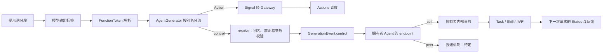

# Assistant 内部函数标记的定义、解析与执行

目标：模型可见的函数只分两类：Action 与 control。本文定义两类的边界、解析与调度链路、control 的归属与执行，以及函数库位置、命名和提示词布置。Assistant 的 control 与其 Task、Skill 和轮次状态内聚。

本需求与 [Agent 职责边界](Agents-Responsibility-Boundaries.md) 和 [Signal 核心架构重设计](Signal-Architecture-Redesign.md) 第 23 节衔接。第 23 节已把 control 从 Skill 配置移入 Assistant 固定能力；本需求定义其余链路。

## 概念边界

模型侧所有函数都是同一种 XML 标签（`<alias .../>`）。分类只看一件事：执行者是谁。

| 维度 | Action | control |
| --- | --- | --- |
| 执行者 | Actions，经 Gateway 进入 | 拥有该函数的 Agent |
| 传输 | 经 Gateway 到 Actions：调度协议（Signal 与 Channel）或直接协议（tool，无 Channel） | 不经 Gateway 到 Actions；由拥有者的 endpoint 直接处理 |
| 作用对象 | Agent 之外：设备、窗口、外部资源 | `destination=self`：Agent 自身状态（Task、Skill、轮次）；`destination=peer`：另一个 Agent |
| 注册 | Skill 的 `useActions` 授予 | 拥有者固定内置，不随 Skill 加载或释放 |
| 反馈 | Signal 经 Gateway 返回结果 | `self` 经 States 进入下一次请求；`peer` 的回执由投递机制定义（待定） |
| 状态归属 | Actions 中的有状态服务 | 每个拥有者 Agent 实例各自持有 |

control 内部的差异只通过声明元数据表达（`destination` 与所属拥有者），不形成独立的解析路径。`loadSkills`、`releaseSkills`、`task.start`、`task.end` 是 `self`；`task.send` 是 `peer`。

tool 不是 control：`GenerationEvent.tool` 经 `ToolDispatcher` 与 `GatewayExecution.execute` 进入 Actions 的直接执行，是 Action 的直接调用协议，保持现状。

约束：control 不得出现在 `<wait>` 内，沿用现有控制轮规则；`peer` 的 control 在 `<wait>` 内的处理待定。

## 当前实现（作为起点）

- 解析：[FunctionToken](../../../MobileHarness/Agents/Support/Core/Generation/FunctionToken.swift) 解析所有标签；[AgentGenerator](../../../MobileHarness/Agents/Support/Core/Generation/AgentGenerator.swift) 通过 `isControl(alias)` 分流到 `resolveControl`，产生 `GenerationEvent.control(ControlCall)`。
- 注册：`ControlRegistration` 与 `ControlCall` 位于 Support，`CapabilityRegistry` 持有 `controls`。
- 定义：`AssistantControls.all` 位于 Assistant，含别名、`ActionDeclaration`、`AgentControlOperation`；`AssistantContextState.runtimeCapabilities` 将其注册为固定能力。
- 执行：`AssistantChatWorker` 的 `controlTask`、`controlLocalTaskAndSkills` 等直接调用 Task、Skill 与历史状态。
- 提示词：`ActionCatalog` 的 `controls` 段列出 control。
- 与收敛后的模型对应：`GenerationEvent.control` 是 control 类；`action` 与 `tool` 是 Action 的调度与直接协议；`runtimeAction` 仍是代码生成的呈现，不计入模型可见分类。
- Writer 的原生工具列表混合了 Actions 调用（`edit`、`read`、`render` 等）与 Writer 自身处理（`ask`、`enter`、`create`、`finish` 的前置校验）。是否拆出 `self` control 作为后续事项，本需求不改动。

## 目标链路

各阶段职责：

1. 标签定义（提示词）：每个 Agent 的声明是其 control 的唯一来源；Action 的声明仍由 Skill 授予。
2. 解析适配（Support）：`FunctionToken` 与 `AgentGenerator` 只做语法分流和参数形状校验；别名属于 Action 还是 control 由注册表回答。Support 不了解 Task 或 Skill 的语义。
3. 解析结果：Action 产生 `action` 事件并进入 Signal 调度；control 产生 `control` 事件，携带拥有者与 `destination`，不携带 Channel，不进入 Action 调度。
4. 调度（拥有者）：拥有者检查能否执行（轮次、固定可用、会话状态）。门槛不通过时返回拒绝，不静默丢弃。
5. 执行（拥有者）：`self` 在拥有者内部修改 Task、Skill 与历史状态，事务失败则保持原状态并返回拒绝。`peer` 的投递方式与回执见待定段。
6. 反馈：`self` 的效果通过 States 与下一次请求呈现；不把内部执行结果伪装成 Action 结果。

## 函数库位置与文件

文件仍放在 `MobileHarness/Agents/Assistant/`，与状态高内聚。不新增目录。

| 文件 | 职责 |
| --- | --- |
| `AssistantControls.swift` | 定义：别名、声明、`destination`、操作枚举、库的查找与注册 |
| `AssistantControlExecution.swift`（新） | 执行：宿主入口 `AssistantControlLink`、`executeControl`、门槛检查、Task 与 Skill 事务、失败语义 |

Support 中的 `ControlRegistration`、`ControlCall`、`FunctionToken` 与 `AgentGenerator` 保持通用；`ControlDestination` 与它们同位于 `ControlRegistration.swift`。

## 命名

- 拥有者 Agent 内的函数类别名定为 `control`。`control` 内部以 `destination` 区分 `self`（拥有者自身状态）与 `peer`（另一个 Agent）。
- Action 与 control 是类别；`destination` 是 control 的属性，不再单独成类。
- 代码沿用 `control` 命名：`ControlRegistration`、`ControlCall`、`GenerationEvent.control`、`AssistantControls` 不做 Regulation 改名。`destination` 由 `ControlDestination`（`self`、`peer`）表达，挂在 `ControlRegistration` 与 `ControlCall` 上。
- `task.send` 等 `peer` 控制与 `self` 控制共用同一类别。
- 代码中已有的 `AssistantChatControl`、`AssistantSessionControl`、`ListeningControl` 等与本类别无关，不在本需求内改名；实施时需避免同一词在不同含义下混用。
- boundary checker 当前禁用标识符 `AssistantControl`，与本命名冲突；从该禁用列表中移除 `AssistantControl`，其余过时标识符保持禁用。
- 模型可见的标签名（`task.start`、`loadSkills` 等）保持不变。

## 提示词布置

- 提示词分为两段：外部操作（Action）与本 Agent 的 control。模型只需区分“外部操作”与“我自己能做的事”。
- control 段每条在标题行标出 `destination`（`Control task.send (peer):`），文档行说明效果与生效时机；参数以声明为准。
- control 段标题说明：由本 Agent 执行，`self` 改变本 Agent 状态，`peer` 送达另一个 Agent，无通道，不能放入 `<wait>`。
- 提示词文本仍由 `ActionCatalog` 渲染，不写死在执行代码中。

## 失败语义

- 未知别名或参数不合法：返回拒绝，不执行。拒绝记录的类别与别名所属一致：control 别名为 `control`，其余为 `action` 或 `tool`。
- 位于 `<wait>` 内：返回拒绝。
- 门槛不通过（轮次占用、会话不允许）：返回拒绝并说明原因。
- 执行事务失败：保持原状态，返回拒绝；不自动回滚到别的目标。

## `task.send` 的投递（已定）

`task.send` 属于 control，`destination=peer`，不是 Action，不经 Gateway 进入 Actions。

- 职责：发送方只按 `agent.task.v1` 协议发送并等待投递回包，不写消息记录；接收方负责校验与持久记录（发送方、会话、`replyTo`、发送方上下文 `senderContext`）。`senderContext` 随协议消息携带，接收方原样记录并用于回复关联。
- 回执：投递回包只表示对方已接纳；结果以对方发回的 `agent.task.events.v1` 为准。
- `<wait>` 内的 peer control 继续拒绝。
- 不按 Agent 写死：是否以 `agent.task.v1` 文本请求转交，由目标是否实现该协议（`AgentTaskMessaging.permits`）决定。

实现见 [AssistantChatTaskCommunication](../../../MobileHarness/Agents/Assistant/AssistantChatTaskCommunication.swift) 的 `deliverTaskMessage` 与 Writer 的 `enqueue`。

## control 声明放入资源文件（已定）

control 声明与其他提示词一样放在资源中，按语言分文件，新增语言只加文件，不改代码。

- 文件：`MobileHarness/Resources/Agents/Assistant/Controls.json`（英文，规范来源）与 `Controls.<language>.json`（如 `Controls.zh-Hans.json`）。内容为 `{ version, controls: [{ alias, operation, destination, declaration }] }`，`declaration` 即 `ActionDeclaration` 的编码形式。
- 加载：`AssistantControls` 经 `AgentConfigurations.data` 读取并校验（别名、操作唯一，`destination` 合法，各语言文件的别名、操作、路径与英文一致）。缺少某语言文件时使用英文。
- 本地化：`ControlRegistration` 携带按语言取声明的闭包；`AgentSkillLoader.localizedControls` 只调用该闭包，不再从 `FunctionCopy` 取 control 文案。`FunctionCopy` 删除 `Agent.Task.*` 条目。

## Writer 到 Assistant 的消息（已定）

pub/sub 发后即丢：不补发、不重试、不兜底，错过就是错过。消息表只是记录与溯源，可在 Settings 的各记录页查看；业务逻辑不读取消息表来决定处理。

- Writer（发送方）：进度、终态与拒绝都只按 `agent.task.events.v1` 发布一次；失败只记入运行状态的 `deliveryFailure`，不排队重发。删除 `WriterNotifications` 及其 outbox（`pendingDelegationNotifications`、`finishDelegationNotification`、`delegationNotification`、`WriterDelegationNotification`、`nextAgentDelivery`），进度报告失败也不再退避重试。Writer 不再向 `agent_messages` 写事件或拒绝记录；终态只写入 Writer 自己的 `writer_executions`。执行权限的退休在终态后直接执行一次，结果记入 `writer_executions`（`cleanup_failed` 保留可见）。拒绝时 Writer 只把自己收到的请求记录标为已消费。
- Assistant（接收方）：收到 Writer 的进度、终态或拒绝时，把该消息写入 `agent_messages` 作为通信记录（接收即消费），并把文本作为 Agent 角色输入写入对话上下文；全双工与半双工都写入，半双工另外照常播报。记录失败记入 `messageRecordFailure`，不阻断处理。
- 来源对话：Assistant 发出 `task.send` 时，在内存中的跟踪项记下当前对话（`originDialog`）；后续报告据此关联对话，不再从消息表读取 `senderContext`。
- 删除依赖消息表的恢复与校验：`restoreTrackedTasks`、`startTaskRecovery`、`runTaskRecovery`、`replayTaskEvents`、`confirmTracking`、`writerMessageOrigin`，终态与拒绝对存储记录的比对校验，以及 `observationRequests`、`taskEvents`、`consumeTaskEvents`、`agentReply`、`rejectAgentMessage`、`failAgentMessage`。重启后不恢复跟踪，未收到的报告不再补收。Assistant 发出的后台任务信号也不再由发送方写记录。
- 存储：`agent_messages` 删除只服务 outbox 与游标的列（`published_at`、`delivery_state`、`attempt_count`、`next_attempt_at`、`last_error`、`claim_token`、`claim_expires_at`）与 `task_observation_cursors` 表；schema 版本递增，旧库清空重建。
- 仍保留的接收方业务读取：Writer 处理自己收到的请求时仍以自己的接收记录做去重与 `writer_executions` 关联（`isAgentMessageConsumed`、`associateAgentMessage`、状态查询）。这属于 Assistant 到 Writer 方向，另行处理。

## 旧实现清理（不保留兼容）

决定（用户确认）：不兼容任何旧实现；数据库允许清空；删除没用的 Action、Skill 内容与 Skill。

1. 旧 `send` Action（`Agent.Communication.send` / `publish`）整条删除：`AgentTaskCommunication.sendDeclaration`、`AgentConfigurations` 的 send 特例、`AgentCommunicationAdapter`（`catalog`、`isCommunication`、`action`，文件删除）、`CapabilityCoverage` 豁免、`AssistantChatEmission` 的通信分支、`deferredCommunications` 及其在 PendingRound 中的保存与回放、`modelCommunication`、FunctionCopy 条目、`CommunicationContext` 中只服务该路径的模板，以及测试夹具 `fixtureCatalogWithCommunication` 和依赖它的测试。等待用户的回答由 `task.send` 承担：`sendTaskMessage` 已按 `inputInteractions` 设置 `replyTo` 与 `interactionID`。
2. 未被任何 Skill、角色配置、内部授权或代码调用使用的 Action 声明及其实现删除（以全量目录与授权集合的差集为准，逐项确认无代码调用）。
3. Skill：删除不可达的 Skill；Instructions 中引用不存在函数的内容删除。
4. 兼容代码：SQLite 只保留当前版本；版本不一致时清空并按当前 schema 重建，删除逐版本迁移。删除只为旧数据保留的解码与契约别名（旧输入批次格式与来源行、旧契约名、旧语音偏好字段等）。
5. 同步删除只覆盖旧行为的测试，更新受影响 README。

清理结果（已实施）：

- 旧 `send` 路径按第 1 项全部删除；Skill 中出现 `Agent.Communication.*` 由 boundary checker 拒绝。
- 未使用 Action：`UI.Notice.showNotice`、`UI.Notice.dismissNotice`、`UI.Light.updateLight`、`UI.Island.update`、`System.Runtime.runtimeInfo` 及只为它们存在的 UI 状态与端口已删除。新增回归测试要求每个声明的 Action 都被授予，例外只有由相机与聆听代码组合调用的 `UI.Feedback.playCue` 与 `UI.Feedback.vibrate`。
- Skill：九个 Skill 均可达，没有删除。BasicSkill 改正 control 描述（task.end 不再称为 Action，说明 self 与 peer），revision 59。
- 兼容代码：SQLite 逐版本迁移、旧契约别名（agent.task.request、agent.taskMessage、task.request、agent.task.response、writer.completion、task.cancel 回退）、旧输入批次重投影与旧来源行、旧下载偏好文件搬迁已删除。
- 保留：ModelResources 的 `useLocalDecision` 与 Provider 设置的继承关系仍是现行设置项之间的关系，不作为旧数据兼容删除；偏好文档对缺失字段使用默认值；NexArm 固件兼容属于硬件协议。

## 验收

- 标签定义、解析、调度、执行、提示词和失败语义各有自动化覆盖：解析分流（Action 与 control 互不串流）、`<wait>` 拒绝、未知别名拒绝、事务失败保持原状态、固定可用不依赖 Skill 加载。
- 工程检查：`./scripts/check.sh` 与 `./scripts/build-ios.sh` 通过，并记录到 validation。
- 模型是否按提示词正确选用内部函数，属于 experiments 的评估范围，不在工程检查中判定。
- 实施后同步更新 `MobileHarness/Agents/Assistant/README.md` 与 `MobileHarness/Agents/Support/Core/Capability/README.md`，只描述已实现的设计。

实施状态：命名、`destination`、提示词、文件拆分与 checker 调整已实施，验证见 [Signal 改造验证](../../validation/Signal-Redesign-Validation.md#第-23-节与-control-两类模型的验证)。对照复查后补充：拒绝记录新增 `control` 类别；Agent 目录是否显示改由是否注册 `peer` control 决定，不再匹配 `sendMessage` 路径；状态快照的 controls 输出 `destination`；技术 README 中残留的 `useControls` 描述已清除。`task.send` 投递、旧 `send` Action 删除与 Writer 原生工具拆分仍待定。
