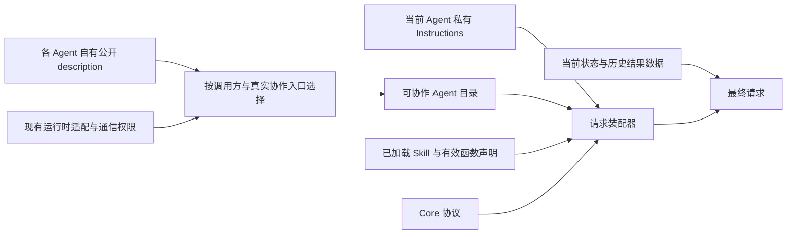

# 提示词所有权与 Agent 自描述

日期：2026-11-08。用户确认后已实施下述资源与运行时迁移；自动检查和构建证据见[验证记录](../../validation/Prompt-Ownership.md)。真实模型和手机场景验收仍单独保留。

## 用户要求

Assistant 角色指令只介绍自身；每个 Agent 维护自己的用途说明。提示词随职责内聚，职责调整不要求同步修改其他 Agent 的身份、通用 Skill 和通用 Action 文档。

## 调整前的装配与问题

调整前 `AssistantContextState.systemPrompt` 组合：Core 协议、Assistant Instructions、可用 Skill 概述、Assistant Prompts 的 delegation 模板、已加载 Skill 指令、有效 Action 目录。

- `Resources/Agents/Assistant/Instructions.md` 混合自身职责、所有同伴的介绍、Writer 的用途/工作区生命周期、Task 协议。
- `Resources/Agents/Assistant/Prompts.json` 的 delegation 模板再次手写六个同伴介绍，与身份指令维护的 Writer 介绍不同步。
- `Resources/Skills/BasicSkill/Instructions.md` 既定义 Task/Skill 的使用规则，又维护 Writer 的用途、单任务限制、作品定位与业务示例。
- `Actions/System/Task/TaskActions.swift` 的 startTask/delegateTask 文档包含 Writer 业务分工。
- Writer 的私有控制/内容指令在 `Agents/Writer/WriterWorkflow.swift`，其原生工具说明在 `WriterAgent.swift`；所有者正确，但长正文和执行代码混在一起。
- Skill 的用途已有自己的 `Skill.json.description` 和按目录生成的 overview；Agent 没有对应的统一公开介绍读取接口。
- 当前 `AgentChatWorker.controlTask` 的 delegate 适配实际只接受 writer。Agent 注册、通信输入声明或一段用途介绍均不能据此新增公开委派能力。

## 所有权划分

| 内容 | 唯一正文所有者 | 消费者与边界 |
| --- | --- | --- |
| 自身身份、责任、沟通风格 | 各 Agent 的私有 Instructions | 只进入该 Agent 自己的模型请求；Assistant 维护用户对话、目标协调和汇报责任。 |
| 对外用途与委派条件 | 各 Agent 自己的公开介绍 | 按需进入有权协作的调用者上下文；例如 Writer 维护写作、绘图、文件修改、作品搜索/打开/删除的职责及输入要求。 |
| 通用 Task / Skill 使用流程 | BasicSkill | 教 start/delegate 平级、按目标所有者选择、同一目标不重复建立包装任务、send/cancel、接纳与完成的区别；不列举 Writer 等具体角色用途。 |
| 函数参数、约束和完成含义 | 对应函数的 canonical 声明 | 由有效函数目录生成，不在 Agent 介绍或 Skill 中另写一套 Schema；Task Action 文档保持通用，不维护 Writer 业务列表。 |
| XML、Channel、wait、调用格式 | AgentCore 的 FunctionTokenPrompts / CapabilityContextBuilder | 协议机制，不拥有业务分工和 Agent 名单。 |
| 业务操作步骤、跨函数示例 | 拥有该流程的 Skill 或 Agent 私有指令 | 作品操作步骤归 Writer；外部介绍只说何时交给 Writer、需要提供什么、会得到什么。 |
| 实时状态、历史、结果与错误 | 各状态/证据所有者；Context Builder 组装 | 数据区单独注入，不写进静态介绍，不转成额外角色指令。 |

公开介绍是角色随应用发布的静态契约，不是让 Agent 每轮调用模型生成自我介绍，也不通过一次运行/消息握手获取。公开介绍不包含其内部系统提示词、私有历史、原生工具目录、执行循环和恢复算法。

## 资源设计

沿用现有目录，不新建目录：

- `Resources/Agents/<Role>/Agent.json`：新增简短公开 `description`，由该角色维护。复用现有 id、通信与后台契约字段，不再建立平行身份清单。实现时明确更新资源 schema/校验及相应测试，避免把新增字段静默忽略。
- `Resources/Agents/<Role>/Instructions.md`：该角色私有身份及执行约束。没有模型请求的确定性角色不为形式统一添加私有提示词文件。
- `Resources/Agents/Writer/Instructions.md`：承接 Writer 私有控制指令。
- `Resources/Agents/Writer/Prompts.json`：承接 Writer 内容输出及按格式选择的指令模板。格式选择、调用顺序、恢复次数和执行校验仍由 Writer 代码拥有。
- `Resources/Agents/Assistant/Prompts.json`：保留 Assistant 请求/证据包装模板，删除手写的 delegation 职责清单。

公开 description 只陈述能力、适用目标、必要输入和对外承诺，不携带重复 Action XML 或专属调用 Schema。Writer 介绍例如：“负责创建和修改图形、页面与文本文档，以及查找、打开和管理已保存作品；接收目标和已知作品线索，自行核对作品；返回结果、问题或明确失败。”单任务/忙碌等静态对外限制可由 Writer 同一介绍说明，实时 busy 值继续读取 State。

## 装配与权限边界

实施的数据流：

- `AgentConfigurations` 负责按 Catalog 读取、校验公开介绍；不扫描目录、不加入第二份角色职责文案。
- 选择哪些角色可被发现，必须复用真实的协作适配/准入能力与通信授权来源。若抽取现有 delegate 适配查询，执行路径与目录选择共同消费该接口，不能再独立手写一套“可委派 Agent”名单。
- 当前 Writer 才是 `task.delegate` 可用目标；不能因为其他 Agent 有 description 就把它们加入可委派目录。必要的只读/系统角色介绍应明确其非委派属性，仅在相关流程需要时注入。
- 装配器拥有排序、章节、容量与错误传播；不得维护 Writer 等具体职责文案。Assistant 只组合自己的指令与公开目录，不加载其他 Agent 的私有 Instructions。
- 介绍缺失、无效或身份不匹配应在配置/装配时明确失败；不以复制在 Assistant 中的旧介绍兜底。字段、条目数和总输出均有明确容量校验，超限报错，不截掉可能改变职责边界的后半段文字。
- 静态目录说明职责和已支持入口；可用性、忙碌、暂停等动态状态独立提供。介绍不授予权限，执行仍通过原有身份、通信和 Gateway 屏障。

## Assistant 提示词内容

Assistant 身份只保留：面向用户的对话责任、理解目标与协调职责、回复风格、如实汇报、保护其他角色的私有上下文。有关 Action-only 的能力边界可保留简短身份约束，具体语法只由 Core 教学。

BasicSkill 统一教：本 Agent 自己执行且需要跨轮保持的目标用 task.start；公开目录中其他 Agent 所拥有的目标直接 task.delegate；同一目标二选一，已有独立前台目标可以并存。先根据 Agent/Skill 的自有说明选择所有者，不维护“写作→writer”等硬编码业务表。

Writer 的介绍由 Writer 资源注入独立的协作目录段。因此 Writer 增加一种作品能力时只更新自身介绍和实现，不修改 Assistant 身份、BasicSkill 和通用 Task Action。

## 实施顺序与涉及文件

1. 增加 Agent 自有 description 的配置读取/校验；沿用现有 Catalog 和资源路径。涉及 `Agents/Support/AgentConfigurations.swift`、各角色 Agent.json、配置与资源测试。公开协作目录选择对接现有 Task 控制/通信能力，不扩大目标集合。
2. 修改 `Agents/Assistant/AssistantProcessing.swift`，用角色自有介绍装配协作目录；删除 Assistant Instructions/Prompts 内的同伴职责正文。同步 Assistant、Support、Resources/Agents README。
3. 清理 BasicSkill、WebBrowsing 等 Skill 中复制的角色业务清单；跨边界只保留对公开目录的通用指引。BasicSkill 保留 start/delegate 平级语义。移除 TaskActions 文档中的 Writer 业务判断，保持既有参数、调度和完成行为。
4. 将 Writer 私有长指令迁入现有 Writer 资源目录；`WriterWorkflow`/`WriterAgent` 继续拥有装配、格式选择和工具适配。工具参数说明仍由实际工具契约维护，不把私有工具说明装入公开介绍。同步 Writer README。
5. 全量核对当前技术 README 和总体设计，移除多处职责正文与过期 delegation 模板；历史证据保留。后续其他具有模型事务的 Agent 按同样规则归属，不为确定性 Agent 引入额外模型循环。

## 验收

- Assistant 身份指令不包含 Writer 或其他角色的用途列表；BasicSkill/Task Action 不再复制 Writer 业务职责。
- 最终 Assistant 请求仍能看到 Writer 自己维护的用途，并保留 start/delegate 平级规则；Writer 私有指令不进入 Assistant 请求。
- 新增/调整公开介绍不会新增执行授权；不可委派的角色不出现在可委派目录。缺失/错误/超限资源测试覆盖明确失败。
- Writer 内容模板保持按格式输出、编辑/发布约束与现有执行结果；示例、提示体积、资源打包、作用域和取消回归均验证。
- 代码迁移后执行 `./scripts/check.sh` 与 `./scripts/build-ios.sh`。真实模型重测绘图直委派、打开作品和并存前台任务；自动化与手机验收分别记录。

资源 v8、自有公开介绍、实际权限目录、Assistant/BasicSkill 去重、Writer 私有模板迁移和对应技术文档已实现。新增配置/请求/格式回归、完整 check.sh 与 iOS 四目标构建均通过，详细证据记录在验证文档。真实模型重测绘图直委派、打开作品和并存前台目标尚未执行，不以编译或替身测试替代。

## 实施细化（代码修改前）

- Agent 资源 schema 升为 v8，必填非空 description（最多 2048 UTF-8 字节）；Agents 资源加载器投影为现有 AgentCore v7 函数/通信配置。历史记录及已编译函数契约不迁移。
- 在既有 AgentTasks.swift 抽取公开委派适配身份/业务契约与发送权限判断，供目录选择和 task.delegate 准入共同使用；当前仅 assistant→writer，不能由新增 description 扩权。
- AgentChatContextState 增加接收实际 CommunicationDeclaration 的提示词装配入口；两条实际模型请求路径传入实例 communicationPolicy，避免权限收窄后仍展示默认可委派目标。
- 公开目录总量最多 8192 UTF-8 字节，超限明确失败；角色资源必须完整可校验。Writer 模板通过普通 PromptTemplates 加载，不要求具有 Assistant 的证据模板键。
- 配置、请求装配、权限收窄、Writer 格式模板与打包回归同步更新。所有文件均落在已有目录。
