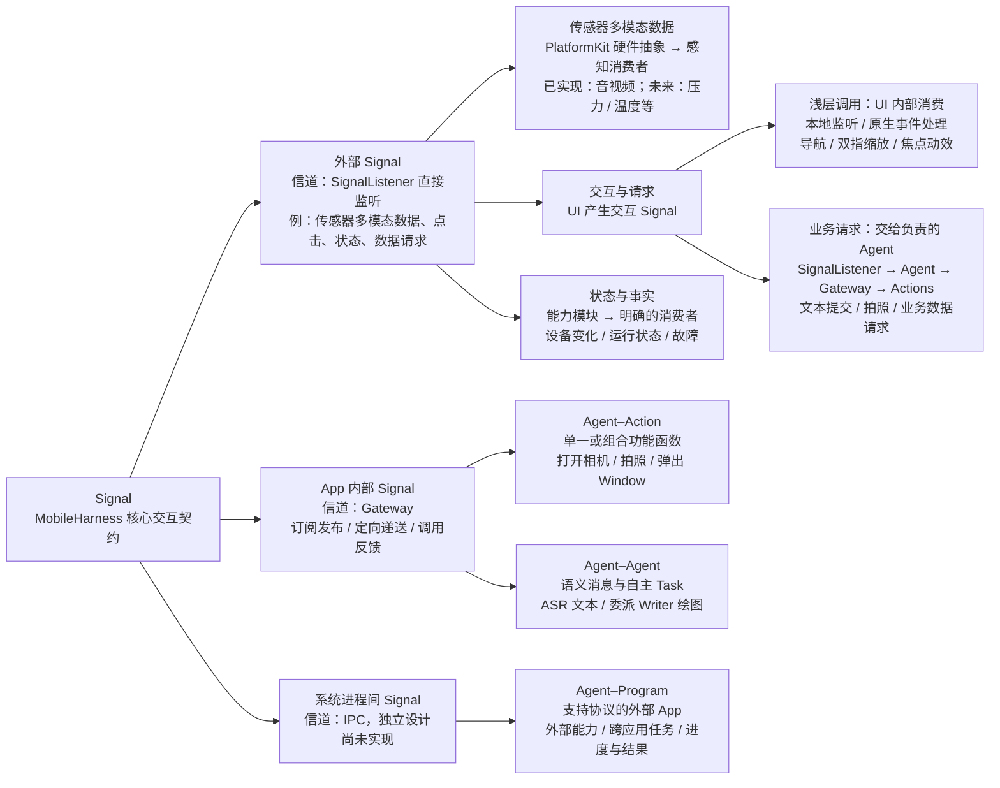
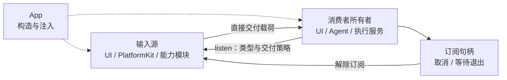
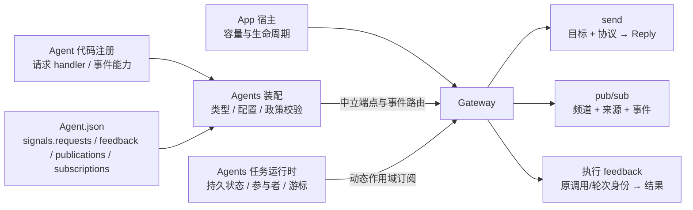
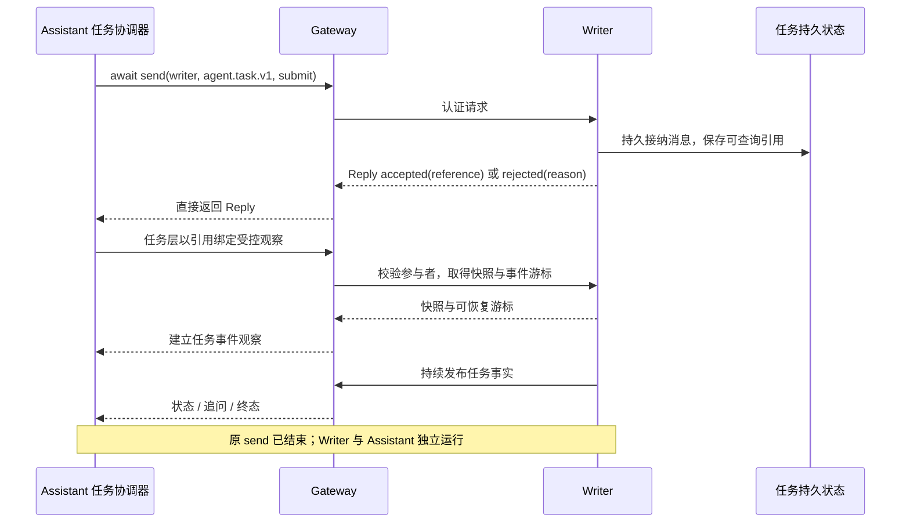
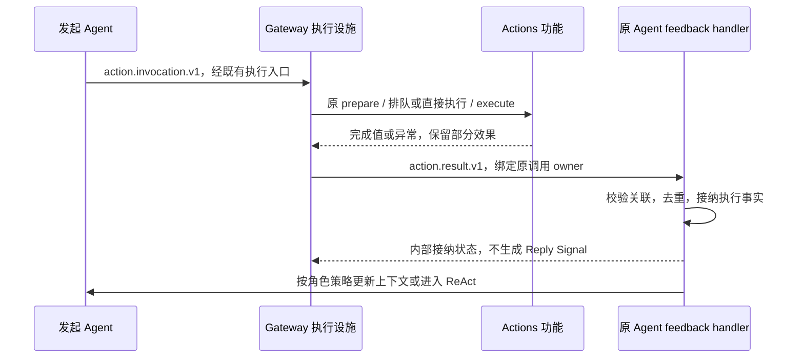
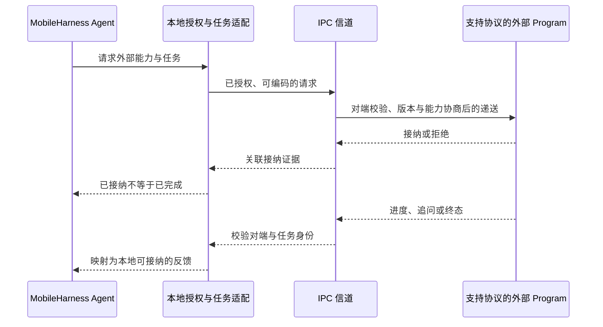
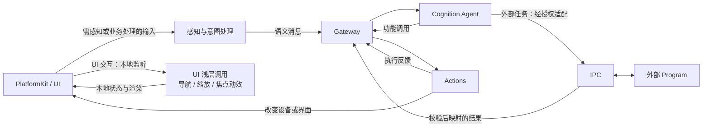

# Signal 核心架构重设计

日期：2026-11-19。状态：需求与方案草案，SignalListener、Gateway 新通信/配置与反馈协议、IPC 均为拟议设计，尚未按本文实施。本文是 Signal 重设计的需求入口；当前实现仍以 [总体技术设计](../../../MobileHarness/README.md) 和各模块 README 为准。

## 1. 目标与设计定位

MobileHarness 是 Multi Signal 输入、Multi Action 输出的全双工交互 Agent Harness。Signal 是核心数据交互概念：外部输入形成感知与意图，内部处理形成协作和执行，执行与环境变化继续形成新的 Signal。输入获取与输出执行能够并行，不以等待一轮回复结束作为所有输入的接纳条件。

本次重设计围绕三类边界展开：

1. **外部 Signal**：从 PlatformKit、UI 等输入源直接监听，统一 SignalListener 契约，优先保持低开销和快速获取；消费者可以是 Agent，也可以是直接处理本地交互的 UI。
2. **App 内部 Signal**：通过 Gateway 完成订阅发布、定向投递以及功能调用与反馈，服务 Agent–Agent 和 Agent–Action。
3. **系统进程间 Signal**：通过未来独立设计的 IPC 信道完成 Agent–Program 通信，将任务委派给支持 MobileHarness 协议的系统或第三方 App。

“所有数据处理围绕 Signal”表示统一描述跨边界的数据来源、接纳、处理和反馈；不要求把每个局部变量、模型内部计算、文件字节或同步返回值包装成通用消息。统一概念和可观察契约，不强制统一载荷表示、调度器或物理信道。

## 2. 三类 Signal 分类图



“外部”按输入来源划分：用户交互、硬件感知等来自认知与业务通信之外的输入，不等于来自 App 进程外，也不要求一定进入 Agent。UI 和 PlatformKit 均可在本进程内产生外部 Signal。UI 内部消费用户交互仍属于这一类别，不因消费者在 App 内就变成 Gateway 内部通信。进程间边界单列为第三类。

IPC（Inter-Process Communication，进程间通信）在本文中指待设计的进程间协议与独立信道，不预设具体系统 API。具体平台承载、协议细节和首个对接程序在后续设计中确定。

Action → Agent → Program 表示能力封装与委派范围逐步扩大，不是强制调用层级，也不是按运行时长分类：Action 可以异步，Agent 可以只发轻量消息，Program 也可以提供简单能力。

PlatformKit 在此承担统一硬件能力抽象，概念上类似 Linux `/dev` 将设备能力提供给上层：消费者面向类型化传感器接口，不直接依赖具体硬件驱动。这里借鉴的是设备抽象边界，不要求采用文件节点、字节流或 Linux API。传感器 Signal 可为连续采样、标量读数、向量、帧或离散变化；音视频是当前已实现且数据量较大的子类，压力、温度等是未来扩展，不要求每种传感器都表现为媒体流。

## 3. 当前基线与目标差异

| 范围 | 当前实现 | 本次目标 |
| --- | --- | --- |
| 传感器多模态数据 | 当前主要已实现音视频：SpeechPerception 直接消费 PCM，VisionPerception 直接消费 CameraFrame；不经过 Gateway。压力、温度尚未在本需求中实现 | 面向 PlatformKit 硬件抽象统一监听契约，支持采样、标量、向量、帧和变化事件；保留直接路径，不增加数据转发层 |
| UI 本地交互 | 当前 UI 设计已将纯展示交互保留在 UI；本地导航由 UI Root 拥有 | 将此路径明确命名为“浅层调用”，保留原生事件处理，不为统一 Signal 增加 Agent/Gateway 往返 |
| UI 业务请求、状态与故障 | 通过所属能力的类型化请求、观察、回调接口接入负责角色 | 梳理并统一 SignalListener 接入语义，保留类型与请求完成契约 |
| Agent 通信 | Agents 适配器负责语义与权限，Gateway.SignalTransport 负责进程内递送 | 统一内部 Signal 术语，明确 publish/subscribe、定向 send 的适用范围 |
| 执行调用与反馈 | Gateway 的执行协调设施与 SignalTransport 分工；Actions 执行业务 | 在内部 Signal 模型下解释调用、进度、结果，不把 Action 调用强制改成普通消息发送 |
| 进程间通信 | 当前 SignalTransport 持有进程内载荷和回调，不是 IPC 协议 | 独立设计 IPC 及本地接入适配，不把现有 Swift 对象直接作为跨进程协议 |

基线来源：[直接输入需求及证据范围](Direct-Container-Input-Plan.md)、[业务通信契约](../../../MobileHarness/Agents/Support/Communication/README.md)、[Gateway](../../../MobileHarness/Gateway/README.md)、[SignalTransport](../../../MobileHarness/Gateway/Input/README.md)。历史文档中的契约名不替代当前 [AgentContracts](../../../MobileHarness/Agents/AgentContracts.swift) 和 [角色声明](../../../MobileHarness/Resources/Agents/README.md)。直接输入性能优先是设计目标，尚不能据此声称本次方案已有量化性能提升。

## 4. 计划的生产方、消费方与信道

下表中的统一 SignalListener 和 IPC 均是目标设计；示例角色关系来自现有实现或明确标注的未来接入。

| 类别 / 场景 | 生产方 | 消费方 | 目标通信方式 | 载荷与交付重点 |
| --- | --- | --- | --- | --- |
| 外部：传感器 / 音频（已实现） | PlatformKit.Audio | SpeechPerception | 直接 SignalListener | 原生 PCM；有界、有序、连续性及采集代校验；溢出显式失败 |
| 外部：传感器 / 图像（已实现） | PlatformKit.Vision | VisionPerception；其他显式获准的媒体消费者 | 直接 SignalListener | 原生帧或缓冲引用；最新值策略、新鲜度与所有权 |
| 外部：传感器 / 压力、温度等（未来） | PlatformKit 抽象的内置或外接硬件能力 | 按场景配置的 Perception Agent 或明确获准的消费者，具体角色待定 | 直接 SignalListener | 类型化标量、向量、采样序列或变化事件；声明单位、采样时间、有效性、量程及按需校准信息 |
| 外部：UI 浅层调用 | UI 原生触控、手势、焦点等事件源 | UI 自有组件、导航或交互状态所有者 | UI 本地监听 / 原生事件处理；不经过 Agent、Gateway 或 Actions | 导航、双指缩放、输入框焦点及动效；只改变 UI 所有的局部状态 |
| 外部：用户文本 | UI 会话输入源 | Assistant | 直接 SignalListener 请求 | 文本及请求身份；接纳与回复完成分开 |
| 外部：交互控制 | UI 聆听、相机、相册、设置、窗口输入源 | SpeechPerception、Photographer、ApplicationControl | 直接 SignalListener 请求 | 类型化意图；取消/停止通路；业务结果回执 |
| 外部：状态、环境与故障 | PlatformKit、UI 及拥有事实的模块/容器 | ApplicationControl、Photographer、相关 Agent 或执行所有者 | 直接 SignalListener 观察 | 快照或变化事实；明确初始值、顺序、合并和失败语义 |
| 外部：数据请求 | UI 等调用方 | 按业务归属的 Agent 或已授权的数据能力 | 直接 SignalListener 请求或保留类型化读取接口 | 请求关联、结果类型、失败与取消；订阅不隐含读取或执行授权 |
| 内部：感知语义 | SpeechPerception、VisionPerception | Assistant、Photographer、显式订阅者 | Gateway publish/subscribe | 目标协议 user.input.speech.v1、perception.vision.pose.v1；保留原类型、来源与新鲜度 |
| 内部：任务协作 | Assistant 等获准角色 | Writer 等目标 Agent；回报反向到请求方 | Gateway await send + 授权任务事件订阅 | 提交/补充/取消直接返回 Reply；进度、追问、终态通过任务引用观察；接纳不等于完成 |
| 内部：功能调用 | 发起操作的 Agent | Actions 拥有的功能实现 | Gateway 执行准入与调度 | 打开相机、拍照、展示窗口；执行身份、资源与取消清理 |
| 内部：执行反馈 | Actions 经 Gateway 执行设施 | 原调用所属 Agent | action.result.v1 → signals.feedback | 返回值、异常与原函数/参数快照；不重复执行业务，不保留普通通信回执 |
| 内部：整轮结算 | Agents/Gateway 的可信执行运行时 | 原轮次所属 Agent | agent.round.result.v1 → signals.feedback | 屏障机制保留，结算成功或失败作为独立反馈，不替代单次 ActionResult |
| 内部：打断信号 | 获授权的 Agent/控制来源 | Assistant | Gateway pub/sub：agent.interruption | agent.interruption.v1；发布接纳不等于打断完成 |
| 内部：其他运行时生命周期 | 可信运行时 | 所属执行会话/角色 | 保留内部绑定 | 活动变化与停止清理，不混入 Action 终态 |
| 进程间：外部委派 | MobileHarness Agent，经 IPC 出口适配 | 支持协议的系统或第三方 App | IPC 定向请求 | 能力协商、授权、任务身份、接纳与执行完成分离 |
| 进程间：外部返回 | 外部 App，经 IPC 入口适配 | 原请求 Agent 或明确注册的本地消费者 | IPC 事件 / 进度 / 结果；本地再按政策路由 | 对端身份、版本、断连、迟到、重复与终态校验 |
| 进程间：外部主动事件 | 已授权外部程序，未来按场景开放 | 本地明确允许接收的角色 | IPC 订阅事件，接入后映射本地契约 | 不允许仅凭对端声明冒充本地 Agent、runtime 或用户 |

ModelKit 与 Storage 继续拥有推理和存储能力，不自动成为通用消息发布者。推理结果由调用角色决定是否发布为语义 Signal；存储读取和提交维持类型化接口。确有状态观察需求时，再按外部监听契约暴露。

## 5. 外部信道：SignalListener

### 5.1 统一使用模型

借鉴 JavaScript EventListener 的“输入源注册监听、事件到达后消费、显式移除监听”思路，但使用 Swift 类型化、隔离和异步生命周期契约。SignalListener 是暂定协议族名称；源接口、监听器接口及订阅句柄的最终 Swift 命名和泛型签名待接口设计阶段确定。

概念流程为：`注入源 → listen → 获得订阅句柄 → 消费 Signal → cancel / 结束 → join 清理`。这是设计示意，不是当前可调用 API。



统一的是订阅与生命周期，不建立全局广播中心，不新增逐帧中转，不强制编码、类型擦除或复制媒体。监听本身不得启动相机/麦克风或隐式获取权限；设备启动仍由明确授权的执行流程负责。

### 5.2 必须声明的契约

| 契约 | 需求 |
| --- | --- |
| 类型与来源 | 源声明稳定类型、设备/传感器身份与来源；支持标量、向量、帧及采样序列。媒体保留原生缓冲及有效生命周期，不统一转为 JSON/Data |
| 传感器测量语义 | 按能力声明单位、量程、采样时间/频率、有效性和按需校准信息；不可用、失效或缺失不伪装成零值。阈值判断等业务含义归消费者 |
| 消费者数量 | 明确单消费者还是多消费者；重复订阅、数量上限及慢消费者处理可测试 |
| 队列与背压 | 每个源明确容量和溢出策略；允许有序 FIFO、最新值替换或拒绝，不设无界默认队列 |
| 隔离与执行 | 明确生产线程/actor 与消费执行域；原生实时回调不能等待任意业务处理；不逐包创建无限 Task |
| 顺序与时效 | 按需保留 sequence、采集时间、generation、新鲜度；不声称跨源全局顺序 |
| 生命周期 | 消费任务由能力或角色所有者持有；取消阻止后续接纳，join 明确等待哪些在途工作；重绑隔离旧代结果 |
| 正常结束与失败 | 区分主动关闭、源正常结束、意外中断、消费错误、容量拒绝；错误传给负责者 |
| 请求与回复 | 请求有 requestID、结果和失败通路；明确仅接纳回执与实际完成，取消请求不伪造业务已撤销 |
| 可观察性 | 提供必要的接纳、处理、替换、拒绝和失败计数；诊断不复制全部原始媒体、不形成第二个积压源 |

连续采样（包括媒体流）、单次读数、离散变化、状态和请求是同一外部类别下的交付模式，不再增加顶层 Signal 类别。状态可选择最新值合并；点击与业务请求不能因此被静默覆盖。请求/响应扩展应按需采用，不为每个音频包生成业务回执。具体容量在逐源清单中确定后才能实施。

### 5.3 UI 内部消费：浅层调用

**浅层调用**指 UI 对交互 Signal 的直接、局部处理：不需要 Agent 理解、决策或 Agent 发起的 Action 控制，就由 UI 的组件或状态所有者完成。可以用“反射式响应”帮助理解其即时、本地闭环的特点；这是设计类比，不表示实现人体反射或自主生理调节机制。

典型场景包括用户点击导航后的本地页面切换、已加载内容的双指缩放/平移、输入框聚焦及焦点动效、按压反馈、滚动和局部展开收起。UI 拥有这些交互状态，事件处理无需等待模型或业务执行。

| 判定 | 处理路径 | 完成边界 |
| --- | --- | --- |
| 只需改变 UI 自有导航、布局、焦点、视口或动效 | UI Signal → 本地处理 → UI 状态/渲染 | 本地状态提交与实际呈现分别确认；不产生虚假的业务完成 |
| 需要理解意图、业务决策、持久化、业务数据查询或设备操作 | UI 类型化请求 → 负责 Agent → Gateway → Actions | 由业务所有者返回实际结果；UI 只处理展示 |
| 同一交互兼有本地响应和业务副作用 | 本地响应立即完成，业务部分另发明确请求 | 两条完成语义分离；导航完成不代表数据已加载或设备已启动 |

例如进入相册的导航可以本地完成，但读取照片记录属于业务请求；缩放已经呈现的图像是浅层调用，控制相机硬件变焦则是设备操作。点击输入框产生焦点与动效可由 UI 消费，提交内容后再按用途交给负责角色。分类依据是状态和效果的所有权，而非“是否点击”“是否执行很快”。

SignalListener 的统一设计应容纳 UI 本地消费，但不要求把 SwiftUI/原生手势回调全部改成异步队列或转发到容器。局部原生处理可直接承载浅层调用语义；只有确有跨组件订阅需要时才暴露监听端口。UI 不依赖 Agents、Gateway 或 Actions 的实现来完成这条路径。

Agent 主动要求导航或展示时，仍走既有 Gateway → Actions → UI 路径；UI 可复用同一状态和呈现能力，不复制第二套状态。UI 本地变化如需供 Agent 感知，应通过已有公开 State 或明确的事实观察提供，不为每次触控强制发送消息，也不把观察回流当作再次执行同一操作的命令。

当前边界依据：[UI 职责与交互路由](../../../MobileHarness/UI/README.md)、[UI Root 导航所有权](../../../MobileHarness/UI/Root/README.md)。

## 6. Gateway 与 Agent Signal 配置：收敛设计

核心约定：**事件按频道订阅；请求按目标直接回复；代码注册能力，JSON 启用接收协议并选择静态事件关系，启动校验完整性，Action 结果与轮次结算以 feedback 独立接纳，任务运行时建立动态观察。**

### 6.1 两种角色通信、独立执行反馈与三个配置归属

| 通信方式 | 寻址 | 完成语义 | 场景 |
| --- | --- | --- | --- |
| pub/sub | channel + 事件协议；订阅用 sources 限定来源，可筛选事件类型 | 发布完成表示 Gateway 已按规则接纳；不代表订阅者业务完成 | ASR、姿态、状态、任务进度与终态观察 |
| send | target + 请求协议 + request | `async throws -> Reply`；回复属于原请求，无独立 response topic 或回执 Signal | 提交任务、补充、答复、查询、取消、短请求问答 |
| feedback | 原调用或轮次的可信 owner/context + 结果协议 | 接纳执行或结算事实；不创建新请求或事件频道 | Action 返回值/异常、整轮结算通知 |

| 配置归属 | 内容 | 不放什么 |
| --- | --- | --- |
| 代码中的能力注册 | 类型化 Request/Reply handler、事件生产/消费能力、版本、大小、交付策略和访问政策 | 不注册没有实现的协议，不复制角色间路由表 |
| Agent.json 的 signals | requests 接收协议启用清单、feedback 执行回报协议，以及静态 publications 与 subscriptions | 不含逐目标 sends/calls、Agent 消息的独立 response/receipt，不含原生监听源或动态任务 ID |
| App 注入的 Gateway 配置 | 中立容量、等待策略、生命周期及诊断上限 | 不包含 Writer/Assistant 业务 schema 或角色业务权限表 |

三类信道边界保持不变：PlatformKit/UI 的 SignalListener 直接监听与 UI 浅层调用不进入此配置；IPC 后续通过独立接入适配，不能直接获得本地 Agent 身份。



### 6.2 send：所有 Agent 自动接收，handler 决定支持什么

每个已注册的 Agent 都有统一接收入口，不需要配置接收端口开关。具体启用哪些请求协议由 signals.requests 声明；启动时必须验证其静态描述符和 handler 完整。调用未启用或未知协议返回明确的 unsupportedProtocol，而不是超时等待；配置了协议但实现不完整则在启动阶段失败，不能拖到第一次调用。

概念 API（不是当前可编译接口）：

```swift
let reply = try await gateway.send(
    to: .writer,
    using: AgentTask.v1,
    request: .submit(text: goal)
)
```

`AgentTask.v1` 是类型化描述符，示例稳定协议标识为 `agent.task.v1`。描述符绑定 Request、Reply、版本、大小、默认 deadline、操作元数据和访问政策。最终泛型签名在实施前定稿。

角色注册类似 `register(AgentTask.v1, handler: handleTaskRequest)` 的处理器。代码注册定义可实现能力，signals.requests 决定本次启用的协议。协议可跨角色复用；只有完整实现且配置启用、启动校验通过的协议才进入公开自描述和调用目录，不自动把所有角色变为可委派 Agent。配置仅引用协议标识，不复制 Request/Reply schema 或处理逻辑。

接收顺序：活跃目标定位 → 可信来源/代际校验 → 已启用协议及版本查找 → 访问与操作校验 → 类型化 handler → 原调用 Reply/error。未知协议/版本快速失败，不启动模型，不触发业务效果。

- 普通公开协议允许有效本地 Agent 调用，不维护 Assistant→Writer 逐对 send 白名单。
- 任务归属、Skill 与执行授权继续按实际操作校验；受限 handler 显式声明访问政策。支持协议但无权操作返回 unauthorized。
- 同一协议可有明确的操作枚举；例如 AgentTask.v1 的 submit/update/answer/status/cancel。协议描述符声明必需操作与显式可选扩展；必需操作的 handler 必须完整，否则启动失败。可选扩展的支持情况进入自描述，不支持的扩展或未知操作返回 unsupportedOperation；不能把缺失必需操作当作正常运行时拒绝，不靠自由文本建立权限。
- 公开能力目录从已启用且通过校验的 handler 投影，模型是否看到调用工具仍由其有效 Skill/工具目录决定。“所有 Agent 有接收端口”不等于每个模型自动获得所有调用工具。
- 不把内部 runtime/actionResult 等反馈注册成公开 send 协议，避免外部角色伪造执行完成。

Reply 直接沿原调用返回；删除“DeliveryReport 回投 CommunicationReceipt 再唤醒 Agent”的普通通信链。Gateway 内部的调用关联和诊断仍存在，但不再要求接收者发送另一条回复消息或调用者订阅回执。

### 6.3 pub/sub：频道有协议，订阅有来源

事件地址由 `channel + source` 标识；单条 Signal 的 source 仍是一个可信生产者，配置的 sources 是允许匹配的来源集合，channel 绑定一个带版本的事件协议。协议可以是枚举，如 user.input.speech.v1 中的 partial/final；订阅通过 events 选择变体。channel 是逻辑事件流，protocol 是数据契约，两者不互相隐式推导。

```swift
try await gateway.publish(channel: .userSpeechInput, event: SpeechInput.final(text))
```

发布端口在装配时绑定真实生产者，调用者不能填写任意 source。静态订阅由 JSON 装配到已注册的类型化消费者，业务代码无需再重复 subscribe 一次。运行时动态任务观察复用相同递送机制，但不写入 JSON。

统一使用 **EventChannel** 表示事件频道，既有 Action 的排序 Channel 保留执行域语义；两者不能共用一张配置表或以同名值暗中耦合。

交付规则由事件协议的类型化描述符定义，JSON 不配置并发或队列：

- 姿态、partial 等可采用显式 latest-value 合并；final、任务追问/终态不能因共用频道而被覆盖。按事件变体定义策略，不对整个频道套一个粗粒度丢弃规则。
- 在源作用域内保留序号；每个订阅消费有确定顺序。不同来源没有全局顺序承诺；晚订阅不默认重放普通事件。
- 发布先验证自身类型、来源及全局预算；失败时不发出任何分支。发布已接纳后，各订阅分支独立处理容量和消费者失败，记录明确的 accepted/coalesced/rejected/closed 证据；不引入跨消费者原子事务，慢诊断观察者不能阻塞其他角色。不可丢弃事件拒绝必须通知负责者，不能静默吞掉。不得因一个分支失败重发整个广播，造成其他分支重复；可靠性由目标业务处理，任务事件使用持久恢复。
- 无订阅者可以正常发布，诊断标为 unobserved；发布成功不表示有人接收，更不表示业务完成。
- 任务的可靠恢复由任务持久状态与游标负责，不让通用 pub/sub 承诺持久递送。

#### 打断：授权来源发布，Assistant 订阅

打断采用 pub/sub，Channel 为 agent.interruption，Protocol 为 agent.interruption.v1。多个获授权 Agent 可发布，Assistant 用一条订阅的 sources 显式列出接收来源；不在 requests 中启用同名 send 协议，不重复建立两条外部打断路径。

载荷保留 signalID、会话作用域、目标 current/replyID 及可选原因。对于 current，Assistant 在实际接收时锁定同会话当前回复；replyID 只匹配已捕获的回复。可信来源由发布端口绑定，Assistant 检查作用域、来源政策与目标有效性，去重后调用现有 requestInterrupt，清理加入后才记录处理完成。信号在控制路径处理，不排入普通用户文本队列，也不再次调用 Decision。

publish 只表示发布接纳，不表示 interrupted。处理结果保留内部事实/诊断，不自动新增 response 频道；若后续业务明确需要发布方观察完成结果，再单独定义观察契约。控制信号不可静默丢失或被普通进度合并；容量拒绝显式报告，端点更替和迟到目标拒绝，不自动重放到下一条回复。中断分支必须有独立控制准入，不能被普通事件等待队列耗尽；具体全局槽与字节预留在第 11 节实施门槛中确定。

Assistant 内部 Decision、可信宿主控制继续直接调用同一处理入口，不为复用协议强制绕 Gateway。非 Agent 来源若需通过 Gateway 发布，必须由 App 注册中立可信来源并赋予指定频道的发布能力；UI/PlatformKit 不直接取得 Agent 通信权限。此次配置示例不引入任意来源或通配来源。

#### Channel 与 Protocol 的分层命名规范

二者都按**语义域 → 能力/对象 → 具体语义**从大到小命名，但含义不同：Channel 标识事件流，Protocol 标识类型与行为契约。域名描述业务语义，不直接复制源码目录、生产者类名或传输方式。

| 标识 | 格式 | 示例 |
| --- | --- | --- |
| EventChannel | `<domain>.<subject>[.<stream>]`，必要时增加语义层级 | user.input.speech、perception.vision.pose、agent.task |
| Protocol | `<domain>.<subject>[.<contract>].v<major>` | user.input.speech.v1、agent.task.v1、agent.task.events.v1、action.result.v1 |
| 事件变体 | 协议枚举成员，独立放在 events/payload | partial、final，不作为请求/回复 topic |
| 来源与作用域 | 独立的 source/target/scope 字段 | speechPerception、writer、taskRef，不拼进频道或协议名 |

首批语义域固定为 user（用户意图/输入）、perception（加工后的感知事实）、agent（角色协作）、action（功能执行）。新增域需有真实语义边界，不能为每个 Agent 或设备建一个域。原始压力、温度、PCM 等仍走 SignalListener，不因制定 Channel 规范就迁入 Gateway；以后若发布加工后的感知事实，再定义 perception 下的业务契约。

具体命名表：

| 用途 | Channel | Protocol | 进一步区分 |
| --- | --- | --- | --- |
| 用户语音识别输入 | user.input.speech | user.input.speech.v1 | events=partial/final，sources=[speechPerception] |
| 姿态感知 | perception.vision.pose | perception.vision.pose.v1 | sources=[visionPerception] |
| 声源感知 | perception.audio.source | perception.audio.source.v1 | 声源类型与测量内容在载荷中 |
| 打断信号 | agent.interruption | agent.interruption.v1 | 授权来源发布，Assistant 订阅；载荷区分 current/reply 与会话 |
| 任务请求 | 无，send 指定 target | agent.task.v1 | submit/update/answer/status/cancel 在请求操作枚举中 |
| 任务后续事实 | agent.task | agent.task.events.v1 | scope 区分实例，事件枚举区分进度/追问/终态 |
| Action 调用 | 无事件频道，保留独立执行 Channel | action.invocation.v1 | function 区分具体功能 |
| Action 回报 | 无，按 owner 定向 feedback | action.result.v1 | function/callID 区分具体调用 |
| 整轮结算回报 | 无，按轮次 owner 定向 feedback | agent.round.result.v1 | roundID 区分轮次，屏障后回报完成或失败 |

命名与校验规则：

- 点号分层，使用小写 ASCII 单词和数字；每段以字母开头，协议最后一段固定为 v 加正整数。使用 `^[a-z][a-z0-9]*$` 校验普通段，版本段为 `^v[1-9][0-9]*$`。不混用大写、下划线、连字符、斜杠或空段。
- Channel 为 2–5 个语义段；Protocol 为 2–5 个语义段加 1 个版本段；各完整标识最多 64 UTF-8 字节。层数用于限制过度细分，不要求所有名称补齐到同一深度。
- Channel 不带协议版本，不含 Agent ID、会话/任务/设备实例 ID、时间或 UUID。需要并行运行不兼容版本时，另行设计显式兼容绑定/迁移方案；首版仍执行一个频道绑定一种协议的约束，不临时拼接 `.v2` 成频道。
- Protocol 的主版本标识固定完整契约。兼容新增字段必须声明默认值/可选规则并验证旧消费者；破坏性变更升主版本。配置 schema 的 version 与协议版本互不替代。
- 相同前缀便于理解，不建立隐式路由：channel 与 protocol 仍显式绑定；send/feedback 的协议不因名称有点号就产生频道。禁止通配、前缀继承和自动订阅子频道，例如订阅 perception 不代表订阅其下所有事件。
- 同一概念只保留一种稳定名称；不并存 speech/asr/transcript 三种同义频道。名称不编码 handler 所在模块；以后替换发布者由 source 和装配决定。
- 现有执行 Channel（例如 Speech/Control）和 canonical 函数地址（例如 Camera.Capture.takePhoto）属于另一套既有命名体系，本次不改名，也不把它们按事件频道规则校验。现有 lowerCamelCase Agent ID 同样保留。
- 所有示例新名称均属待实施方案。启动校验标识语法、描述符存在与绑定一致性；旧契约/频道必须显式迁移，历史记录保留原名，不按新规范重写历史事实。

### 6.4 Agent.json：请求、执行反馈与静态事件关系

拟议资源 schema 从 v10 升到 **v11**，将 communication 替换为 signals。以下是新设计示例，不能直接替换当前资源并期待旧加载器接受。其他字段保持现有职责，示例 description 可保留角色现有完整文案。

Assistant：

```json
{
  "version": 11,
  "id": "assistant",
  "category": "cognition",
  "description": "Handle user conversation and coordinate available capabilities.",
  "baseSkills": ["basic-skill", "expression-interaction"],
  "signals": {
    "requests": [],
    "feedback": ["action.result.v1", "agent.round.result.v1"],
    "publications": [],
    "subscriptions": [
      {
        "channel": "user.input.speech",
        "protocol": "user.input.speech.v1",
        "sources": ["speechPerception"],
        "events": ["final"]
      },
      {
        "channel": "agent.interruption",
        "protocol": "agent.interruption.v1",
        "sources": ["applicationControl"]
      }
    ]
  }
}
```

Writer：

```json
{
  "version": 11,
  "id": "writer",
  "category": "cognition",
  "description": "Own background creative tasks and their results.",
  "baseSkills": ["writer-workspace"],
  "signals": {
    "requests": ["agent.task.v1"],
    "feedback": ["action.result.v1"],
    "publications": [],
    "subscriptions": []
  }
}
```

Writer 的 requests 显式启用 agent.task.v1，代码提供完整 handler；publications/subscriptions 的空数组仅表示没有静态事件关系。任务运行时按已接纳工作创建受控事件源，Assistant 自动观察自己的委托，不需要固定 writer→assistant 消息白名单。Assistant 订阅 agent.interruption / agent.interruption.v1 以保留打断接收能力，并启用 agent.round.result.v1 以接收轮次结算；其向 Writer 发起 send 或收到原调用 Reply 不依赖 requests：该字段只配置入站请求协议，不是发送许可。其他角色示例暂不列固定任务协议，只说明格式，不授权删除现有固定任务能力；最终启用清单必须按第 6.10 节逐角色盘点。

SpeechPerception：

```json
{
  "version": 11,
  "id": "speechPerception",
  "category": "perception",
  "description": "Interpret microphone input and publish speech and sound-source observations.",
  "baseSkills": [],
  "signals": {
    "requests": [],
    "feedback": ["action.result.v1"],
    "publications": [
      {"channel": "user.input.speech", "protocol": "user.input.speech.v1"},
      {"channel": "perception.audio.source", "protocol": "perception.audio.source.v1"}
    ],
    "subscriptions": []
  }
}
```

其他角色的 signals 对象示例：

```json
{
  "applicationControl": {
    "requests": [],
    "feedback": ["action.result.v1"],
    "publications": [{"channel": "agent.interruption", "protocol": "agent.interruption.v1"}],
    "subscriptions": []
  },
  "visionPerception": {
    "requests": [],
    "feedback": ["action.result.v1"],
    "publications": [{"channel": "perception.vision.pose", "protocol": "perception.vision.pose.v1"}],
    "subscriptions": []
  },
  "photographer": {
    "requests": [],
    "feedback": ["action.result.v1"],
    "publications": [],
    "subscriptions": [
      {"channel": "perception.vision.pose", "protocol": "perception.vision.pose.v1", "sources": ["visionPerception"]}
    ]
  }
}
```

Assistant 示例中的 applicationControl 是拟议授权发布来源示例，不表示当前代码已接通该广播。上述多角色示例给出配套 publication；采用此配置时，该来源还必须实现匹配的发布能力；也可在 sources 中列出多个明确授权的来源。完整来源清单随实际业务装配确定，不能只新增订阅而缺少发布实现。其他按轮次结算的角色也必须按自身执行绑定启用 agent.round.result.v1，不只限于 Assistant。

上面的多角色对象只是文档对照，不新增集中式角色配置文件。每个 signals 对象仍放回其所属 Agent.json。

字段规则：

| 字段 | 规则 |
| --- | --- |
| signals | 必填；只接受 requests/feedback/publications/subscriptions，四数组必填，空值为 [] |
| requests[] | 本角色启用的入站 Request/Reply 协议标识；无重复、最多 32 项；必须匹配完整静态描述符和 handler。空数组表示不开放业务请求协议，统一接收入口仍返回明确的不支持错误 |
| feedback[] | 启用的执行回报协议标识，当前规划 action.result.v1 与 agent.round.result.v1；无重复、最多 16 项；必须存在静态描述符和完整接收 handler。无需 source/target/channel，Gateway 从原调用或轮次绑定身份。空数组表示不接纳此类 Agent 反馈，不允许把需要反馈的调用配置成静默丢失 |
| publications[].channel / protocol | 必填；本角色必须注册匹配的事件生产能力；不写 source，运行时绑定本角色 |
| subscriptions[].channel / protocol / sources | 必填；sources 为非空、无重复的显式来源 ID 数组，最多 16 项；每个来源须有匹配 publication 或宿主注册的授权发布能力。运行时暂未启动可等待重新绑定，不启动发布者 |
| subscriptions[].events | 可选，省略表示协议内全部事件；出现则必须是非空、无重复的已知事件集合 |
| protocol | 示例使用带版本的稳定标识，不再同时填写 version/kind/contract/topic；schema version 仍独立 |

发布者与消费者代码声明“具备什么能力”，JSON 声明“本角色启用哪些请求/执行回报协议、接通哪些静态事件关系”。这种分工允许调整订阅而不复制类型定义；配置不能凭空制造生产者或 handler。配置统一使用 sources 数组，单来源也写一项，不同时接受 source 字符串与 sources 两种格式。首版不支持通配 sources、正则 channel 或热更新，避免引入隐式路由和复杂重绑政策。

装配时按命名规范校验标识，并校验未知字段、重复/重叠订阅、频道协议冲突、源不存在、无对应生产/消费能力及容量，错误明确失败。同一 channel 在当前 App 目录内只绑定一个 protocol 标识；不兼容协议迁移必须显式替换或使用新频道，不能混发两种 schema。source incarnation 由生命周期运行时绑定，JSON 不保存实例身份。

#### 启动协议完整性校验

启动采用“加载 → 校验 → 绑定 → 开放准入”，在完整校验前不允许请求进入。能力描述符的检查是静态装配，不启动模型、相机或真实业务工作。feedback 与 requests 同样校验协议存在、版本、完整 handler 和类型；需要结果反馈的角色/执行绑定若未启用相应 feedback，则报启动协议异常。动态启用的新执行能力在准入时也要检查结果接收能力，不能执行后才发现结果无人消费。

| 情况 | 启动/运行行为 |
| --- | --- |
| 配置启用，描述符与 handler 完整且版本匹配 | 启动绑定端点，协议进入有效能力目录 |
| 配置启用，但描述符未知、缺少 handler、必需操作缺失或 Request/Reply 类型不匹配 | 抛出结构化启动协议异常，关闭该次根启动准入，不静默跳过 |
| 已实现但未配置启用 | 正常启动；该协议不绑定、不出现在有效目录，调用返回 unsupportedProtocol |
| requests 为空 | 正常启动；接收端口存在，不开放业务请求协议 |
| 已声明必需的角色能力/组合依赖未启用 | 启动校验失败；不要求把所有可选实现都启用 |
| 外部请求使用未知或未启用协议 | 运行时明确拒绝；不是启动异常 |

异常建议统一为 AgentProtocolStartupError，携带 agentID、配置字段路径、protocolID、期望/实际版本和具体原因，如 unknownProtocol、missingHandler、missingRequiredOperation、schemaMismatch、duplicateHandler、missingRequiredProtocol。只列出本次启用清单和显式必需依赖的问题，不把未启用的可选实现误报为缺失。

必需操作集由协议描述符拥有；具体角色若只提供较小功能，应实现适合的协议或已声明的可选扩展，不能声称完整支持却缺少必需操作。静态校验可证明注册完整性和类型匹配，不能证明真实业务正确，仍需行为测试。

全体配置与实现校验通过后再发布有效目录并开放根准入。静态完整性通过角色工厂/类型化注册清单验证；不为检查 handler 而创建模型会话、激活设备或启动按需角色。实际角色实例创建时才绑定活跃端点，并复核与已验证清单一致；具备静态实现但当前未启动仍返回 unavailableTarget，不能误报 unsupportedProtocol。绑定阶段失败时撤销本次部分绑定、加入清理并报告启动失败；不留下“部分已启用但 App 宣称启动成功”的状态。该失败范围沿用 App 组合根启动/回滚契约。运行中设备或模型暂不可用仍是运行时能力故障，不混入静态协议完整性异常。

首版不热更新协议启用清单；变更配置需要受控重建或重启并重新校验。启动时不要求其他可选角色实例一直运行，静态能力存在与当前端点在线分别判断。模型可见协议目录只能投影最终启用集合，不能直接暴露全部注册实现。

### 6.5 长期任务：send 接纳，任务层自动观察

长期任务不是一次请求长期占用的通信槽。任务层提供“提交并观察”便利入口，内部仍只有 send 与 pub/sub 两种原语：

```swift
let submission = try await tasks.submit(to: .writer, text: goal)
// submission 保存可查询的消息/任务引用；观察由 Agent 所有者持有。
```

这一调用取得真实接纳后返回，并由角色所有的任务协调器建立、消费和清理观察；不把每次任务的 channel/source/event 配置暴露给模型或 Agent.json。



图中观察绑定是任务层流程，由受控 send 与订阅组合实现；也可在提交 Reply 携带快照/游标以减少往返。两种实现都必须保证接纳与观察之间已经发生的终态不丢失。

Writer 可能先收下消息，再用自己的模型决定新建/补充/拒绝。因此 Reply 可以是 accepted(messageRef, taskRef?)、已处理结果或明确拒绝，不伪造“已开始执行”。messageRef 作为稳定观察起点，后续任务归属由 Writer 持久建立。

动态事件地址采用结构化 `(channel: agent.task, scope: messageRef/taskRef, source: executor)`，事件协议为 agent.task.events.v1。不拼接 request/response topic；scope 不改变 channel 的类型。只有认证参与者可观察，引用不是任意操作权限。任务控制仍通过 send，任务事件只表达事实，不把观察者变为执行者。

持久状态和通知由 Agents 任务所有者通过 Storage 管理，Gateway 保持内存递送职责：

- 快照与事件游标原子接续，或先订阅再按版本对账；终态早于订阅也能取回。
- 普通进度可合并；追问与终态保存可恢复证据。新会话根据已持久关联恢复未消费通知，消费标记与业务视图提交保持一致，不把模型是否播报当作消费确认。
- 正常断开观察只释放订阅，不取消后台任务。显式取消使用 send，只有真实清理后才确认取消完成。
- 可选 `await task.result()` 复用任务观察，不新增 Gateway 通信机制，不占用最初 send 的槽。
- Writer 的持久 outbox 在新恢复机制通过验证前保留；不能用不可靠广播替换它，也不双发新旧通知。

### 6.6 生命周期、故障与容量

请求/回复独立于 Agent 普通输入队列。回复直接恢复调用者，不需要同一串行 inbox 再消费 receipt；等待期间控制/取消请求仍有处理机会。调用链保留因果身份并拒绝循环等待；不得在持有不可重入业务锁时等待其他角色回调。

send 至多完成一次；可信运行时绑定 requestID、source、target incarnation 与 deadline。未知端点、未知协议、版本/操作不支持、未授权、无效载荷、容量满、关闭分别可辨。业务拒绝由 Reply 表达；执行异常保留结构化错误。

超时/取消只结束当前等待，已经接纳的任务不自动撤销。可能已发生效果时保留 requestID 与 outcomeUnknown，支持按稳定身份查询；不自动重试有副作用请求。显式重试由任务层幂等接纳，不承诺通用 exactly-once。过期或迟到回复不完成新调用。

等待槽可释放，但仍未退出的处理器必须由目标所有者持有并计入在途预算直到 join；不能在超时后无限启动替代任务。目标退役关闭准入、结束等待、取消并加入所拥有处理器；后台业务任务按自身生命周期处理，不能把端口关闭等同于业务清理成功。

初始容量预算如下，属待验证的设计值，不是当前性能结论；App 可降低，提升需重新验证：

| 资源 | 初始界限及满载策略 |
| --- | --- |
| 注册端点 / 协议目录 | 128 个端点；请求、事件与执行反馈描述符合计 128 项；超限装配/注册拒绝 |
| 静态频道与角色关系 | 64 个频道；每角色 64 项 publication、16 项 subscription；每频道最多 16 个静态订阅；每订阅 sources 至多 16 项；重复与重叠拒绝 |
| 活跃 send | 全局 128，每目标 16；每目标其中 1 槽保留给协议声明且已授权的取消/控制操作；非控制最多 15，无额外等待队列 |
| 消息预算 | send 与事件设施共享 8 MiB 在途逻辑载荷预算；请求/回复各最多 256 KiB，协议可更小；接受请求时预留回复上限，回复不争用新的普通投递槽 |
| 事件分支 | 全局至多 256 个在途/待处理分支；每订阅 16 个等待事件加 1 个处理事件；按协议变体合并或显式拒绝该分支，不无限阻塞生产者 |
| 动态任务观察 | 全局 128 个观察，每个任务作用域至多 16 个观察者；与事件分支及字节预算共同约束；满时显式拒绝观察并保留持久可查询状态 |

上表 send/事件字节限额不直接套到已有 Action 返回值上；执行反馈继续使用原结果账本的容量及业务结果约束，不截断或静默拒绝实际返回值。静态与动态订阅有独立数量账本，共用递送预算。诊断沿用有界记录策略，不保留全部原始载荷。协议级默认 deadline 为必填有限值，由 handler 设计时确定；调用者只能缩短。任务长期运行不使用无限 send deadline。共享预算中的取消准入与回复保留需要在实现前验证资源预留算法，不能仅靠声明有“控制槽”保证字节满载时可取消。

### 6.7 Agent–Action：统一调用契约与独立结果反馈

#### 命名依据与决定

ReAct 原论文使用 **Observation** 表示行动后获得的观测，示例轨迹交替出现 Thought、Action、Observation；作者介绍也以环境 feedback 描述这些信息的作用。来源：[ReAct 原论文，§2 与附录示例](https://ysymyth.github.io/papers/react_llm.pdf)、[作者团队的 Google Research 介绍](https://research.google/blog/react-synergizing-reasoning-and-acting-in-language-models/)。论文给出了推理/行动术语，不规定软件配置字段名。

本项目选择 **signals.feedback** 作为独立配置字段，具体回报协议命名 **action.result.v1**、类型概念为 **ActionResult**。原因是此处需要区分“执行产生的回报”与原始传感器观察、普通事件订阅；Observation 在本项目会覆盖更广泛的输入含义。ActionResult 被 Agent 转为模型上下文时可以作为 ReAct Observation。Feedback 是工程职责名，Result 是具体载荷，Observation 是认知使用方式，不将三者再拆成三份消息。

feedback 不是评价分数或用户点赞，也不是新请求：接纳原调用或轮次关联的真实返回值、异常及结算事实。与 Agent–Agent 的 send Reply 不同，它保留现有异步 Action 调度后的定向回报语义；不改成 pub/sub，不增加 action.result 订阅频道或通用通信回执。

#### 当前调用与优化范围

当前 AgentOutput 分为 ActionCall（actionPath/channel/parameters）与 ToolCall（id/toolPath/arguments），由 OutputEnvelope 携带来源、会话、输入、轮次和因果信息。中立执行侧已有 FunctionRequest、FunctionInvocation，排队侧另有 ScheduledAction。Gateway 通过 ActionsExecutionPort 的 prepare/execute/discard 调用 Actions；函数目录由 catalog 提供。源码见 [AgentOutput](../../../MobileHarness/Agents/Support/Core/Output/AgentOutput.swift)、[FunctionRequest](../../../MobileHarness/Actions/Support/Contracts/FunctionRequest.swift)、[ActionsExecutionPort](../../../MobileHarness/Actions/Support/Contracts/ActionsExecutionPort.swift)。

选定的优化是统一调用与结果的字段、身份和版本契约，保留排队与直接执行设施：

| 方向 | 契约 | 入口/递送 |
| --- | --- | --- |
| Agent → Action | action.invocation.v1 / ActionInvocation | 原 Gateway 执行入口；按既有可信绑定排队或直接调用，不经 Agent send |
| Action → Agent | action.result.v1 / ActionResult | Gateway 从执行结果构造反馈，按原 owner 定向交付已启用的 feedback handler |

这是一对执行契约，不是 request topic / response topic。协议标识描述进程内类型化 schema，不要求 JSON 编码或新增消息跳转。Action 不变成消息接收 Agent，不新增请求监听器、Execution 句柄或 execute/send 新 API。现有 Actions/Support 已有 ActionInvocation 类型，实施时应复用/协调既有命名与中立契约，不再创建平行同名结构。

模型 Action/Tool 调用格式继续作为入口适配。两者共用规范化函数地址、参数和调用身份，再交给原调度/直接执行路径。执行 Channel、资源和权限来自可信绑定，不成为模型可自由填写的信道参数。当前按 ActionCall/ToolCall 入口分派的行为先保持，executionPolicy 是否成为唯一分派依据不在本轮修改范围。

#### 统一的调用关联

| 字段组 | 契约 |
| --- | --- |
| protocol | action.invocation.v1；和结果 schema 的兼容关系由静态执行契约声明 |
| callID | 每次规范化调用必有稳定 ID；保留模型原生调用关联，可信运行时保证作用域内唯一 |
| function / arguments | 必填的不可变调用快照：canonical ActionIdentifier（完整函数名）及本次传入的每个参数名和对应值；复用现有参数校验，本轮不改参数编码体系 |
| owner / context | 可信运行时绑定 Agent/端点、incarnation、session、input 及可选 round/task/turn；调用者不能靠 payload 授权 |
| executionID | 实际执行实例身份，由执行运行时分配；与 callID 关联，不取代它 |
| scheduling | 单独保留已有 Channel/ordering scope/wait 等执行元数据；不复制到业务参数 |

Gateway 各适配层传递同一身份，不反复推断来源。调用在执行前被拒绝时也保留 callID；没有真实执行则 executionID 可空、effect 为 notStarted，不能伪造执行成功。排队、准备、执行和结果递送维持各自阶段。

#### ActionResult：返回值与异常的统一表达

| 字段 | 含义 |
| --- | --- |
| protocol | action.result.v1 |
| callID / executionID | 对应原调用及实际执行；迟到、重投与接收去重的关联依据 |
| function | 从 Invocation 保留的 canonical 函数路径（完整函数名） |
| completedAt | 实际终态的发生时间，重投不改写；接收时间另记，供 Assistant 多源时间线正确排序 |
| arguments | 从同次 Invocation 保留的完整输入参数名—值快照；不是返回值，也不是处理完成后读取的当前配置 |
| owner / context | 从原调用保留，不由 Action 选择目标 Agent |
| status | succeeded / failed / partialFailure / cancelled，复用实际终态 |
| completion | completed（无业务返回值）、value、report、activityStarted/activityStopped 等既有完成值；不能把空字符串等同无返回值 |
| failure | 结构化 code、message、必要的 cause/report；保留超时、业务异常和清理失败，不压缩为泛化字符串 |
| effect | notStarted / contractCompleted / unknown，区别是否已产生效果以及确定性 |

成功必须有合法完成证据；失败可携带实际部分效果，但不能把它解释为成功。取消和异常不能覆盖已经发生的真实部分失败。启动录像的完成只证明开始动作满足契约，不证明录像已经结束。ActivityEvent 保留内部生命周期绑定；roundResult 迁为独立 agent.round.result.v1 feedback，两者均不混入单次 ActionResult。

具体字段优先复用现有中立 ExecutionResult、ActionCompletion/ActionReport/ActionFailure 和认知侧 ActionResult/ToolResult。统一的是终态事实及关联协议；模型原生 tool-call 的结果格式仍由适配器生成，不要求把所有结果强制转字符串或 JSON。

#### 调用参数快照：Invocation 与 Result 对齐

- 在调用入口完成函数地址解析后冻结传入参数快照，Gateway 随执行记录保留，生成 Result 时直接复用。不能从当前 UI、模型上下文或可能已变化的设置重建，也不由 Action 在结束时自行重新填写。
- arguments 保存实际传入的参数名及值，区分缺省、空字符串、零和 false；本轮沿用现有字符串参数表示，不把字符串伪装成已升级的类型化值。无参数调用显式记录空参数集合。
- 如果执行端根据配置解析缺省值或进行单位换算，原 arguments 不被覆盖；确需回报实际解析值时，在执行报告中明确标注 resolvedArguments 及其产生阶段，不能冒充调用方原始输入。
- 成功、异常、部分失败、取消及执行前拒绝均保留已有调用快照。尚未成功解析函数名或参数的解析错误保留原入口错误证据，不制造合法的 Invocation。
- 返回值继续放在 completion/value，输入值放在 arguments；二者不能共用一个模糊 value 字段。重投同一结果必须保持同一输入快照。
- 进程内可共享不可变快照，避免每次投递复制整份参数；结果在持久记录或导出时须具有可恢复的输入内容，不能仅引用已释放的内存。参数快照计入相应记录容量，不在执行后因诊断限制静默截断。
- 沿用现有敏感字段边界：可信执行保留所需输入，模型/诊断/持久化投影不暴露密钥等秘密；脱敏必须显式标记，不把脱敏文本标为原始值。原生媒体附件和凭据句柄不被展开到普通参数日志，保留受控引用及必要元数据。

例如调用 Camera.Capture.takePhoto，传入 delaySeconds="3"，其成功结果或相机不可用异常都携带相同的函数名与 arguments={delaySeconds: "3"}；之后界面改成其他倒计时值不影响该记录。此例是协议字段示意，不是已执行的设备测试。

#### 回报路径与消费语义



- Action 只返回结果或抛出异常，不认识 Assistant、不发布消息、不选择接收者。Gateway 负责执行事实与原调用身份关联，Agents 适配器负责认知侧格式与接收绑定。
- feedback 只能由可信执行链递送，不能通过普通 send、pub/sub 或自由填入 runtime 来源伪造；接收者核对 call、owner、incarnation、会话及终态。
- Gateway 复用现有有界结果账本、容量预留及取消/关闭语义；接纳成功、暂时繁忙、作用域关闭分别处理。重试只重投不可变结果，不重新执行功能。结果递送失败必须留下关联证据，不伪造接收成功。
- 接收去重与事实提交形成一个受保护的接纳步骤；失败不能提前记为已消费。已接纳结果再次送达仅确认已有事实，不重复入 ReAct。
- scheduled Action 沿当前账本回报；直接 Tool 保留原返回链，在已有结果适配边界形成同一 ActionResult 事实。每次调用绑定唯一的认知消费入口，不能让直接返回和额外 Signal 各自推进一次 ReAct。无需绕路再经过普通消息队列。
- handler 负责接纳与关联，不必须立即执行一次模型请求。成功无返回值、业务值、异常按角色政策处理；全双工的现有输入协调和轮次结算继续负责何时 ReAct。
- feedback=[] 不意味着执行失败可以丢弃。需要认知回报的能力必须启用对应协议；不需要模型反馈的本地执行仍通过原调用返回/运行时诊断处理失败。静态依赖启动检查，动态能力准入检查。

feedback 的配置与启动校验统一见第 6.4 节；同时校验调用/结果版本兼容性与执行绑定依赖。启用 feedback 不授予函数执行权限，函数可用性由 Skill/内部绑定决定。反馈端口须在执行准入前建立，关闭时先排空或明确终结对应执行与结果投递。

#### 整轮结算：agent.round.result.v1 feedback

将现有 roundResult 的**通知**归入 signals.feedback，协议为 agent.round.result.v1，不设置 EventChannel。命名按 agent（语义域）→ round（对象）→ result（契约）→ v1（主版本），与 action.result.v1 的单调用粒度区分。

原屏障仍是：roundFinished 封口 → 加入该轮所需执行/清理与结果递送 → 产生轮次结果。不是将屏障本身改成异步事件，也不能在模型输出结束时就报告结算成功。

| 字段 | 契约 |
| --- | --- |
| protocol | agent.round.result.v1 |
| roundID / owner / context | 可信运行时保留所属轮次、Agent 实例、会话及输入关联；不接受普通 send/pub/sub 伪造 |
| status / failure | settled 或 failed，失败保留结算/递送/清理错误；settled 表示结算完成，不表示所有 Action 业务成功 |
| settledAt | 本次结算通知产生的时间，重投保持不变 |

单次 Action 异常由 action.result.v1 表达；所有必需结果均已接纳、清理完成而其中某个业务调用失败，仍可正常 settled。结果未能送达、清理/屏障失败时回报 failed，不能把业务失败和结算失败混为一谈。

Agent 为该轮保留结果接纳状态，确认所需 Action/Tool 反馈已处理后，轮次 feedback 才解除下一批输入的结算等待。Gateway/执行运行时必须先完成既有结果递送屏障，再产生轮次通知；重复 roundID 通知不得二次推进，旧实例/已关闭轮次不得唤醒新轮。异常关闭也必须结束等待并留证，不依赖一条已无法递送的反馈永久挂起。

调用输出、单调用结果和轮次结算保持各自关联，不在轮次结果中复制所有函数及参数快照；这些证据由同轮 action.result 记录拥有。原生 Tool 配对、Action 排序与 wait 语义均保持。

### 6.8 现有契约与配置迁移

当前 send 实际按 target + contract 路由；task.request 是协议名而非订阅 topic。但 CommunicationContract 默认生成 topic，普通 send 返回 DeliveryReport，CommunicationAction 再回投 runtime.message.receipt，业务结果又另发 agent.task.response。新设计针对这几个混合点简化。

| 当前项 | 新设计 |
| --- | --- |
| communication.inputs / sends | 删除逐目标发送权限与混合输入声明；入站请求协议改为 signals.requests，启动核对完整 handler；业务政策独立 |
| communication.publications / subscriptions | 改为 signals 下明确 channel/protocol/sources/events 的静态关系 |
| contract 默认同名 topic | 删除默认耦合；只有事件描述符与频道绑定，不给 send 附带 topic |
| user.input.asr.partial / final | 示例映射到 user.input.speech.v1 的 partial/final，迁入 user.input.speech 频道 |
| vision.pose / sound.source | 分别迁入 perception.vision.pose / perception.audio.source 频道与对应 v1 协议；保留稳定角色身份 |
| assistant.interrupt | 迁为 agent.interruption 频道上的 agent.interruption.v1；通过 sources 和 publication 绑定授权，保留目标捕获、去重与内部处理结果 |
| agent.task.request / task.request / task.input / task.cancel | 按实际语义迁入请求协议操作；不同载荷不能只重命名合并 |
| agent.task.response | 初次回复变为 Reply；后续进度/追问/终态变为任务事实 |
| runtime.message.receipt / CommunicationReceipts | 删除公开回投与 Agent 等待槽；由原调用关联回复替代，诊断内部保留 |
| action/tool 结果 inputs | 规范化为 action.result.v1，并由 signals.feedback 启用完整 handler；保留直接 Tool 的返回适配，禁止重复认知消费 |
| roundResult | 通知迁为 signals.feedback 中的 agent.round.result.v1；保留 roundFinished 与原结算屏障 |
| ActivityEvent | 保留现有可信内部绑定，不混入单次 Action 终态或整轮结算 |
| ActionCall / ToolCall 的公共调用字段 | 规范化为 action.invocation.v1 契约；入口格式、排队/直接执行和资源机制保持 |
| Writer 持久通知 | 迁移为任务状态/事件恢复证据；保留原稳定身份与未消费记录 |

示例事件协议是拟议新 schema，必须迁移所有生产者、消费者、诊断及测试；历史持久记录保留原协议版本，不把旧 payload 按新枚举强行解码。

### 6.9 Gateway 迁移文件与实施顺序

| 范围 | 计划改动 |
| --- | --- |
| Gateway/Input/SignalTransport.swift、GatewayContainer 及状态投影 | 分开事件递送与中立 Request/Reply；关联完成、超时取消、容量/回复预留、退役清理；不引入 AgentCore 依赖 |
| Agents/Support/Core/Communication：CommunicationPolicy、AgentMessaging、AgentTaskSignal、SignalObservation、DeliveryHistory | 请求/事件描述符、handler 能力目录、请求协议启用及事件配置与任务引用；移除逐对 send 权限和 topic 默认值 |
| Agents/Support/Core/Output/CommunicationAction.swift、Core/AgentInput.swift、Core/Runtime | 移除普通通信 receipt 及 InputKind；将输出等待改为关联结果；统一 ActionInvocation/ActionResult 字段、函数与输入参数快照及唯一认知消费，保留执行结果和任务隔离 |
| Agents/Support/InputGateway.swift、OutputGateway.swift、AgentGatewayAssembly/Ports、执行会话 | 注册统一端点和 handler；事件政策与订阅绑定；回复不再经过 Agent.receive inbox；执行反馈使用可信绑定 |
| Agents/Support/Communication/AgentTasks.swift、Chat/AgentCommunicationAdapter、任务协调器 | 类型化任务请求/回复、提交并观察、任务事件/游标与模型结果适配 |
| Assistant、Writer、感知角色及固定任务角色 | 按实际能力注册 handler/事件源；迁移 ASR/姿态消费者，Writer 接纳/任务恢复，保留各自业务生命周期 |
| Agents/AgentContracts.swift、Support/AgentConfigurations.swift、Core/Capability/AgentConfiguration.swift、AgentDescriptor.swift | 分离资源 schema 与运行时能力，增加 v11 signals 解码和装配校验；对 requests/feedback 做完整性与调用回报兼容校验并产生启动协议异常；从已启用 handler 投影可用协议 |
| Resources/Agents/*/Agent.json、提示词与资源验证入口 | 更新 signals 示例格式、协议及模型说明；删除旧配置和旧请求/回复/receipt 教学 |
| Actions/Support/Contracts、Gateway/Output/Dispatch/Results、Agents/Core/Output | 复用并规范化调用与终态中立契约，接入反馈协议和原结果账本；不新增 Action 消息请求或重写调度器 |
| Storage/Database/AgentMessages、WriterMessages/WriterExecutionRepository 与 SQLite 实现 | 保存可查询 Reply/状态、事件及消费游标；设计历史与未消费通知迁移，是否改表由数据设计决定 |
| App/Composition、诊断投影与 UI 诊断视图 | 注入宿主容量、绑定端口；区分 request/reply 与任务事件轨迹；UI 浅层交互不改 |
| Tests/Gateway、Agents/Core/Support/Assistant/Writer、Storage、App 及配置验证 | 替换旧夹具，覆盖配置、直接回复、任务恢复、容量、取消和代际故障 |

实施顺序：协议与持久恢复详细设计 → Gateway 中立 Request/Reply 和事件接纳回归 → 角色注册与 v11 加载校验 → Assistant–Writer 完整闭环 → 感知及其他实际路由迁移 → 删除旧路径并更新技术文档。生产切换以完整依赖闭环为单位，不能只改 JSON 后依赖运行时兜底。必要的临时兼容仅允许单向适配与单一权威状态，禁止新旧消息双发。

实施后按第 9 节同步所属技术文档。现有 Resources 文档中的历史输入/故障路由描述需随代码迁移核对，不作为恢复旧外部 Gateway 入口的依据。

### 6.10 业务兼容与恢复约束

以下记录新协议必须保留的业务行为与源码依据。通信契约以第 6.2–6.7 节为准，具体 Swift 接口和数据库迁移在实施前定稿。

| 现行业务 / 证据 | 必须保留的要点 |
| --- | --- |
| [AssistantInterrupt.swift](../../../MobileHarness/Agents/Assistant/AssistantInterrupt.swift) 与 [Assistant 打断设计](../../../MobileHarness/Agents/Assistant/README.md) | 按第 6.3 节迁移；保留 interrupted/no_target/target_expired/duplicate 内部处理证据，完成模型、Action 与播放清理后才记录 interrupted。 |
| [AssistantChatWorker.swift](../../../MobileHarness/Agents/Assistant/AssistantChatWorker.swift) | 按第 6.7 节迁移；feedback 接纳、执行事实持久化与整轮结算分别保留，删除 communicationReceipt 不得误删 roundResult。 |
| [Assistant 多源输入](../../../MobileHarness/Agents/Assistant/README.md) | 仅用户文本/ASR 在到达时满足同会话忙碌条件才进入 Decision；角色任务报告和 Action 事实不进入 Decision。保留 turn/task 关联、真实来源与输入时间线；transport kind/protocol 变化不能把运行时结果冒充用户指令。 |
| [Writer 工作流](../../../MobileHarness/Agents/Writer/README.md) | submit 仍可表达新目标、补充、回答或自然语言停止意图，Writer 保留解释职责；类型化 update/answer/cancel 只用于可信上下文已有明确语义的情况，不能强迫 Assistant 预先代替 Writer 分类。保留消息 ID、delegateID、可选 workspaceID、interactionID、事件序号和来源对话；workspace 不等于任务身份。 |
| [AgentMessageRepository](../../../MobileHarness/Storage/Database/AgentMessages/README.md) | 当前消息有接收/消费事实、不可变正文、冲突去重、领取 token、有限重试与 dead_letter。新 Reply/事件恢复不能丢失消息级拒绝、未消费终态或把接收标记当作任务完成；终态与通知的原子提交、执行权限退休与通知消费仍是独立职责。 |
| [UI 请求机制](../../../MobileHarness/UI/Shared/README.md) | 单消费者、64 个普通在途请求、独立控制槽、当前 120 秒处理期限及取消回调不是可省略的监听细节。SignalListener 适配不能把 UI 请求降为没有回复/取消的事件，也不能让页面取消只取消回执而遗留已接纳业务工作。 |
| [SpeechPerceptionMicrophone.swift](../../../MobileHarness/Agents/SpeechPerception/SpeechPerceptionMicrophone.swift)、[VisionPerception](../../../MobileHarness/Agents/VisionPerception/README.md) | PCM 只保留原生有界 FIFO，当前包处理后再取下一包；视觉保持单在途推理与 latest 候选。统一监听不得新增第二个媒体队列、逐帧 Task 或逐包模型/持久化读取。 |
| [AgentInput 元数据](../../../MobileHarness/Agents/Support/Core/AgentInput.swift)、[PoseObservation](../../../MobileHarness/Agents/Support/Communication/PoseObservation.swift) | 源/代际、因果链、时间、序号及 freshness 不因改名丢失；姿态几何、坐标系、置信度等业务 schema 完整迁移，而非只把旧载荷包进新名字。 |

#### 生命周期与恢复边界

- UI 页面取消只影响其所拥有的交互请求；普通 Scene 隐藏、角色 pause、会话 close、根 stop 必须继续区分。Writer 后台工作不能因 Assistant 对话结束或页面隐藏自动终止；根停止与明确取消仍加入实际工作。
- 生产者/消费者实例更替时撤销旧订阅 token，关闭旧实例分支并等待必要清理；新订阅不能继承旧 incarnation 的待送达事件。普通广播不自动重放，持久任务通知按稳定业务身份重新认证和恢复。
- 原请求者或执行者退出时，已有固定任务终结政策与 runtime.taskTermination 等可信清理通路必须映射。不能因为去掉旧任务消息而留下永久运行记录，也不能把所有后台任务都改成随请求者退出取消。
- Writer 向来源对话回报的归属保持；来源对话已关闭时保留待消费业务通知，由现有恢复策略决定展示，不把旧报告直接注入另一个当前对话，也不重新取得已失效的执行权限。
- 任务引用观察满载不撤销已接受的提交。保留可查询身份并显式报告观察失败；禁止调用者因观察失败自动重新提交同一副作用任务。

#### 元数据与时钟边界

不新增所有输入都必须包装的巨型信封，而是保留各信道实际需要的字段：Signal ID、稳定 source 与 incarnation、session/turn/task、root/parent、sequence 和发生/接收时间。当前最多八跳的因果保护继续保留；重投保留同一事件身份，不能每次生成新 ID 绕过去重。

区分采集/事件发生时间、Gateway 接纳时间、执行完成时间与接收时间。进程内 freshness/timeout 使用所属时钟和采集代；不得把设备 uptime 或 ContinuousClock.Instant 直接持久化后用于重启比较，也不能直接跨进程传送并比较。IPC 需另外定义时钟映射/剩余预算与重启代际，不能从 wall-clock 变化推断样本顺序。现有事件无通用默认 TTL，send 的有限等待期限不应自动变成 ASR、任务终态或所有观察的过期时间。

#### 执行反馈与参数记录的补充边界

模型工具调用、角色内部展示调用和 Writer 私有本地工具不是同一输入来源。仅经 Gateway 执行的函数适用本次 action.invocation/result 标准化；角色私有本地工具保留自身返回链。内部展示完成只回到其内部调用者，不因启用 feedback 就变成 Assistant 新输入或制造“更新 UI → 反馈 → 再更新 UI”的循环。

feedback 的参数快照不能只挂在临时 ActionResult 上：还需盘点 Assistant 对话执行证据、ModelRequestLog、历史重建和诊断投影是否保留必要输入。不能用仅 2048 字节预览的诊断记录冒充完整参数证据。旧记录缺少参数时标记 unavailable/legacy，不能重建为假定的空参数；新记录按第 6.7 节保真并执行敏感字段规则。

加入参数快照后的内存与存储预算是实施前门槛：目前结果账本限制条目数，函数参数/返回值未统一设置通用字节上限。必须盘点现有大参数（例如作品内容），明确共享快照计量、准入容量或受控存储引用方案，并完成大载荷回归；不能在 Action 已产生效果后才因保存快照超限丢结果。这里不新增未经验证的结果截断规则。

#### 最终资源与协议清单不能由示例替代

当前 Resources 除 Assistant/Writer/感知角色外，还有 Photographer、ApplicationControl、Memory 的固定任务实现和隔离诊断角色。编码前建立逐角色“原契约 → 新 handler/配置或明确保留内部绑定”的完整表，覆盖 enabled、未开放但仍被测试/内部调用的路径。示例中的空 requests 不能视为删除既有能力的批准。

资源 v11 与运行时配置 schema/严格解码器分开升级；打包 Catalog、schema 校验、角色实例注册及有效 Skill/模型工具目录同步更新。资源加载不可静默接受旧字段或把未知协议转换为空集合；持久历史采用显式旧版本解码，与启动资源严格拒绝旧版是两条不同规则。

## 7. 系统进程间信道：IPC

### 7.1 目标与接入流程

IPC 服务于 MobileHarness 自身无法完成或适合交给外部程序的任务。对方必须实现约定协议或通过明确适配支持协议；“能够打开某个 App”不构成已建立任务通信与完成回执。



图中适配与 IPC 是逻辑职责，不表示已批准新增模块或目录。本地映射可使用 Gateway 的受控消息入口，但不能借此授予外部进程本地 Agent/runtime 身份。若未来需要传输媒体，应另行定义 IPC 媒体子协议、所有权和限额，再接到指定消费者，不能默认走普通任务消息。

### 7.2 首轮设计与实验必须回答的问题

- **平台承载**：目标 OS、进程与首个合作 App；选择公开且适用的系统接口，验证沙箱、权限、后台与唤醒约束。暂不选择 XPC、socket、URL scheme 等具体实现，也不假定任意第三方 App 可接入。
- **协议与身份**：版本/能力协商、对端身份认证、授权撤销、消息类型与编码、长度及附件限额；外部提供的 source 和 taskID 不能直接建立本地权力。
- **任务状态**：请求、接纳/拒绝、进度、追问/答复、取消、终态的状态机；定义任务与连接的独立生命周期。
- **故障与恢复**：断连、进程退出、App 挂起、超时、迟到与重复；区分递送失败、执行失败和执行结果未知。重连不能盲目重放有副作用操作。
- **可靠性**：是否持久化 outbox、回执、重试和幂等键，保留多久、谁负责清理；不得默认承诺 exactly-once。
- **数据与资源**：编码字节、附件所有权/释放、并发与队列上限、敏感内容最小披露；取消/超时不代表对端已停止，必须有确认或标为未知。

首个验证闭环至少覆盖请求、拒绝、接纳、进度、终态、取消和断连结果未知；外部能力清单与正式支持范围根据实验另行确定。

## 8. 全双工数据闭环



传感器数据接纳、语义队列、模型生成、Action 执行与外部 Task 可以有独立进度。统一 Signal 不引入全局串行锁；每个角色按自己的状态决定排队、并行、打断或拒绝。业务影响和新观测通过因果身份关联，但不将一个回执误作另一个边界的完成证明。

## 9. 模块所有权与文档影响

本节定义三类信道的模块边界与文档归属；Gateway 具体文件迁移见第 6.9 节。

| 所有者 | 计划职责 | 实施后需同步的文档 |
| --- | --- | --- |
| PlatformKit | 硬件能力抽象、类型化传感器输入源（音视频及未来压力、温度等）、设备事实、监听资源生命周期；若选择平台 IPC，拥有相应底层机制而非 Agent 政策 | [PlatformKit](../../../MobileHarness/PlatformKit/README.md) 及 Audio/Vision/Connectivity 等实际受影响目录 |
| UI | 类型化交互源、浅层调用的本地消费与状态所有权、业务请求及回复契约 | [UI](../../../MobileHarness/UI/README.md) 及实际受影响能力目录 |
| ModelKit / Storage | 保持独立的推理/存储契约；仅在有消费需求时提供观察源 | [ModelKit](../../../MobileHarness/ModelKit/README.md)、[Storage](../../../MobileHarness/Storage/README.md)，按实际改动更新 |
| Agents | 监听消费者、语义转换、内部通信政策、任务生命周期、外部能力委派政策 | [Agents](../../../MobileHarness/Agents/README.md)、各角色及 Support/Core/Communication |
| Gateway | 内部消息递送、执行协调与反馈；独立于具体外部输入源和业务 schema | [Gateway](../../../MobileHarness/Gateway/README.md)、Input 与 Output |
| Actions | 功能执行、真实进度/结果、原生清理及失败 | [Actions](../../../MobileHarness/Actions/README.md) 与实际能力目录 |
| App | 装配三类信道所需端口、根生命周期与实现选择 | [App](../../../MobileHarness/App/README.md)、Composition 与总体设计 |
| IPC 所有权待定 | 分开定义平台承载、协议、连接/任务状态和业务适配的拥有者，再决定放置位置 | 在 docs 中完成设计后，更新最终所属模块 README |

共享 SignalListener 声明的编译归属是前置设计问题：基础模块不得依赖 AgentCore、Agents 或彼此。先审计现有中立契约目标能否合理承载，再决定公共声明或各模块自有端口的方案；不能为了统一名称偷偷新增循环依赖。新增目录或模块须按仓库规则另行解释用途、现有目录为何不足并取得批准。

总体 [Architecture](../../Architecture.md)、[Concepts](../../Concepts.md) 和 [MobileHarness 技术设计](../../../MobileHarness/README.md) 在实现后更新三类边界与跨模块流。当前阶段不把本草案写成已实现技术契约。

## 10. 实施阶段与验收

| 阶段 | 计划产出 | 完成条件 | 状态 |
| --- | --- | --- | --- |
| A：逐源盘点与接口设计 | 列出实际源接口/文件、消费者、容量、执行域、所有权；确定监听协议族、编译归属及受影响文件清单 | 覆盖音视频、UI 请求、状态/故障及压力/温度等未来载荷契约；不破坏基础模块独立性 | 待实施 |
| B：统一外部监听 | 先选一个已实现音视频源与一个请求源验证，并用标量传感器契约夹具验证可扩展性，再迁移其余批准范围；夹具不代表真实压力/温度硬件已接入 | 保留直接路径；取消、结束、失败、背压与请求完成回归通过；清理被替代接口 | 待实施 |
| C：内部通信简化 | 分离事件频道与请求协议；await send 直接回复；迁移角色配置与持久任务观察，清理旧 receipt/response 路由 | 直接回复、真实接纳与长期任务完成分离；身份/容量/取消及终态恢复不退化 | 待实施 |
| D：IPC 协议与试验 | 确定平台、对端、承载和协议；最小跨进程闭环与故障验证 | 真实双进程通信与断连/取消证据；清楚区分 stub 与真实外部 App | 待设计、待实施 |
| E：整体验收与文档对齐 | 多源并发及全双工回归、性能证据、当前设计与历史记录协调 | 原范围迁移/清理/必需验收完成，无旧新路径无理由并存 | 待实施 |

每阶段代码修改前，在本需求或关联设计中补齐具体受影响文件、接口与行为；设计改变先修订文档。迁移如需兼容期，必须说明唯一权威状态、适配方向及删除条件，不能恢复旧的原始媒体 Gateway 入口。

验证要求：

- **工程行为**：Swift 测试覆盖监听取消/join、重复消费者、慢消费、容量、代际隔离、媒体连续性、非媒体传感器的单位/时间/有效性与采样/变化交付、请求接纳与完成；内部投递覆盖来源权限、目标更替、重复/迟到与反馈关联。
- **Gateway 新通信**：验证频道/协议层级语法、主版本、显式绑定与无前缀订阅行为，以及所有注册 Agent 的统一接收入口、配置启用但缺失描述符/handler/必需操作或类型不符时启动失败及回滚、已实现未启用时不公开、空启用清单正常启动、未知协议/版本运行时快速失败、公开协议无需逐对配置且受限操作仍校验授权，以及 send 直接回复/业务拒绝、回包不依赖 inbox、deadline/取消/端点更替释放等待槽、迟到与重复回复、循环调用拒绝；Writer 提交后任务独立运行，订阅前完成、断连恢复和重启后的未消费终态可恢复；重试不重复任务。
- **Action 调用与反馈**：验证 feedback 启用与 handler/版本缺失导致启动失败、调用与结果身份及函数/参数快照贯通、配置变化不改历史输入、缺省/空值与输入/返回值区分、重投快照一致和敏感投影边界、返回值/异常/部分效果保真、非执行链伪造拒绝、结果重投去重、直接 Tool 与 Signal 不重复推进 ReAct、关闭时结果可交付或明确失败；回归原 Channel/wait、资源与真实清理语义。
- **UI 浅层调用**：验证本地导航、缩放、焦点/动效不依赖 Agent 或 Gateway 可用性；混合交互保留即时本地响应，业务查询、持久化和设备控制仍通过授权路径；本地呈现完成不冒充业务完成。
- **打断与轮次反馈**：验证多授权来源可发布、未授权来源拒绝、sources 重叠配置拒绝、发布接纳不冒充打断完成、打断目标过期/去重与控制准入；验证 agent.round.result.v1 仅在既有屏障后产生、settled 与业务成功分离、反馈失败结束等待、迟到/重复不推进新轮。
- **现行业务保留**：覆盖多源 Decision 分流、Writer 来源对话和失效 scope 恢复、UI 请求取消与控制槽、普通 Scene 隐藏与根停止差异，以及内部展示不进入模型循环。
- **全双工**：输出播放、模型工作与 Writer/外部任务活动期间仍按各源政策接纳输入；停止/打断不被普通满载队列永久阻塞。
- **性能**：同设备同配置比较当前直连基线与统一监听方案的输入延迟 p50/p95、CPU、分配、常驻/峰值内存、替换/丢帧和 PCM 溢出。不得引入额外媒体复制或无界队列；具体回归阈值先根据基线确定。
- **IPC**：真实双进程的身份、版本、容量、断连、进程退出、重连、取消确认及结果未知；平台实际允许的运行范围单独记录。
- **工程门禁**：代码变更运行 `./scripts/check.sh`；完整 Xcode 可用时运行 `./scripts/build-ios.sh`。自动测试、构建、真实模型、原生 UI、外部 App 和物理设备证据分别记录。
- **目录归属**：App/通信功能与跨模块链路验证归 Swift Tests；模型效果矩阵才归 Python experiments，不为 IPC 工程验证创建模型实验。报告归 docs/validation，原始输出按各执行入口既有约定保存。

## 11. 实施前待决策项与范围

以下事项须在对应阶段编码前定稿；配置示例不能替代完整的角色清单或接口设计。

| 范围 | 待确定内容 |
| --- | --- |
| SignalListener | 精确接口、请求/回复扩展的组织方式、共享声明编译归属、首批迁移源与各源容量；请求完成和取消语义必须保留 |
| send 与任务观察 | Swift 签名、错误类型、agent.task.v1 必需操作集、固定任务与 Writer 消息式接纳映射、任务引用/游标及消费事务、历史通知迁移 |
| 角色配置 | 逐角色完整 requests/feedback 清单、打断授权发布者与订阅 sources、受限操作的访问上下文 |
| 容量与执行证据 | 大参数/返回值快照与持久化预算、取消控制在全局槽/字节满载时的预留、回复预留算法、诊断字段最小集合 |
| pub/sub | 源内顺序、分支独立容量与控制准入的具体实现；目标顺序契约不能当作当前已有的全局 FIFO 保证 |
| IPC | 首个目标平台/合作程序、承载技术、身份与时钟、断连恢复及职责归属，见第 7 节 |

本次交付为需求与设计文档，生产代码与资源 schema 在用户确认方案后另行迁移。不新增目录或依赖；文档核对不替代工程、性能、真实模型或跨进程验收。
