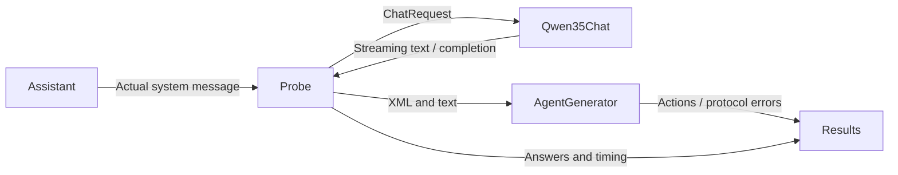

# Qwen3.5 MLX device evaluation

Purpose: verify the new Qwen35Chat provider against the actual Assistant prompt on the physical iPhone before enabling it in the normal app.

✅ Qwen35Probe.swift captures the production prompt and evaluates ten scenarios with greedy and two unseeded sampled repetitions; it validates output through AgentGenerator and saves bounded results after each case.
✅ make-probe.py generates a temporary Xcode project using the existing signing profile and ModelKitQwen35 product. Model artifacts come from the pinned repository manifest. No production project is generated or overwritten by this script.
❌ This isolated harness does not validate microphone, ASR/TTS coexistence, sustained thermals, or general model intelligence.

Run make-probe.py, build /tmp/Qwen35Probe.xcodeproj scheme MobileHarness for the connected device, install and launch. Retrieve the size-specific result file described below from the app container. The temporary build uses the normal bundle identifier; finish by installing the normal app. Timings include prefill and output generation. No user audio or private messages are evaluated.

## Initial 2B result

✅ Physical iPhone 17 Pro: model load completed in 2.942 s; all 30 requests completed. Median first text was 0.320 s and median full output 0.773 s. The first request took 3.387 s overall. These timings include prefill and short answers; they are not isolated decode throughput.
❌ 15/30 outputs failed XML/parameter validation. All three expression-only requests emitted an unregistered thinking tag. Greedy arithmetic was correct; two sampled arithmetic runs returned only an unclosed channel. Correct box-name recall did not imply robust correction or channel behavior.
✅ Mac tokenizer parity, real inference and cancel/unload/reload tests passed. A 20-case minimal/clarified prompt comparison is archived separately; clarification still left incomplete channels and unknown tags, so production prompts were not changed on that evidence.
❌ This 2B configuration is technically runnable but is not accepted as a reliable XML Action generator. The test pass markers only establish transport/lifecycle/tokenizer contracts.

## 4B comparison and deployment

✅ The pinned 4B profile (0e7ffd5c629ef7719d4cbc04069232580bfa9d9c) passed local generation, cancellation/unload/reload and full tokenizer parity tests. Its tokenizer vocabulary/config match the 2B artifact byte-for-byte; the template differs only in the default thinking branch, and explicit enable_thinking=false matches the same ten Python fixtures.
✅ Under the original system prompt, the ten greedy Mac cases had 2 XML failures; arithmetic, recall, correction, required expression parameters and explicit channel ordering were correct in this small sample. Raw minimal/clarified/original comparisons are in 4b-prompt-variants-mac.json. The clarified prompt still had a failure and was not adopted in production.
❌ The first iPhone 4B load terminated with signal 9 before any output; no new matching Jetsam report was available. Do not label this proven OOM.
✅ An increased-memory-limit entitlement, matching the official MLX LLMBasic example, was added to the physical app target. The signed retry installed successfully. Initial retry launch was blocked by the iPhone lock screen; post-entitlement device quality remains pending until the retry runs.

For 4B reproduction, pass --four-b to make-probe.py. The probe selects the sole bundled profile, including when opened from its icon; no launch flag is required. The result file is Documents/Qwen35-4B-results.json (2B uses Qwen35-2B-results.json). Normal App composition selects fourB explicitly and stages its matching manifest/weights; no production system-prompt or parser changes were made during the diagnostic prompt experiments.

Source: [official MLX iOS memory entitlement](https://github.com/ml-explore/mlx-swift-examples/blob/main/Applications/LLMBasic/LLMBasic.entitlements).

The normal Debug app also supports `-qwen35-validation`: AppContainer warms ASR and Qwen concurrently resident, generates one synthetic arithmetic response and logs `QWEN_VOICE_VALIDATION_OK` or `QWEN_VOICE_VALIDATION_FAILED`. This is a coexistence smoke test, not the 30-case Agent protocol evaluation. Launch without the flag for normal conversation. Post-entitlement device validation remains blocked until the phone is unlocked.

✅ Final root checks, optional package regression tests, five simulator schemes and the signed physical Debug app build passed after adding the explicit coexistence diagnostic.
❌ The first normal-app replacement installation failed with CoreDevice 3002 / IXRemoteErrorDomain 6 (connection interrupted). The replacement retry failed with the same error. Normal-app installation is not confirmed; the previous temporary probe may remain installed. An unlocked, preferably USB-connected iPhone is required to resume installation and post-entitlement validation.

## Template checksum mismatch correction

✅ Reproduced the screenshot failure locally: the old probe bundle contained 4B template bytes and both 2B/4B manifests. An icon launch defaulted to 2B, whose template hash differs. This was an evaluation packaging/selection defect, not evidence of model inference failure.
✅ The probe staging script now deletes its generated Qwen35 resource directory before copying a profile, and enables shell failure propagation. The probe requires exactly one bundled profile and selects it without launch arguments; ambiguous packages fail explicitly.
✅ The normal app selects 4B explicitly and its packaged files are independently verified against its sole 4B manifest. Checksum validation remains enabled.
❌ Replacement installation and post-entitlement physical-device validation remain pending.

✅ Regression validation for the checksum fix: generated staging script removes stale 2B files when packaging 4B and exits unsuccessfully when its source is missing; repaired probe compiles. Root checks and all five simulator schemes passed again.

✅ Rebuilt repaired probe contains only the 4B manifest; all ten packaged artifact sizes/hashes match.
❌ After the screenshot report, normal-app installation over Wi-Fi again failed with CoreDevice 3002 / IXRemoteErrorDomain 6. Launching the existing probe explicitly with `-four-b` was then rejected because the phone was locked. Neither replacement installation nor a successful post-fix device run is claimed.
