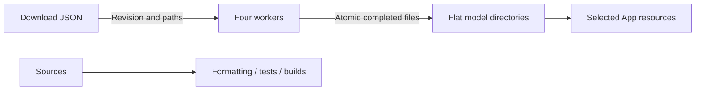

# Repository scripts

Purpose: validate code, download local models and stage selected resources. Design goals: reproducible development inputs and minimal runtime configuration.

- ✅ check.sh runs formatting, root tests and metadata validation; build-ios.sh builds four simulator schemes.
- ✅ model_download.py reads development-only *.download.json profiles with fixed remote revisions. Each wrapper chooses a model; Qwen defaults to 2B, with --size 4b for comparison. Audio8 keeps a download wrapper only.
- ✅ Downloads use four workers, safe relative paths, .partial files and atomic replacement. Existing files are reused; --force refreshes them after a revision change or corruption. Errors propagate; no checksum catalog is generated.
- ✅ clean-app-models.sh removes only generated app Models resources in the scheme pre-build action. stage-voice-models.sh copies Nemotron, Qwen35, Silero and diagnostic Kokoro plus licenses on iPhone; simulator ships no model weights.
- ✅ Optional model test scripts compile their respective adapters; HARNESS_TEST_QWEN35=1 enables local generation, cancellation/reload and tokenizer parity.
- ❌ Compilation does not establish microphone UX, recognition accuracy or thermal acceptance. MLX compilation requires Xcode's Metal Toolchain.

✅ Run python3 scripts/update-model-filelists.py after editing production download profiles. It generates explicit Xcode sandbox file inputs and outputs; staging copies only those required files and licenses.

✅ Language-model download and test entry points target Qwen3.5 MLX. No CoreAILM language package is required.

✅ check-modelkit-boundaries.py rejects business imports and target dependencies in ModelKit and checks directory documentation. test-qwen35.sh uses the root project package. Agent evaluations run with HARNESS_EVAL_QWEN35=1 swift test --filter AgentModelEvaluationTests.
