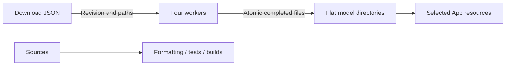

# Repository scripts

Purpose: validate code, download local models and stage selected resources. Design goals: reproducible development inputs and minimal runtime configuration.

- ✅ check.sh runs formatting, root tests and metadata validation; build-ios.sh builds four simulator schemes.
- ✅ select-app-icon.sh accepts `original` or `robot-camera`, copying a preserved 1024 × 1024 variant into the shared app icon slot; rebuild/install after selection.
- ✅ model_download.py reads development-only *.download.json profiles with fixed remote revisions. Each wrapper chooses a model; Qwen defaults to 2B, with --size 4b for comparison. Audio8 and legacy Kokoro keep comparison download wrappers only.
- ✅ Downloads use four workers, safe relative paths, .partial files and atomic replacement. Existing files are reused; --force refreshes them after a revision change or corruption. Errors propagate; no checksum catalog is generated.
- ✅ clean-app-models.sh removes only generated app Models resources in the scheme pre-build action. stage-voice-models.sh copies Nemotron, Qwen35, Silero and MOSS-TTS-Nano plus licenses on iPhone; simulator ships no model weights.
- ✅ Optional model test scripts compile their respective adapters; HARNESS_TEST_QWEN35=1 enables local generation, cancellation/reload and tokenizer parity.
- ❌ Compilation does not establish microphone UX, recognition accuracy or thermal acceptance. MLX compilation requires Xcode's Metal Toolchain.

✅ Run python3 scripts/update-model-filelists.py after editing production download profiles. It generates explicit Xcode sandbox file inputs and outputs; staging copies only those required files and licenses.

✅ Language-model download and test entry points target Qwen3.5 MLX. No CoreAILM language package is required.

✅ check-modelkit-boundaries.py rejects business imports and target dependencies in ModelKit and checks directory documentation. test-qwen35.sh uses the root project package. Agent evaluations run with HARNESS_EVAL_QWEN35=1 swift test --filter AgentModelEvaluationTests.

✅ download-yolo26-pose.py provisions the official YOLO26n-Pose INT8 ZIP with archive/member hash verification. ✅ The physical App file lists now stage the YOLO package.

✅ update-model-filelists.py includes yolo26-pose in physical-device staging; simulator still has no camera/model acceptance path.

✅ download-yolo26-pose.py provisions the pinned official ZIP through model_download. Archive/member hashes, exact members, path confinement, symlink rejection and size limits are verified before replacing a package; failed verification preserves the prior installation. check.sh now includes the offline ZIP provisioning tests. update-model-filelists.py stages only the YOLO26 package.

✅ check-modelkit-boundaries.py also rejects Gateway model/platform/Agent dependencies and AgentCore model/platform/business imports; Gateway has no ModelKit target dependency.

✅ Boundary checks restrict Agent imports/dependencies to AgentCore/base ModelKit/Storage/StorageAudio/Foundation and reject presentation assignments in the speech Signal observer. This static check complements protocol tests; it is not a full semantic proof of arbitrary callback purity.

✅ Signal-observer checks target App/Lifecycle/VoiceSessionCoordinator.swift and also guard the Action-owned presentationPhase field.

✅ download-kokoro.py provisions the pinned FluidAudio Core ML graph/lexicon profile. Optional per-file URLs support the separately pinned BERT vocabulary; inference does not download. Boundary checks allow FluidAudio only through its dedicated backend target.

✅ Boundary validation permits the shared StorageAudio dependency in Agents while continuing to forbid device/UI/Actions/concrete model imports. It also enforces Foundation-only Storage core and the narrow StorageAudio dependency set. ❌ This check cannot establish physical playback behavior.

✅ download-moss-tts-nano.py provisions the four streaming graphs, tokenizer, config and two preset voice-code files at a fixed revision; no custom-voice encoder or source .mlpackage is packaged. ❌ Phone performance remains unverified.

✅ Agent boundary validation now allows Foundation-only Storage for the shared conversation journal. ModelKit remains independent of Storage and business modules.

✅ Directory consolidation checks require Agents/Core to remain the independent AgentCore target, exclude it from business compilation, remove standalone runtime targets and reject direct Gateway behavior calls. Core source checks use its new path and fail if it is missing. ❌ Static checks do not prove callback behavior.

✅ Boundary checks enforce the independent UI target at MobileHarness/UI, shared value-only dependencies, no service construction/App coordinator references, explicit ApplicationRuntime injection, and README coverage in both App and UI directories.

## Domain-owned behavior assembly

✅ check-modelkit-boundaries.py enforces the BehaviorAssembly target map/dependencies and rejects individual ActionDefinition/ToolDefinition registrations, concrete ActionPath construction, string handler registrations and UIActions/UITools/SystemTools function invocation in App. Semantic type references remain permitted. ❌ Static source checks complement type checking/tests; they are not a general Swift semantic analyzer.

## Action implementation audit

✅ The Action standard check recursively scans domain sources, requires Support-owned definitions and exactly one matching invocation:using: entry in domain-root files, and checks README coverage. Related entries may share a namespace file; registrations are checked regardless of filename. Runtime infrastructure is exempt from callable-domain checks. Swift and assembly tests validate semantic binding.

## Storage domain organization

✅ Boundary checks enforce Storage core exclusion of Audio/Chat, StorageChat → Storage dependency, Foundation/Storage-only chat imports and Storage directory READMEs. UI may use StorageChat values only.

❌ Image/video/semantic-memory stores remain planned; this migration adds no storage behavior.

✅ Tool authoring checks now recursively discover domain registrations, require each registered path to have one domain entry, keep registration in Support, and require directory READMEs. The existing unqualified `runtimeInfo` path is explicit. ❌ Source checks do not replace Swift semantic validation.
