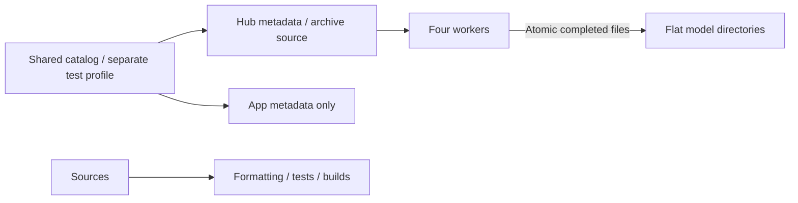

# Repository scripts

Purpose: validate code, download local models and stage selected resources. Design goals: reproducible development inputs and minimal runtime configuration.

Implemented Agent business-source audit: speech boundary validation maps TranscriptAccumulator to its owning SpeechRecognitionTurn source, requires the helper declaration and preserves the Foundation/ModelKit-only import rule. File co-location does not relax module isolation.

- ✅ check.sh runs formatting, root tests and metadata validation; build-ios.sh builds four simulator schemes.
- ✅ select-app-icon.sh accepts `original`, `robot-camera` or `lamp-arm`, copying a preserved 1024 × 1024 variant into the shared app icon slot; rebuild/install after selection. `lamp-arm` is the user-selected white articulated arm/iPhone icon. Explicit-name validation and the existing copy/exit behavior are retained. The root README references the shared selected image.
- ✅ model_download.py reads production sources from model-catalog.json and resolves selected HF files through paginated Hub metadata. Only Gemma 4 E2B4B retains a separate test profile; Nemotron macos/ios options select the same Core ML catalog entry. Gemma 4 E2B defaults to 2B; --size 4b selects comparison. The inactive Audio8 wrapper/profile is removed.
- ✅ Downloads use four workers, safe relative paths, .partial files and atomic replacement. Existing files are reused; --force refreshes them after a revision change or corruption. Errors propagate; no checksum catalog is generated.
- ✅ clean-app-models.sh removes generated app Models resources and the embedded Agents bundle in the scheme pre-build action. stage-voice-models.sh copies only the source catalog/license notices for both device and simulator; no weights are packaged.
- ✅ Optional model test scripts compile their respective adapters; HARNESS_TEST_GEMMA4=1 enables local generation, cancellation/reload and tokenizer parity.
- ❌ Compilation does not establish microphone UX, recognition accuracy or thermal acceptance. CoreAI language execution requires OS 27 and full Xcode.

✅ Run python3 scripts/update-model-filelists.py after editing production download profiles. It generates explicit Xcode sandbox file inputs and outputs; staging copies only those required files and licenses.

✅ Language-model download and test entry points target Gemma 4 E2B CoreAI through the pinned CoreAILM runtime.

✅ check-modelkit-boundaries.py rejects business imports and target dependencies in ModelKit and checks directory documentation. test-gemma4.sh uses the root project package. Agent evaluations run with HARNESS_EVAL_GEMMA4=1 swift test --filter AgentModelEvaluationTests.

✅ download-yolo26-pose.py reads the official YOLO26n-Pose INT8 ZIP source/hash from the shared catalog. App file lists stage metadata only.

✅ update-model-filelists.py includes yolo26-pose in physical-device staging; simulator still has no camera/model acceptance path.

✅ download-yolo26-pose.py provisions the pinned official ZIP through model_download. Optional archive hash, required files, path confinement, symlink rejection and size limits are verified before replacing a package; failed verification preserves the prior installation. check.sh now includes the offline ZIP provisioning tests. update-model-filelists.py stages only the source catalog/licenses.

✅ check-modelkit-boundaries.py also rejects Gateway model/platform/Agent dependencies and AgentCore model/platform/business imports; Gateway has no ModelKit target dependency.

✅ Boundary checks restrict Agent imports/dependencies to AgentCore/base ModelKit/Storage/StorageAudio/Foundation and reject presentation assignments in the speech Signal observer. This static check complements protocol tests; it is not a full semantic proof of arbitrary callback purity.

✅ Signal-observer checks target App/Lifecycle/VoiceSessionCoordinator.swift and also guard the Action-owned presentationPhase field.

✅ Boundary validation permits the shared StorageAudio dependency in Agents while continuing to forbid device/UI/Actions/concrete model imports. It also enforces Foundation-only Storage core and the narrow StorageAudio dependency set. ❌ This check cannot establish physical playback behavior.

✅ download-moss-tts-nano.py provisions the four streaming graphs, tokenizer, config and two preset voice-code files at a fixed revision; custom-voice encoders/source .mlpackage are not selected for local provisioning; App bundles no MOSS inference assets. ❌ Phone performance remains unverified.

✅ Agent boundary validation now allows Foundation-only Storage for the shared conversation journal. ModelKit remains independent of Storage and business modules.

✅ Directory consolidation checks require Agents/Support/Core to remain the independent AgentCore target, exclude it from business compilation, compile independent FunctionContracts/ExecutionRuntime/CallRuntime targets with their explicit dependency boundaries and reject direct Gateway behavior calls. Core source checks use its new path and fail if it is missing. ❌ Static checks do not prove callback behavior.

✅ Boundary checks enforce the independent UI target at MobileHarness/UI, shared value-only dependencies, no service construction/App coordinator references, explicit ApplicationRuntime injection, and README coverage in both App and UI directories.

## Domain-owned behavior assembly

✅ check-modelkit-boundaries.py enforces the BehaviorAssembly target map/dependencies and rejects individual ActionDefinition/ToolDefinition registrations, concrete ActionPath construction, string handler registrations and UIActions/UITools/SystemTools function invocation in App. Semantic type references remain permitted. ❌ Static source checks complement type checking/tests; they are not a general Swift semantic analyzer.

## Action implementation audit

✅ The Action standard check recursively scans domain sources, requires Support-owned definitions and exactly one matching invocation:using: entry in domain-root files, and checks README coverage. Related entries may share a namespace file; registrations are checked regardless of filename. Runtime infrastructure is exempt from callable-domain checks. Swift and assembly tests validate semantic binding.

## Storage domain organization

✅ Boundary checks enforce Storage core exclusion of Audio/Chat, StorageChat → Storage dependency, Foundation/Storage-only chat imports and Storage directory READMEs. UI may use StorageChat values only.

❌ Bounded owned JPEG storage is implemented in ADR0184; galleries, video and semantic-memory stores remain planned.

✅ Tool authoring checks now recursively discover domain registrations, require each registered path to have one domain entry, keep registration in Support, and require directory READMEs. The existing unqualified `runtimeInfo` path is explicit. ❌ Source checks do not replace Swift semantic validation.

✅ ADR0093: check-modelkit-boundaries.py enforces PlatformKit independence and rejects NexArm gesture/execution-policy types in the device SDK. Only Actions/NexArm/Support may consume PlatformKit from the Actions source tree.

✅ PlatformKit audit guards now reject Action-side jog/reset types, localized string literals, business display/gesture APIs and camera layout assignments in the foundational SDK.

✅ Boundary checks validate macro-generated binding placement and keep the BehaviorDefinitions compiler plugin limited to SwiftSyntax dependencies.

✅ The boundary check also prevents retired NexArm polling diagnostics and historical test algorithms from returning to production Actions.

✅ Behavior boundary checks reject Actions/Tools dependencies on AgentCore, Gateway, UI, App or each other, and recognize Support as infrastructure rather than a callable domain.

✅ Boundary validation requires StorageAudio dependencies to be Storage only, and rejects other source imports including AgentCore.

✅ ADR0098 boundary checks require independent execution runtimes, shared Types, narrow feature workflow imports and role-specific Lifecycle dependencies; the complete project target graph is checked for cycles. ❌ Static checks complement compilation/regression tests and do not establish physical-device acceptance.

✅ Boundary checks include CameraTools in forbidden concrete business-entry use outside domain catalogs; camera Tool directories follow the existing namespace/Support checks.

✅ Tracking aim boundary checks keep rest/angle and speed policy in Actions/NexArm/Support and reject an aim wrapper in PlatformKit. ❌ Static checks do not establish physical tracking behavior.

✅ Lifecycle boundary checks reject direct Photographer construction; composition must inject its factory. Runtime tests validate five-motor Tool metadata and failure/recovery without hardware writes.

✅ The scheme pre-build cleaner removes only the generated embedded Agents bundle alongside generated model resources, forcing SwiftPM resource refresh after branch switches. verify-app-agent-resources.py checks all final app configs against source bytes; build-ios.sh verifies the simulator app.

## Local model resources — current contract

✅ App staging/file lists contain only catalog/license metadata and clean stale weights. Boundary checks enforce declarative schema v2 and no bundled file URL/hash manifests. model_download.py shares production source declarations with App, resolves remote file metadata dynamically, supports --endpoint, and retains only two separate Mac/comparison profiles. ❌ Real network/device acceptance remains pending.

✅ Local cleanup preserves the five active Mac model test roots, removes unused Kokoro CoreAI/iPhone Nemotron weights and deletes duplicate production download JSONs. Six offline provisioning tests cover shared configuration routing, mirror/prefix selection, missing-file/pagination errors and ZIP verification/publication. ❌ Actual download-network acceptance remains pending.

✅ Removed the unregistered Kokoro comparison profile, downloader and local Core ML weights; no current App/diagnostic source requires them. ❌ Its optional adapter real-model tests require externally supplied resources.

✅ Local chat configuration now targets Gemma 4 E2B CoreAI; Qwen/MLX production bindings are removed. ❌ Real-model/device acceptance is separate from compilation and contract tests.

✅ Boundary checks require UI → Types/StorageChat, allow business Agents → Types, and reject PoseOverlay under AgentCore.

✅ Boundary checks require AgentCore → Types only and reject concrete AgentID constants, pose/speech value definitions and automatic speech prompt policy under Core. Closed domain messages and their catalog remain a documented future migration.

✅ Boundary checks reject speech/vision schema strings and fixed gray64 transport under Core/Gateway, enforce shared values in Types and business contracts in Agents/Support/Communication, and validate relocated App native adapters.

✅ SpeechPerception boundary checks require the four perception helpers and restrict their imports to Foundation/ModelKit; transport, presentation and device ownership remain in their owning layers. ❌ Semantic actor race validation remains runtime-test responsibility.

✅ Core boundary checks reject concrete resource constants, device result fields/error cases and fixed sentence length policy. ❌ Static scanning complements rather than replaces runtime tests.

✅ SDK boundary checks require ModelKit/PlatformKit to have zero project/product dependencies, reject Types imports/re-exports, and reject App lifecycle ImageFrame construction or ASR resampling. Agents may consume PlatformKit to adapt device values for ModelKit. ❌ Static checks do not replace physical-device acceptance.

✅ Storage boundary validation scans nested core sources and qualified imports (including import struct/import func). Storage core accepts Foundation only; StorageChat/StorageAudio accept Foundation plus internal Storage only. ❌ External data aliases and concrete services cannot enter storage targets.

✅ Boundary checks require Agent-domain speech/pose values in Agents/Support/Communication, reject their declarations under Types/Core, and keep image receiver ordering/session policy out of Types. ❌ No domain value re-export or compatibility alias is retained.

✅ Types removal is checked through zero-dependency AgentCore, StorageChat-only UI, retired-target/import rejection, and existing vision payload/PCM integration tests. ❌ Simulator validation remains subject to CoreAI availability.

✅ ModelKit capability error/availability diagnostic literals are checked for localized presentation leakage. Model warm-up text is input data and remains allowed. ❌ Storage semantic decoupling is tracked in its README and remains pending.

✅ ADR0122: Runtime resource values contain no camera constants. ActionFailure and ActionReport.Entry.Code are bounded opaque identifiers (1–64 UTF-8 bytes); Runtime provides generic execution codes only. NexArm owns its result vocabulary, BluetoothWorkflowError owns its failure-to-report mapping, and Gateway preserves producer identifiers. Existing device failure/report identifiers and presentation are unchanged.

❌ Runtime must not classify pose, foreground, control-readiness or device-feedback failures. Producers provide actionReportCode through ActionExecutionFailureProviding; the generic default handles invalid arguments/resource unavailability and otherwise reports handlerFailed. CancellationError remains cancellation.

✅ Boundary checks keep SoundSourceEstimator Foundation-only and sound.source out of Core/Gateway concrete registries. PlatformKit spatial capture cannot import business Agents/Gateway/ModelKit. ❌ Device microphone spatial format and accuracy require physical validation.

✅ Audio detection boundary checks keep diagnostic workflow construction independent of Agents/Gateway and prevent a duplicated estimator/resampler or device backend in the workflow. The estimator remains pure Agent policy; capture facts remain device SDK values.

✅ Boundary checks require Settings presets/reset to reuse Actions feedback execution and reject nominal-frame playback sleeps. ❌ Physical motion quality remains outside static checks.

✅ ADR0129 boundary checks reject whole voice/session cleanup and scheduler-coupling hooks in Bluetooth workflow/composition. Regressions verify ordinary device failures and retained queued Actions; static checks alone cannot prove runtime isolation.

✅ ADR0130 boundary checks forbid active connection probes; passive feedback and native connection determine separate state. ❌ Hardware passive-cadence acceptance remains pending.

✅ Bluetooth presentation boundary checks reject shared Action errors, incidents, execution and control-readiness state in the scan/connect view while permitting separate device-detail diagnostics.

✅ ADR0131 boundary guards reject execution catches that write device incidents/reconnect, recovery dependencies on Actions, camera/home Bluetooth execution banners and SDK execution-context vocabulary. ❌ Static guards do not replace native device acceptance.

✅ ADR0132: Boundary checks reject generic Bluetooth record writers, SDK firmware business policy, cancellation-shaped channel admission and missing independent bounded Tool failure-code contracts.

❌ Sustained physical-device acceptance and durable error history remain pending.

✅ ADR0134: Bluetooth exception history is removed at SDK/App/UI layers. Latest native connection, communication issue and recovery state alone appear in Settings; healthy snapshots/new connections replace prior faults. ADR0138 uses one row to connect while unconnected or open detail when already connected; connection success stays on the list, disconnect appears only when connected, and remembered devices remain forgettable; an already-open disconnected detail disables actions/motor gestures. Execution results/home issues and bounded automatic recovery remain independently owned. ❌ Physical BLE/navigation/touch acceptance remains pending.

✅ ADR0138: Boundary checks reject shared/pending destination state, appearance/connection-driven navigation, duplicate connectionButton rows and a duplicate 通信 row. Device-row intent connects while disconnected and assigns one view-local destination only on a connected-name tap. ❌ Static checks cannot certify interactive swipe behavior.

✅ ADR0139 boundary checks keep owner preemption generic in Gateway, require the concrete Assistant-over-Photographer writer policy in App composition and verify a weak current-Agent freshness binding. ❌ Source guards do not establish physical takeover safety.

✅ ADR0141 boundary guards reject persistent resource fault/recover and camera recovery flags, require ownership snapshots and per-use permits, and retain concrete-priority/SDK/recovery isolation checks. ❌ Source checks complement regression tests rather than proving execution timing.

✅ Boundary checks reject Storage localization, default title wording, ten-round context selection and synthesis timeout policy. ❌ Static checks do not replace behavior tests.

✅ Boundary checks require the History domain to retain Tools-owned queries, injected StorageChat and independent BehaviorAssembly/ToolRuntime contracts. ❌ Static checks do not establish provider invocation quality.

✅ Boundary validation permits the documented AppHistoryWorkflow Agent/Gateway/Tool transport dependencies and separately enforces transport, legacy workflow and presentation-adapter imports. Memory may import only AgentCore/Foundation; UI and AgentCore remain independent. Final-app resource validation discovers all six Agent JSON resources. ❌ Physical UI intent acceptance is separate.

✅ Boundary checks reject resource Task/effect implementations and installation policy in UI.ModelResourcesState, and keep effect tests under AppWorkflowTests. ✅ Resource admission uses ApplicationControl and both Gateways.

✅ Boundary checks prohibit direct journal deletion in the legacy history workflow; Memory remains AgentCore/Foundation-only. ❌ Native UI confirmation acceptance remains separate.

✅ ADR0149 boundary checks prevent returning Tool feedback from reverting to public external admission and require retained output input context. ❌ These source checks do not establish runtime or physical correctness; regression tests validate delivery behavior.

✅ ADR0161 boundary checks require protocol-neutral business Actions, FunctionContracts as the contract leaf, ExecutionRuntime depending only on that leaf and CallRuntime depending on both. Retired runtime imports, @Tool and business protocol aliases are rejected. Agent v6 permissions remain independently validated.

✅ ADR0151: Actions is the single executable capability directory; Tools and ToolRuntime are re-export-only compatibility targets. Boundary checks reject recreated Tools sources or nontrivial shims. ❌ Unified definitions and compatibility import removal remain pending.

✅ ADR0152: production registers one six-domain CapabilityModules catalog, with unified UI/NexArm ownership and unchanged call paths/permissions. Registry projections preserve existing execution policy; regression coverage checks expression and gaze through the same UI catalog. ❌ Unified call definitions and compatibility removal remain pending.

✅ ADR0154 implements cohesive module entry files with one copy of each function and unchanged protocol behavior. File ownership is checked explicitly. ❌ Three-field path/configuration/registration migration remains outstanding.

✅ Obsolete definition-key checks are removed; behavioral regressions verify task-local Channel ordering and cross-Channel/task concurrency.

❌ Three-level runtime paths and unified Action/Tool definitions are not completed by this stage.

✅ ADR0156/0157 boundary checks require v6 explicit Agent bindings, three-field paths, canonical domain definition catalogs, shared metadata validation, one lifetime implementation and absent retired compatibility targets/imports. ❌ Runtime tests and native acceptance remain separate checks.

✅ Canonical metadata checks enforce directory/module-file/path alignment and one validated, frozen CapabilityCatalog before protocol projection; duplicate cross-protocol addresses and hidden invalid definitions fail before startup.

✅ ADR0159 unifies @Action metadata and invocation contracts; all business and injected endpoints receive one ActionInvocation/ActionExecutionContext. Three-level ownership, existing availability/resources/deadlines and independent Agent grants are preserved.

✅ ADR0160: boundary checks reject Tool contracts, ActionBinding and protocol/runtime policy in business Action domains or @Action factories. Production assembly must bind the validated pure catalog through grouped host profiles. ❌ Static checks do not establish physical/model acceptance.

✅ ADR0161: checks enforce FunctionContracts/ExecutionRuntime/CallRuntime target separation, Actions import isolation, standard input without Channel, removed aliases and unique shared-source ownership. ❌ Static checks cannot establish physical/model acceptance.

✅ ADR0163 checks keep history intent outside Core business enums, reject legacy history string parsing and require scheduled result context capture at the Gateway ledger boundary.

✅ Implemented: boundary checks recognize five History functions and the computation-only Memory title helper. The actor remains Core-only; helper cannot mutate the journal or execute effects, and history facade cannot archive, save titles or invoke inference.

✅ Implemented: boundary checks include System.ModelResources, the canonical ApplicationControl role-directory actor/JSON, the narrow settings transport dependency exception and absence of direct manager command mutations in UI operation bindings. Packaged configuration verification includes seven Agent resources.

✅ ADR0167: boundary checks require Agent-routed preference application, Core-only ApplicationControl actor imports and the fourth System.ModelResources function. Native lifecycle/Defaults bindings remain composition-owned.

✅ ADR0168: checks permit Storage only in the owned resource preference service, reject facade persistence/normalization and require Agent preference routing. Six source/binding/native functions retain canonical three-level paths.

✅ ADR0169: boundary checks require Agent inventory routing, the seventh System.ModelResources function and removal of ModelResourcePolicy from Settings effects. Inventory facts remain protocol-neutral and UI receives passive values.

✅ ADR0170: boundary audit recognizes UI.ResourcePresentation entries and production presentInventory binding; require no direct items/groups assignment in resource interaction.

✅ ADR0171: boundary audit recognizes a pure injected ResourceObservationWorkflow and prohibits polling/refresh loops in resource UI; root source/lifecycle bindings remain explicit.

✅ ADR0172: Boundary catalog audit includes the new pure UI.ResourcePresentation operation-error function; existing module profile is retained.

✅ ADR0173: Catalog audit includes showResourcePreferenceFailure. No generic runtime business-code handling or new dependency.

✅ Provider discovery boundary update: System.Provider.discoverModels joins the cohesive directory/module/function catalog. The boundary checker continues to forbid SDK/UI/protocol imports inside Actions and allows no new module directory.

## Provider configuration transactions

✅ Implemented: boundary rules add System.Provider restoreSettings/saveSettings, remove AppSettingsWorkflow Storage dependency and forbid the retired CloudSettingsStore/prepare transaction implementation in App workflows. Strict module independence remains.

❌ Pending: validate registered provider result presentation and passive SettingsState, plus native discovery policy retirement.

## Read-only model grants and shared capability facts

❌ Pending: Assistant JSON explicitly grants System.ModelResources.snapshotResources and System.Provider.readSettings as native read-only tools. The same canonical functions used by deterministic/manual routes return the current shared inventory and a confirmed cloud-enabled/model summary. Provider summary excludes endpoint/key and never restores or changes a binding; unavailable/unconfirmed state fails explicitly. LLM configuration mutations remain staged-secret human operations. These tools query current facts rather than fixed runtimeInfo text and can feed bounded model continuation.

## Typed device, navigation and environment entry points

❌ Pending: app.interaction/1 maps explicit device commands and navigation destinations to fixed registered functions through ApplicationControl and the shared root transport. This Agent now coordinates native resource interactions as well as model resources; it performs no native I/O. UI controls emit typed intent through a root-owned BluetoothInteractionWorkflow; native BluetoothWorkflow remains the injected connection/recovery/manual worker host. Existing arrival tolerance, timeouts, pacing and takeover algorithms stay unchanged.

❌ Pending: System.Device.control validates bounded string arguments and invokes neutral DeviceControlCapability; successful submission reports acceptance, not physical arrival. Read-only status and selected connection commands are explicitly model-granted. UI.Navigation.open commits native route state; manual taps and model requests share that function. A bounded latest motor-intent worker sends only changed values, with reset/stop priority and explicit failure display. No queued motion replay.

❌ Pending: app.environment/1 stores latest sequenced scene/device/capability facts in the root Agent, with finite categories and bounded data. App still performs synchronous background/native safety fencing before reporting facts; physical safety cannot wait on Agent admission or iOS background execution. Native back navigation remains platform-owned and reports a fact, rather than replaying navigation effects. Photo-library creation and physical acceptance are feature/acceptance boundaries, not implied by navigation support.

## Independent history presentation values

❌ Pending: remove the final UI → StorageChat project dependency. History rendering receives UI-owned immutable HistorySnapshot/HistoryConversation/HistoryTurn values with matching data fields, not Storage types or stores. App HistoryPresentationAdapter copies the bounded stored snapshot through an explicit Codable boundary and propagates adaptation failure; Agent history mutations/queries are unchanged. Preview receives only fragments/finish reason from the view value. Optional exact continuation requests are visible in history details. UI target has zero project dependencies.

✅ ADR0180: Memory / memory identity and MemoryHistoryIntent are used consistently in configuration, host transport, presentation source guards and regression fixtures; preserve history.intent/1 and runtime behavior. Enforce the two reorganized roles’ directory/actor/configuration naming and isolated business components.

✅ ADR0180: boundary checks require every directory-owned Agent configuration to match its directory, actor filename/type and lowerCamelCase identity. Root ApplicationControl remains an explicitly documented migration exception; removed ConversationMemory aliases are rejected in current Swift/JSON.

✅ ADR0181: boundary checks require composition-injected root Photographer transport rather than a transient lifecycle factory; camera grants are absent from ApplicationControl.

✅ ADR0182: canonical applicationControl identity and role-directory packaging checks; existing resource/provider/device/navigation/failure regressions now exercise ApplicationControl. All concrete Agent configurations require canonical role directories; no root exception remains.

## Assistant photo observation — ADR0184

✅ Implemented: update canonical Camera.Capture inventory to include takePhoto while retaining exact directory/function ownership validation.

❌ Real camera/shutter/animation and configured-model vision acceptance remain pending; video recording and system Photos export are outside this iteration.

✅ Ownership inventory update: add Camera.Capture.savePhoto/ignorePhoto to the existing boundary check; keep PlatformKit localization and module independence checks intact.

Pending ADR0188: boundary validation permits the shared output consumer in existing Settings/History targets and base ModelKit/StorageChat in specialist business Agents. Core remains Foundation-only; concrete device/UI/Actions imports remain forbidden in Agents. Canonical Assistant entry may specialize the shared Chat actor. Robot takeover belongs to Assistant interaction Actions and fixed ApplicationControl operations over Photographer.

✅ ADR0189 implemented: boundary checks follow Agents/Support/Core and Support/Communication; the independent AgentCore target and its exclusion from Agents business compilation remain enforced.

ADR0189 layer checks require Core imports to remain Foundation-only, Communication to use Foundation/AgentCore, Context to use Foundation/AgentCore/Storage, and Chat to use Foundation/AgentCore/ModelKit/StorageChat. Shared source placement cannot relax these boundaries.

✅ Implemented: capability ownership guards recognize cohesive Speech/ListeningActions.swift and its canonical Speech.Listening.update function. Publication/listening regressions validate one-way routing and default-Agent authority.

✅ Robot Action ownership correction: Resource-policy audit checks Assistant and fixed ApplicationControl allowed writers and joined takeover of Photographer. Do not treat old ApplicationControl-only model-motion ownership as current architecture.

✅ Task-history boundary update: HistoryPresentationAdapter may import AgentCore/Agents solely to project immutable context/task contracts to UI-owned values. It does not invoke Agents, mutate history, select context for inference or own task policy. The boundary allowlist remains file-specific; UI retains zero project dependencies.

verify-app-agent-resources.py verifies the exact Resources tree, independent AgentCore Function Token resource and FunctionContracts canonical metadata against source bytes, rejecting missing/stale assets.

✅ Skill migration checks validate Resources/Catalog.json, confined v7 Agent/v1 Skill assets and final preserved resource paths, with canonical function metadata packaged separately by FunctionContracts.

✅ Resource-path contract: pure Agent and Skill assets move to MobileHarness/Resources/{Agents,Skills} with Catalog.json. Agents retains loading and policy ownership. Package sources remain limited to Agents; explicit copies exclude unrelated app/model assets. Bundle catalog lookup establishes the runtime root without repeating Resources. Regression covers flat and Resources-containing Bundle lookup plus missing catalog failure; final packaging checks compare indexed asset bytes. Device acceptance is recorded separately.

❌ Pending source organization audit (2026-10-11): Update resource boundary and final bundle verifier for canonical UpperCamelCase names; enforce Swift source names and Support placement to prevent this drift. Scripts retain existing kebab-case naming.

## Action-owned documentation and Skill instruction contract

✅ 边界检查保留 System 命名空间，显式认定 Agent.Task 是 System 的宿主控制协议地址。最终 App 资源检查拒绝遗留 FunctionMetadata.json，函数声明由编译代码提供。

✅ clean-app-models.sh also cleans only the exact generated .app/HarnessKit_FunctionContracts.bundle path; the current FunctionContracts target contains no resources.

## Channel-owned Action ordering

✅ Retired serialization-key boundary checks are removed; full check.sh continues to validate imports, formatting, observable scheduling behavior and metadata. build-ios.sh verifies the simulator schemes and packaged assets.

## Agent → Skill → Function registration

✅ Implemented: Agent.json declares baseSkills and communication, never functions/actions/tools. Base and dynamic Skills are the single model function registration source. BasicSkill owns Task/Skill native Tools, environment reading and orchestration teaching; ExpressionInteraction owns expression Actions. Photographer, Memory and ApplicationControl reuse their existing business Skills for fixed catalog composition. Role instructions define identity/responsibilities/style; workflows and named function teaching belong to Skill Instructions. Internal trusted code bindings remain separate. Legacy request evidence is not rewritten.

## ModelKit Support ownership

✅ Boundary checks require unique ModelKit source ownership, explicit disjoint Management source lists, model-local third-party dependencies, no model-specific code in generic backends and no retired mixed-model targets/cancellation helpers.

✅ Boundary audits inspect the package manifest in a disposable build cache, without dependency resolution/version changes or the application workspace lock. The audit typechecks Core alone, rejects conversation/manager identity in Core, and enforces the complete target-layer dependency map and permitted source imports.

✅ Independent ModelKit SDK enforcement: reject unknown external imports and all non-ModelKit project targets without relying on a name denylist; validate third-party product/package ownership, target source confinement and SDK product transitive closure. Eight in-memory manifest/source mutation probes verify rejection without changing production sources.

✅ Implemented: AppSpeechPlayback allowlist adds only Actions and ExecutionRuntime for canonical activation composition. Presentation remains UI/AgentCore/FunctionContracts; ModelKit and foundational-module dependency guards are unchanged.

✅ UI boundary audit permits only public QuartzCore in NativeCompanionSurface.swift and Metal/QuartzCore/Synchronization in MetalHaloRenderer.swift, confined to Components. UI target still has zero project dependencies and service/other-module imports remain rejected.

✅ Architecture checks validate Actions/Support/Contracts as the independent contract leaf, require its exclusion from Actions compilation, and locate authoring macros in shared Support. Support is infrastructure rather than a seventh callable domain; shared helpers remain subject to business-layer import checks.
