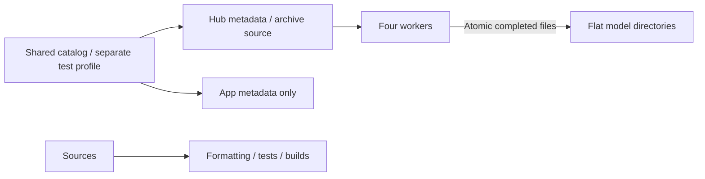

# Repository scripts

Purpose: validate code, download local models and stage selected resources. Design goals: reproducible development inputs and minimal runtime configuration.

- ✅ check.sh runs formatting, root tests and metadata validation; build-ios.sh builds four simulator schemes.
- ✅ select-app-icon.sh accepts `original` or `robot-camera`, copying a preserved 1024 × 1024 variant into the shared app icon slot; rebuild/install after selection.
- ✅ model_download.py reads production sources from model-catalog.json and resolves selected HF files through paginated Hub metadata. Only Gemma 4 E2B4B retains a separate test profile; Nemotron macos/ios options select the same Core ML catalog entry. Gemma 4 E2B defaults to 2B; --size 4b selects comparison. The inactive Audio8 wrapper/profile is removed.
- ✅ Downloads use four workers, safe relative paths, .partial files and atomic replacement. Existing files are reused; --force refreshes them after a revision change or corruption. Errors propagate; no checksum catalog is generated.
- ✅ clean-app-models.sh removes generated app Models resources and the embedded Agents bundle in the scheme pre-build action. stage-voice-models.sh copies only the source catalog/license notices for both device and simulator; no weights are packaged.
- ✅ Optional model test scripts compile their respective adapters; HARNESS_TEST_GEMMA4=1 enables local generation, cancellation/reload and tokenizer parity.
- ❌ Compilation does not establish microphone UX, recognition accuracy or thermal acceptance. CoreAI language execution requires OS 27 and full Xcode.

✅ Run python3 scripts/update-model-filelists.py after editing production download profiles. It generates explicit Xcode sandbox file inputs and outputs; staging copies only those required files and licenses.

✅ Language-model download and test entry points target Gemma 4 E2B CoreAI through the pinned CoreAILM runtime.

✅ check-modelkit-boundaries.py rejects business imports and target dependencies in ModelKit and checks directory documentation. test-gemma4.sh uses the root project package. Agent evaluations run with HARNESS_EVAL_GEMMA4=1 swift test --filter AgentModelEvaluationTests.

✅ download-yolo26-pose.py reads the official YOLO26n-Pose INT8 ZIP source/hash from the shared catalog. App file lists stage metadata only.

✅ update-model-filelists.py includes yolo26-pose in physical-device staging; simulator still has no camera/model acceptance path.

✅ download-yolo26-pose.py provisions the pinned official ZIP through model_download. Optional archive hash, required files, path confinement, symlink rejection and size limits are verified before replacing a package; failed verification preserves the prior installation. check.sh now includes the offline ZIP provisioning tests. update-model-filelists.py stages only the source catalog/licenses.

✅ check-modelkit-boundaries.py also rejects Gateway model/platform/Agent dependencies and AgentCore model/platform/business imports; Gateway has no ModelKit target dependency.

✅ Boundary checks restrict Agent imports/dependencies to AgentCore/base ModelKit/Storage/StorageAudio/Foundation and reject presentation assignments in the speech Signal observer. This static check complements protocol tests; it is not a full semantic proof of arbitrary callback purity.

✅ Signal-observer checks target App/Lifecycle/VoiceSessionCoordinator.swift and also guard the Action-owned presentationPhase field.

✅ Boundary validation permits the shared StorageAudio dependency in Agents while continuing to forbid device/UI/Actions/concrete model imports. It also enforces Foundation-only Storage core and the narrow StorageAudio dependency set. ❌ This check cannot establish physical playback behavior.

✅ download-moss-tts-nano.py provisions the four streaming graphs, tokenizer, config and two preset voice-code files at a fixed revision; custom-voice encoders/source .mlpackage are not selected for local provisioning; App bundles no MOSS inference assets. ❌ Phone performance remains unverified.

✅ Agent boundary validation now allows Foundation-only Storage for the shared conversation journal. ModelKit remains independent of Storage and business modules.

✅ Directory consolidation checks require Agents/Core to remain the independent AgentCore target, exclude it from business compilation, compile standalone ActionRuntime/ToolRuntime targets without business dependencies and reject direct Gateway behavior calls. Core source checks use its new path and fail if it is missing. ❌ Static checks do not prove callback behavior.

✅ Boundary checks enforce the independent UI target at MobileHarness/UI, shared value-only dependencies, no service construction/App coordinator references, explicit ApplicationRuntime injection, and README coverage in both App and UI directories.

## Domain-owned behavior assembly

✅ check-modelkit-boundaries.py enforces the BehaviorAssembly target map/dependencies and rejects individual ActionDefinition/ToolDefinition registrations, concrete ActionPath construction, string handler registrations and UIActions/UITools/SystemTools function invocation in App. Semantic type references remain permitted. ❌ Static source checks complement type checking/tests; they are not a general Swift semantic analyzer.

## Action implementation audit

✅ The Action standard check recursively scans domain sources, requires Support-owned definitions and exactly one matching invocation:using: entry in domain-root files, and checks README coverage. Related entries may share a namespace file; registrations are checked regardless of filename. Runtime infrastructure is exempt from callable-domain checks. Swift and assembly tests validate semantic binding.

## Storage domain organization

✅ Boundary checks enforce Storage core exclusion of Audio/Chat, StorageChat → Storage dependency, Foundation/Storage-only chat imports and Storage directory READMEs. UI may use StorageChat values only.

❌ Image/video/semantic-memory stores remain planned; this migration adds no storage behavior.

✅ Tool authoring checks now recursively discover domain registrations, require each registered path to have one domain entry, keep registration in Support, and require directory READMEs. The existing unqualified `runtimeInfo` path is explicit. ❌ Source checks do not replace Swift semantic validation.

✅ ADR0093: check-modelkit-boundaries.py enforces PlatformKit independence and rejects NexArm gesture/execution-policy types in the device SDK. Only Actions/NexArm/Support may consume PlatformKit from the Actions source tree.

✅ PlatformKit audit guards now reject Action-side jog/reset types, localized string literals, business display/gesture APIs and camera layout assignments in the foundational SDK.

✅ Boundary checks validate macro-generated binding placement and keep the BehaviorDefinitions compiler plugin limited to SwiftSyntax dependencies.

✅ The boundary check also prevents retired NexArm polling diagnostics and historical test algorithms from returning to production Actions.

✅ Behavior boundary checks reject Actions/Tools dependencies on AgentCore, Gateway, UI, App or each other, and recognize Contracts as infrastructure rather than a callable domain.

✅ Boundary validation requires StorageAudio dependencies to be Storage only, and rejects other source imports including AgentCore.

✅ ADR0098 boundary checks require independent execution runtimes, shared Types, narrow feature workflow imports and role-specific Lifecycle dependencies; the complete project target graph is checked for cycles. ❌ Static checks complement compilation/regression tests and do not establish physical-device acceptance.

✅ Boundary checks include CameraTools in forbidden concrete business-entry use outside domain catalogs; camera Tool directories follow the existing namespace/Support checks.

✅ Tracking aim boundary checks keep rest/angle and speed policy in Actions/NexArm/Support and reject an aim wrapper in PlatformKit. ❌ Static checks do not establish physical tracking behavior.

✅ Lifecycle boundary checks reject direct Photographer construction; composition must inject its factory. Runtime tests validate five-motor Tool metadata and failure/recovery without hardware writes.

✅ The scheme pre-build cleaner removes only the generated embedded Agents bundle alongside generated model resources, forcing SwiftPM resource refresh after branch switches. verify-app-agent-resources.py checks all final app configs against source bytes; build-ios.sh verifies the simulator app.

## Local model resources — current contract

✅ App staging/file lists contain only catalog/license metadata and clean stale weights. Boundary checks enforce declarative schema v2 and no bundled file URL/hash manifests. model_download.py shares production source declarations with App, resolves remote file metadata dynamically, supports --endpoint, and retains only two separate Mac/comparison profiles. ❌ Real network/device acceptance remains pending.

✅ Local cleanup preserves the five active Mac model test roots, removes unused Kokoro CoreAI/iPhone Nemotron weights and deletes duplicate production download JSONs. Six offline provisioning tests cover shared configuration routing, mirror/prefix selection, missing-file/pagination errors and ZIP verification/publication. ❌ Actual download-network acceptance remains pending.

✅ Removed the unregistered Kokoro comparison profile, downloader and local Core ML weights; no current App/diagnostic source requires them. ❌ Its optional adapter real-model tests require externally supplied resources.

✅ Local chat configuration now targets Gemma 4 E2B CoreAI; Qwen/MLX production bindings are removed. ❌ Real-model/device acceptance is separate from compilation and contract tests.

✅ Boundary checks require UI → Types/StorageChat, allow business Agents → Types, and reject PoseOverlay under AgentCore.

✅ Boundary checks require AgentCore → Types only and reject concrete AgentID constants, pose/speech value definitions and automatic speech prompt policy under Core. Closed domain messages and their catalog remain a documented future migration.

✅ Boundary checks reject speech/vision schema strings and fixed gray64 transport under Core/Gateway, enforce shared values in Types and business contracts in Agents/Communication, and validate relocated App native adapters.

✅ SpeechPerception boundary checks require the four perception helpers and restrict their imports to Foundation/ModelKit; transport, presentation and device ownership remain in their owning layers. ❌ Semantic actor race validation remains runtime-test responsibility.

✅ Core boundary checks reject concrete resource constants, device result fields/error cases and fixed sentence length policy. ❌ Static scanning complements rather than replaces runtime tests.

✅ SDK boundary checks require ModelKit/PlatformKit to have zero project/product dependencies, reject Types imports/re-exports, and reject App lifecycle ImageFrame construction or ASR resampling. Agents may consume PlatformKit to adapt device values for ModelKit. ❌ Static checks do not replace physical-device acceptance.

✅ Storage boundary validation scans nested core sources and qualified imports (including import struct/import func). Storage core accepts Foundation only; StorageChat/StorageAudio accept Foundation plus internal Storage only. ❌ External data aliases and concrete services cannot enter storage targets.

✅ Boundary checks require Agent-domain speech/pose values in Agents/Communication, reject their declarations under Types/Core, and keep image receiver ordering/session policy out of Types. ❌ No domain value re-export or compatibility alias is retained.

✅ Types removal is checked through zero-dependency AgentCore, StorageChat-only UI, retired-target/import rejection, and existing vision payload/PCM integration tests. ❌ Simulator validation remains subject to CoreAI availability.

✅ ModelKit capability error/availability diagnostic literals are checked for localized presentation leakage. Model warm-up text is input data and remains allowed. ❌ Storage semantic decoupling is tracked in its README and remains pending.

✅ ADR0122: Runtime resource values contain no camera constants. ActionFailure and ActionReport.Entry.Code are bounded opaque identifiers (1–64 UTF-8 bytes); Runtime provides generic execution codes only. NexArm owns its result vocabulary, BluetoothWorkflowError owns its failure-to-report mapping, and Gateway preserves producer identifiers. Existing device failure/report identifiers and presentation are unchanged.

❌ Runtime must not classify pose, foreground, control-readiness or device-feedback failures. Producers provide actionReportCode through ActionExecutionFailureProviding; the generic default handles invalid arguments/resource unavailability and otherwise reports handlerFailed. CancellationError remains cancellation.

✅ Boundary checks keep SoundSourceEstimator Foundation-only and sound.source out of Core/Gateway concrete registries. PlatformKit spatial capture cannot import business Agents/Gateway/ModelKit. ❌ Device microphone spatial format and accuracy require physical validation.

✅ Audio detection boundary checks keep diagnostic workflow construction independent of Agents/Gateway and prevent a duplicated estimator/resampler or device backend in the workflow. The estimator remains pure Agent policy; capture facts remain device SDK values.

✅ Boundary checks require Settings presets/reset to reuse Actions feedback execution and reject nominal-frame playback sleeps. ❌ Physical motion quality remains outside static checks.

✅ ADR0129 boundary checks reject whole voice/session cleanup and scheduler-coupling hooks in Bluetooth workflow/composition. Regressions verify ordinary device failures and retained queued Actions; static checks alone cannot prove runtime isolation.

✅ ADR0130 boundary checks forbid active connection probes; passive feedback and native connection determine separate state. ❌ Hardware passive-cadence acceptance remains pending.

✅ Bluetooth presentation boundary checks reject shared Action errors, incidents, execution and control-readiness state in the scan/connect view while permitting separate device-detail diagnostics.

✅ ADR0131 boundary guards reject execution catches that write device incidents/reconnect, recovery dependencies on Actions, camera/home Bluetooth execution banners and SDK execution-context vocabulary. ❌ Static guards do not replace native device acceptance.

✅ ADR0132: Boundary checks reject generic Bluetooth record writers, SDK firmware business policy, cancellation-shaped channel admission and missing independent bounded Tool failure-code contracts.

❌ Sustained physical-device acceptance and durable error history remain pending.

✅ ADR0134: Bluetooth exception history is removed at SDK/App/UI layers. Latest native connection, communication issue and recovery state alone appear in Settings; healthy snapshots/new connections replace prior faults. ADR0138 uses one row to connect while unconnected or open detail when already connected; connection success stays on the list, disconnect appears only when connected, and remembered devices remain forgettable; an already-open disconnected detail disables actions/motor gestures. Execution results/home issues and bounded automatic recovery remain independently owned. ❌ Physical BLE/navigation/touch acceptance remains pending.

✅ ADR0138: Boundary checks reject shared/pending destination state, appearance/connection-driven navigation, duplicate connectionButton rows and a duplicate 通信 row. Device-row intent connects while disconnected and assigns one view-local destination only on a connected-name tap. ❌ Static checks cannot certify interactive swipe behavior.

✅ ADR0139 boundary checks keep owner preemption generic in Gateway, require the concrete Assistant-over-Photographer writer policy in App composition and verify a weak current-Agent freshness binding. ❌ Source guards do not establish physical takeover safety.

✅ ADR0141 boundary guards reject persistent resource fault/recover and camera recovery flags, require ownership snapshots and per-use permits, and retain concrete-priority/SDK/recovery isolation checks. ❌ Source checks complement regression tests rather than proving execution timing.

✅ Boundary checks reject Storage localization, default title wording, ten-round context selection and synthesis timeout policy. ❌ Static checks do not replace behavior tests.
