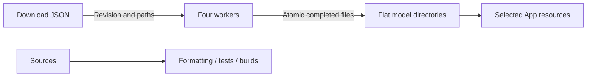

# Repository scripts

Purpose: validate code, download local models and stage selected resources. Design goals: reproducible development inputs and minimal runtime configuration.

- ✅ check.sh runs formatting, root tests and metadata validation; build-ios.sh builds four simulator schemes.
- ✅ select-app-icon.sh accepts `original` or `robot-camera`, copying a preserved 1024 × 1024 variant into the shared app icon slot; rebuild/install after selection.
- ✅ model_download.py reads development-only *.download.json profiles with fixed remote revisions. Each wrapper chooses a model; Qwen defaults to 2B, with --size 4b for comparison. Audio8 and legacy Kokoro keep comparison download wrappers only.
- ✅ Downloads use four workers, safe relative paths, .partial files and atomic replacement. Existing files are reused; --force refreshes them after a revision change or corruption. Errors propagate; no checksum catalog is generated.
- ✅ clean-app-models.sh removes only generated app Models resources in the scheme pre-build action. stage-voice-models.sh copies Nemotron, Qwen35, Silero and MOSS-TTS-Nano plus licenses on iPhone; simulator ships no model weights.
- ✅ Optional model test scripts compile their respective adapters; HARNESS_TEST_QWEN35=1 enables local generation, cancellation/reload and tokenizer parity.
- ❌ Compilation does not establish microphone UX, recognition accuracy or thermal acceptance. MLX compilation requires Xcode's Metal Toolchain.

✅ Run python3 scripts/update-model-filelists.py after editing production download profiles. It generates explicit Xcode sandbox file inputs and outputs; staging copies only those required files and licenses.

✅ Language-model download and test entry points target Qwen3.5 MLX. No CoreAILM language package is required.

✅ check-modelkit-boundaries.py rejects business imports and target dependencies in ModelKit and checks directory documentation. test-qwen35.sh uses the root project package. Agent evaluations run with HARNESS_EVAL_QWEN35=1 swift test --filter AgentModelEvaluationTests.

✅ download-yolo26-pose.py provisions the official YOLO26n-Pose INT8 ZIP with archive/member hash verification. ✅ The physical App file lists now stage the YOLO package.

✅ update-model-filelists.py includes yolo26-pose in physical-device staging; simulator still has no camera/model acceptance path.

✅ download-yolo26-pose.py provisions the pinned official ZIP through model_download. Archive/member hashes, exact members, path confinement, symlink rejection and size limits are verified before replacing a package; failed verification preserves the prior installation. check.sh now includes the offline ZIP provisioning tests. update-model-filelists.py stages only the YOLO26 package.

✅ check-modelkit-boundaries.py also rejects Gateway model/platform/Agent dependencies and AgentCore model/platform/business imports; Gateway has no ModelKit target dependency.

✅ Boundary checks restrict Agent imports/dependencies to AgentCore/base ModelKit/Foundation and reject presentation assignments in the speech Signal observer. This static check complements protocol tests; it is not a full semantic proof of arbitrary callback purity.

✅ Signal-observer checks also guard the Action-owned presentationPhase field.

✅ download-kokoro.py provisions the pinned FluidAudio Core ML graph/lexicon profile. Optional per-file URLs support the separately pinned BERT vocabulary; inference does not download. Boundary checks allow FluidAudio only through its dedicated backend target.

✅ Boundary validation permits the shared StorageAudio dependency in Agents while continuing to forbid device/UI/Actions/concrete model imports. It also enforces Foundation-only Storage core and the narrow StorageAudio dependency set. ❌ This check cannot establish physical playback behavior.

✅ download-moss-tts-nano.py provisions the four streaming graphs, tokenizer, config and two preset voice-code files at a fixed revision; no custom-voice encoder or source .mlpackage is packaged. ❌ Phone performance remains unverified.
